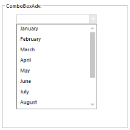
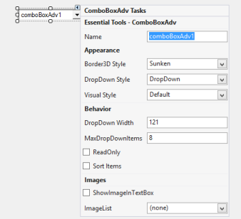
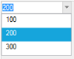

# Getting Started with Windows Forms ComboBoxAdv(Classic)

This section explains how to add the `ComboBoxAdv` control to a Windows Forms application and configure its commonly used settings.

## Assembly Deployment

Refer to the [Control Dependencies](https://help.syncfusion.com/windowsforms/control-dependencies#comboboxadv) section for the list of assemblies and NuGet packages required to use the `ComboBoxAdv` control.

Refer to [NuGet Packages](https://help.syncfusion.com/windowsforms/installation/install-nuget-packages) to learn how to install NuGet packages in a Windows Forms application.

To install the required NuGet package using the NuGet Package Manager Console, run the following command:

```powershell
Install-Package Syncfusion.Tools.Windows
```

## Adding ComboBoxAdv via Designer

1. Create a new Windows Forms application project in Visual Studio.
2. Add the following required assembly references to the project:

    * `Syncfusion.Tools.Windows.dll`
    * `Syncfusion.Shared.Base.dll`

3. Open the **Toolbox** and locate the **ComboBoxAdv** control under the **Syncfusion Windows Forms** tab.
4. Drag the **ComboBoxAdv** control from the **Toolbox** and drop it onto the Windows Form.



## Configuring the ComboBoxAdv Control

The most commonly used settings of the ComboBox control can be configured using the Smart Tag, the Properties window, or code.



Typical settings include:

| Setting | Property | Where to Configure |
| --- | --- | --- |
| Visual style | `Style` | Properties window or code |
| Drop-down behavior | `DropDownStyle` | Properties window or code |
| Data source | `DataSource`, `DisplayMember`, `ValueMember` | Properties window or code |
| Item height | `ItemHeight` | Properties window or code |
| Watermark text | `Watermark` | Properties window or code |

For a complete list of available options, refer to [ComboBoxAdv Options](ComboBoxAdv-Options.md) and [ComboBoxAdv Appearance](ComboBoxAdv-appearance.md).

## Adding ComboBoxAdv via Code

To add the `ComboBoxAdv` control programmatically, follow these steps:

1. Add the following assembly references to the project:

    * `Syncfusion.Tools.Windows.dll`
    * `Syncfusion.Shared.Base.dll`

2. To initialize the control in code, perform the following in order:

   2.1. Add the required namespaces at the top of the file.

        
        

        
        using Syncfusion.Windows.Forms;
        using Syncfusion.Windows.Forms.Tools;
        

        
        Imports Syncfusion.Windows.Forms
        Imports Syncfusion.Windows.Forms.Tools
        

        
        
        {{ codesnippet_ns | OrderList_Indent_Level_2 }}

    2.2. Declare the `comboBoxAdv1` field in the form class and create an instance of it in the constructor after `InitializeComponent()`.

        
        
        

        public Form1()
        {
            InitializeComponent();
            // Inside the Form class
            this.comboBoxAdv1 = new Syncfusion.Windows.Forms.Tools.ComboBoxAdv();
        }

        
        

        Public Sub New()
            InitializeComponent()
            ' Inside the Form class
            Me.comboBoxAdv1 = New Syncfusion.Windows.Forms.Tools.ComboBoxAdv()
        End Sub

        
        
        
        {{ codesnippet_ctor | OrderList_Indent_Level_2 }}

    2.3. Add items to the control using the `Items.Add` method.

        
        
        

        this.comboBoxAdv1.Items.Add("Item1");
        this.comboBoxAdv1.Items.Add("Item2");
        this.comboBoxAdv1.Items.Add("Item3");

        
        

        Me.comboBoxAdv1.Items.Add("Item1")
        Me.comboBoxAdv1.Items.Add("Item2")
        Me.comboBoxAdv1.Items.Add("Item3")

        
        
        
        {{ codesnippet_items | OrderList_Indent_Level_2 }}

    2.4. Add the control to the form by adding it to the `Controls` collection.

        
        
        

        this.Controls.Add(this.comboBoxAdv1);

        
        

        Me.Controls.Add(Me.comboBoxAdv1)

        
        
        
        {{ codesnippet_add | OrderList_Indent_Level_2 }}

### Complete code example

The following sample combines all the preceding steps into a single runnable example.





using Syncfusion.Windows.Forms;
using Syncfusion.Windows.Forms.Tools;

// Inside the Form class
public partial class Form1 : Form
{
    private Syncfusion.Windows.Forms.Tools.ComboBoxAdv comboBoxAdv1;

    public Form1()
    {
        InitializeComponent();
        this.comboBoxAdv1 = new ComboBoxAdv();
        this.comboBoxAdv1.Name = "comboBoxAdv1";
        this.comboBoxAdv1.Location = new System.Drawing.Point(20, 20);
        this.comboBoxAdv1.Size = new System.Drawing.Size(200, 25);

        // Add items to ComboBoxAdv (any object can be added; ToString() is used for display)
        this.comboBoxAdv1.Items.Add("Item1");
        this.comboBoxAdv1.Items.Add("Item2");
        this.comboBoxAdv1.Items.Add("Item3");

        this.Controls.Add(this.comboBoxAdv1);
    }
}




Imports Syncfusion.Windows.Forms
Imports Syncfusion.Windows.Forms.Tools

Public Partial Class Form1
    Inherits System.Windows.Forms.Form

    Private WithEvents comboBoxAdv1 As Syncfusion.Windows.Forms.Tools.ComboBoxAdv

    Public Sub New()
        InitializeComponent()

        Me.comboBoxAdv1 = New ComboBoxAdv()
        Me.comboBoxAdv1.Name = "comboBoxAdv1"
        Me.comboBoxAdv1.Location = New System.Drawing.Point(20, 20)
        Me.comboBoxAdv1.Size = New System.Drawing.Size(200, 25)

        ' Add items to ComboBoxAdv (any object can be added; ToString() is used for display)
        Me.comboBoxAdv1.Items.Add("Item1")
        Me.comboBoxAdv1.Items.Add("Item2")
        Me.comboBoxAdv1.Items.Add("Item3")

        Me.Controls.Add(Me.comboBoxAdv1)
    End Sub
End Class




{{ codesnippet1 | OrderList_Indent_Level_2 }}


