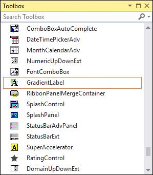
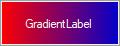

# Getting Started with Windows Forms Gradient Label

This section explains how to get started with the Windows Forms Gradient Label control and its basic features.

## Assembly deployment

Refer to the [Control Dependencies](https://help.syncfusion.com/windowsforms/control-dependencies#gradientlabel) section for the list of assemblies and NuGet packages required to use the Gradient Label control.

Refer to [NuGet Packages](https://help.syncfusion.com/windowsforms/installation/install-nuget-packages) to learn how to install NuGet packages in a Windows Forms application.

To install the required NuGet package using the NuGet Package Manager Console, run the following command:

```powershell
Install-Package Syncfusion.Tools.Windows
```

## Adding the Gradient Label Control via Designer

The following steps describe how to add a `GradientLabel` control using the designer:

1. Create a new Windows Forms application in Visual Studio.

2. Drag the [GradientLabel](https://help.syncfusion.com/cr/windowsforms/Syncfusion.Windows.Forms.Tools.GradientLabel.html) control from the **Toolbox** and drop it onto the Windows Form designer. The following dependent assemblies are added automatically:

    * Syncfusion.Grid.Base
    * Syncfusion.Grid.Windows
    * Syncfusion.Shared.Base
    * Syncfusion.Shared.Windows
    * Syncfusion.Tools.Base
    * Syncfusion.Tools.Windows



## Adding the Gradient Label Control via Code

The following steps describe how to add the Gradient Label control programmatically:

1. Create a C# or VB.NET Windows Forms application in Visual Studio.

2. Add the following assembly references to the project:

    * Syncfusion.Grid.Base
    * Syncfusion.Grid.Windows
    * Syncfusion.Shared.Base
    * Syncfusion.Shared.Windows
    * Syncfusion.Tools.Base
    * Syncfusion.Tools.Windows

3. Include the `Syncfusion.Windows.Forms.Tools` namespace, create an instance of the [GradientLabel](https://help.syncfusion.com/cr/windowsforms/Syncfusion.Windows.Forms.Tools.GradientLabel.html) control in the form constructor, and add it to the form. By default, the control is displayed at the top-left corner of the form with its default size. Set the `Location` and `Size` properties to position and resize the control as needed.





using Syncfusion.Windows.Forms.Tools;
using System.Drawing;

public partial class Form1 : Form
{
    private Syncfusion.Windows.Forms.Tools.GradientLabel gradientLabel1;

    public Form1()
    {
        InitializeComponent();

        this.gradientLabel1 = new Syncfusion.Windows.Forms.Tools.GradientLabel();
        this.gradientLabel1.Location = new System.Drawing.Point(20, 20);
        this.gradientLabel1.Size = new System.Drawing.Size(120, 46);
        this.Controls.Add(this.gradientLabel1);
    }
}





Imports Syncfusion.Windows.Forms.Tools
Imports System.Drawing

Public Partial Class Form1
    Inherits Form

    Private gradientLabel1 As Syncfusion.Windows.Forms.Tools.GradientLabel

    Public Sub New()
        InitializeComponent()

        Me.gradientLabel1 = New Syncfusion.Windows.Forms.Tools.GradientLabel()
        Me.gradientLabel1.Location = New System.Drawing.Point(20, 20)
        Me.gradientLabel1.Size = New System.Drawing.Size(120, 46)
        Me.Controls.Add(Me.gradientLabel1)
    End Sub
End Class




{{ codesnippet1 | OrderList_Indent_Level_1 }}

## Gradient Settings

The appearance of the Gradient Label control can be customized using the `GradientStyle`, `BackgroundColor`, and `ForeColor` properties.





this.gradientLabel1.Size = new System.Drawing.Size(120, 46);
this.gradientLabel1.BackgroundColor = new Syncfusion.Drawing.BrushInfo(Syncfusion.Drawing.GradientStyle.Horizontal, System.Drawing.Color.Red, System.Drawing.Color.MediumBlue);
this.gradientLabel1.Text = "GradientLabel";
this.gradientLabel1.ForeColor = System.Drawing.Color.SeaShell;





Me.gradientLabel1.Size = New System.Drawing.Size(120, 46)
Me.gradientLabel1.BackgroundColor = New Syncfusion.Drawing.BrushInfo(Syncfusion.Drawing.GradientStyle.Horizontal, System.Drawing.Color.Red, System.Drawing.Color.MediumBlue)
Me.gradientLabel1.Text = "GradientLabel"
Me.gradientLabel1.ForeColor = System.Drawing.Color.SeaShell






