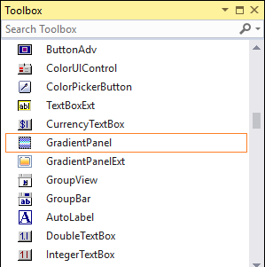
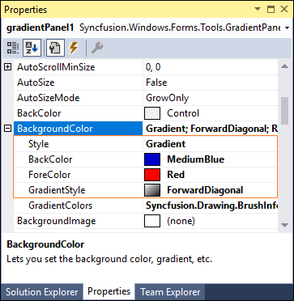
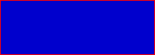
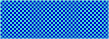

# Getting Started with Windows Forms Gradient Panel

This section explains how to get started with the Windows Forms `GradientPanel` control using the Visual Studio designer and code, and how to customize its background and border styles.

## Assembly deployment

Refer to the [Control Dependencies](https://help.syncfusion.com/windowsforms/control-dependencies#gradientpanel) section for the list of assemblies and NuGet packages required to use the Gradient Panel control.

Refer to [NuGet Packages](https://help.syncfusion.com/windowsforms/installation/install-nuget-packages) to learn how to install NuGet packages in a Windows Forms application.

To install the required NuGet package using the NuGet Package Manager Console, run the following command:

```powershell
Install-Package Syncfusion.Shared.Base
```

## Adding GradientPanel Control via Designer

1. Create a new Windows Forms project in Visual Studio.

2. Install the required Syncfusion WinForms NuGet package. After the control is registered in the Toolbox, drag the [GradientPanel](https://help.syncfusion.com/cr/windowsforms/Syncfusion.Windows.Forms.Tools.GradientPanel.html) control from the Toolbox and drop it onto the Windows Form designer. The following dependent assembly is added automatically:

    * Syncfusion.Shared.Base



3. Configure the Gradient Panel control using the Properties window. For example, set the `BackgroundColor` property to a `Syncfusion.Drawing.BrushInfo` value and customize the `BorderColor` and `BorderStyle` properties as needed.



## Adding GradientPanel Control via Code

The following steps describe how to create a Gradient Panel control programmatically:

1. Create a C# or VB.NET Windows Forms application in Visual Studio.

2. Add the following assembly reference to the project:

    * Syncfusion.Shared.Base

3. Include the required namespaces at the top of the file.





using Syncfusion.Windows.Forms.Tools;
using System.Drawing;
using System.Windows.Forms;




Imports Syncfusion.Windows.Forms.Tools
Imports System.Drawing
Imports System.Windows.Forms




{{ codesnippet1 | OrderList_Indent_Level_1 }}

4. Create an instance of the [GradientPanel](https://help.syncfusion.com/cr/windowsforms/Syncfusion.Windows.Forms.Tools.GradientPanel.html) control, configure its layout properties, and add it to the form.





public partial class Form1 : Form
{
    private Syncfusion.Windows.Forms.Tools.GradientPanel gradientPanel1;

    public Form1()
    {
        this.gradientPanel1 = new Syncfusion.Windows.Forms.Tools.GradientPanel()
        {
            Name = "gradientPanel1",
            Size = new System.Drawing.Size(400, 200),
            Location = new System.Drawing.Point(20, 20),
            Dock = System.Windows.Forms.DockStyle.Fill,
            BorderStyle = System.Windows.Forms.BorderStyle.FixedSingle
        };
        this.Controls.Add(this.gradientPanel1);
    }
}




Public Partial Class Form1
    Inherits Form

    Private WithEvents GradientPanel1 As Syncfusion.Windows.Forms.Tools.GradientPanel
    Public Sub New()
        Me.gradientPanel1 = New Syncfusion.Windows.Forms.Tools.GradientPanel() With {
            .Name = "gradientPanel1",
            .Size = New System.Drawing.Size(400, 200),
            .Location = New System.Drawing.Point(20, 20),
            .Dock = System.Windows.Forms.DockStyle.Fill,
            .BorderStyle = System.Windows.Forms.BorderStyle.FixedSingle
        }
        Me.Controls.Add(Me.gradientPanel1)
    End Sub
End Class




{{ codesnippet2 | OrderList_Indent_Level_1 }}

## Styles

The Gradient Panel control provides the following background styles:

* `Solid` - Displays a single background color.
* `Pattern` - Displays a tiled brush pattern.
* `Gradient` - Displays a smooth blend of colors.

Choose the appropriate style based on the desired visual appearance.

### Solid




this.gradientPanel1.BackgroundColor = new Syncfusion.Drawing.BrushInfo(System.Drawing.Color.MediumBlue);
this.gradientPanel1.BorderColor = System.Drawing.Color.Red;
this.gradientPanel1.BorderStyle = System.Windows.Forms.BorderStyle.FixedSingle;




Me.gradientPanel1.BackgroundColor = New Syncfusion.Drawing.BrushInfo(System.Drawing.Color.MediumBlue)
Me.gradientPanel1.BorderColor = System.Drawing.Color.Red
Me.gradientPanel1.BorderStyle = System.Windows.Forms.BorderStyle.FixedSingle






### Pattern




this.gradientPanel1.BackgroundColor = new Syncfusion.Drawing.BrushInfo(Syncfusion.Drawing.PatternStyle.LargeCheckerBoard, System.Drawing.Color.Turquoise, System.Drawing.Color.MediumBlue);
this.gradientPanel1.BorderColor = System.Drawing.Color.PaleTurquoise;
this.gradientPanel1.BorderStyle = System.Windows.Forms.BorderStyle.FixedSingle;




Me.gradientPanel1.BackgroundColor = New Syncfusion.Drawing.BrushInfo(Syncfusion.Drawing.PatternStyle.LargeCheckerBoard, System.Drawing.Color.Turquoise, System.Drawing.Color.MediumBlue)
Me.gradientPanel1.BorderColor = System.Drawing.Color.PaleTurquoise
Me.gradientPanel1.BorderStyle = System.Windows.Forms.BorderStyle.FixedSingle






### Gradient




this.gradientPanel1.BackgroundColor = new Syncfusion.Drawing.BrushInfo(Syncfusion.Drawing.GradientStyle.ForwardDiagonal, System.Drawing.Color.Red, System.Drawing.Color.MediumBlue);
this.gradientPanel1.BorderColor = System.Drawing.Color.Transparent;
this.gradientPanel1.BorderStyle = System.Windows.Forms.BorderStyle.FixedSingle;




Me.gradientPanel1.BackgroundColor = New Syncfusion.Drawing.BrushInfo(Syncfusion.Drawing.GradientStyle.ForwardDiagonal, System.Drawing.Color.Red, System.Drawing.Color.MediumBlue)
Me.gradientPanel1.BorderColor = System.Drawing.Color.Transparent
Me.gradientPanel1.BorderStyle = System.Windows.Forms.BorderStyle.FixedSingle





