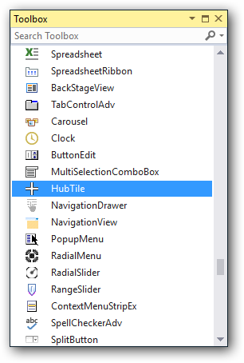
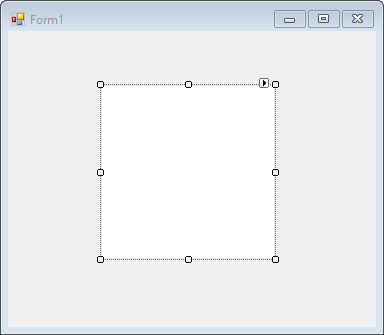
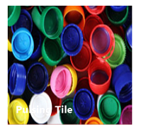
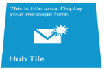
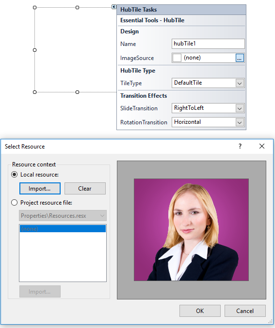
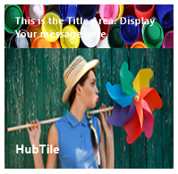
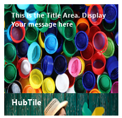
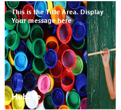

# Getting Started with Windows Forms Hub Tile

This section describes how to add the `HubTile` control to a Windows Forms application and provides an overview of its basic functionalities.

## Assembly deployment

Refer to the [Control Dependencies](https://help.syncfusion.com/windowsforms/control-dependencies#hubtile) section for the list of assemblies and NuGet packages required to use the Hub Tile control.

Refer to [NuGet Packages](https://help.syncfusion.com/windowsforms/installation/install-nuget-packages) to learn how to install NuGet packages in a Windows Forms application.

To install the required NuGet package using the NuGet Package Manager Console, run the following command:

```powershell
Install-Package Syncfusion.Tools.Windows
```

## Adding the Control via Designer

The Hub Tile control can be added to the application by dragging it from the Toolbox and dropping it onto the Windows Form designer. The control is available under the _Syncfusion_ category in the _Toolbox_. The following required assembly references are added automatically:

* Syncfusion.Grid.Base.dll
* Syncfusion.Grid.Windows.dll
* Syncfusion.Shared.Base.dll
* Syncfusion.Shared.Windows.dll
* Syncfusion.Tools.Base.dll
* Syncfusion.Tools.Windows.dll





## Adding the Control via Code

To add the `HubTile` control programmatically, follow these steps:

1. Add the following required assembly references to the project.

        * Syncfusion.Grid.Base.dll
        * Syncfusion.Grid.Windows.dll
        * Syncfusion.Shared.Base.dll
        * Syncfusion.Shared.Windows.dll
        * Syncfusion.Tools.Base.dll
        * Syncfusion.Tools.Windows.dll

2. Include the required namespaces.




using Syncfusion.Windows.Forms.Tools;




Imports Syncfusion.Windows.Forms.Tools




3. Create an instance of the `HubTile` control and add it to the form.




namespace HubTileGettingStarted
{
    public partial class Form1 : Form
    {
        private HubTile hubTile1;

        public Form1()
        {
            this.hubTile1 = new HubTile();
            this.hubTile1.Location = new Point(20, 20);
            this.hubTile1.Name = "hubTile1";
            this.hubTile1.Size = new Size(170, 170);
            this.hubTile1.TabIndex = 0;

            this.AutoScaleDimensions = new SizeF(6F, 13F);
            this.AutoScaleMode = AutoScaleMode.Font;
            this.ClientSize = new Size(400, 300);
            this.Controls.Add(this.hubTile1);
            this.Name = "Form1";
            this.Text = "HubTile Getting Started";
        }
    }
}




Public partial Class Form1
    Inherits Form

    Private hubTile1 As HubTile

    Public Sub New()
        Me.hubTile1 = New HubTile()
        Me.hubTile1.Location = New Point(20, 20)
        Me.hubTile1.Name = "hubTile1"
        Me.hubTile1.Size = New Size(170, 170)
        Me.hubTile1.TabIndex = 0

        Me.AutoScaleDimensions = New SizeF(6.0F, 13.0F)
        Me.AutoScaleMode = AutoScaleMode.Font
        Me.ClientSize = New Size(400, 300)
        Me.Controls.Add(Me.hubTile1)
        Me.Name = "Form1"
        Me.Text = "HubTile Getting Started"
    End Sub
End Class




## Configure the tile type

The HubTile control provides the following tile types:

- **HubTile** (`DefaultTile`) — Displays notifications using various transition effects.
- **RotateTile** — Rotates itself with a configurable transition direction.
- **PulsingTile** — Zooms in and out, and translates its image.

The active tile type is set via the [TileType](https://help.syncfusion.com/cr/windowsforms/Syncfusion.Windows.Forms.Tools.HubTile.html#Syncfusion_Windows_Forms_Tools_HubTile_TileType) property of `HubTile`.




// Setting default tile type
hubTile1.TileType = HubTileType.DefaultTile;

// Setting pulsing tile type
hubTile1.TileType = HubTileType.PulsingTile;

// Setting rotate tile type
hubTile1.TileType = HubTileType.RotateTile;




'Setting default tile
Me.HubTile1.TileType = HubTileType.DefaultTile

'Setting pulsing tile
Me.HubTile2.TileType = HubTileType.PulsingTile

'Setting rotate tile
Me.HubTile3.TileType = HubTileType.RotateTile




**HubTile**


**PulsingTile**



**RotateTile**



## Set the header and footer

You can define the header and footer text of a tile by setting the [Title](https://help.syncfusion.com/cr/windowsforms/Syncfusion.Windows.Forms.Tools.HubTile.html#Syncfusion_Windows_Forms_Tools_HubTile_Title) and [Footer](https://help.syncfusion.com/cr/windowsforms/Syncfusion.Windows.Forms.Tools.HubTile.html#Syncfusion_Windows_Forms_Tools_HubTile_Footer) properties of `HubTile`.




//Set hub tile title
hubTile1.Title.Text = "This is the title area. Display your image here";
//Set hub tile footer text
hubTile1.Footer.Text = "HubTile";
//Title color
hubTile1.Title.TextColor = Color.White;
// Footer color
hubTile1.Footer.TextColor = Color.White;
// HubTile back color
hubTile1.BackColor = Color.FromArgb(17, 158, 218);




'Set hub tile title
hubTile1.Title.Text = "This is the title area. Display your image here"
'Set hub tile footer text
hubTile1.Footer.Text = "HubTile"
'Title color
hubTile1.Title.TextColor = Color.White
'Footer color
hubTile1.Footer.TextColor = Color.White
'HubTile back color
hubTile1.BackColor = Color.FromArgb(17, 158, 218)





## Set the tile image

A background image can be assigned to Hub Tile either through the designer or programmatically.

**Add background image through the designer**

In the designer, use the `ImageSource` property exposed in the `HubTile` smart tag.



**Add background image via code**

Background image can be added to Hub Tile using `ImageSource` property.




hubTile1.ImageSource = Properties.Resources.sampleImage;




Me.hubTile1.ImageSource = ((System.Drawing.Image)(resources.GetObject("hubTile1.ImageSource")))





## Transition effects

The Hub Tile image transition can be performed at specified intervals and in one of the following directions:

- Bottom to Top
- Top to Bottom
- Left to Right
- Right to Left

The transition direction is set with the [SlideTransition](https://help.syncfusion.com/cr/windowsforms/Syncfusion.Windows.Forms.Tools.HubTile.html#Syncfusion_Windows_Forms_Tools_HubTile_SlideTransition) property of `HubTile`.




// Transition direction
hubTile1.SlideTransition = TransitionDirection.BottomToTop;




' Transition direction
hubTile1.SlideTransition = TransitionDirection.BottomToTop




* **Bottom-to-Top**



* **Top-to-Bottom**



* **Left-to-Right**



* **Right-to-Left**


