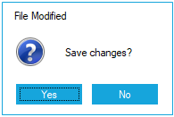
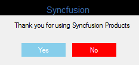

# Getting Started with Windows Forms MessageBox

This section explains how to get started with the [MessageBoxAdv](https://help.syncfusion.com/cr/windowsforms/Syncfusion.Windows.Forms.MessageBoxAdv.html) control in a Windows Forms application. `MessageBoxAdv` is a static helper class that displays a styled message box from code and does not appear as a draggable item in the Visual Studio Toolbox.

## Assembly Deployment

Refer to the [Control Dependencies](https://help.syncfusion.com/windowsforms/control-dependencies#MessageBox) section for the list of assemblies and NuGet packages required to use the MessageBox control.

Refer to [NuGet Packages](https://help.syncfusion.com/windowsforms/installation/install-nuget-packages) to learn how to install NuGet packages in a Windows Forms application.

To install the required NuGet package using the NuGet Package Manager Console, run the following command:

```
Install-Package Syncfusion.Shared.Base
```

## Adding MessageBox via Designer

`MessageBoxAdv` is a static helper class and is not available in the Visual Studio **Toolbox**. The designer is used only to add a trigger control (for example, a **Button**) and generate its `Click` event handler. The `MessageBoxAdv.Show` method must be called in code.

The following dependent assembly is required to use `MessageBoxAdv`:

* Syncfusion.Shared.Base

1. Create a new Windows Forms project in Visual Studio.

2. Open the **Toolbox** and drag a **Button** control (for example, named `btnShow`) onto the form.

3. Double-click the button to generate its `Click` event handler, and then add the following code to display a MessageBox.




private void btnShow_Click(object sender, EventArgs e)
{
    // Display the MessageBox using MessageBoxAdv.Show.
    MessageBoxAdv.MessageBoxStyle = MessageBoxAdv.Style.Metro;
    MessageBoxAdv.Show(this, "Save changes?", "File Modified", MessageBoxButtons.YesNo, MessageBoxIcon.Question);
}




Private Sub btnShow_Click(sender As Object, e As EventArgs)
    ' Display the MessageBox using MessageBoxAdv.Show.
    MessageBoxAdv.MessageBoxStyle = MessageBoxAdv.Style.Metro
    MessageBoxAdv.Show(Me, "Save changes?", "File Modified", MessageBoxButtons.YesNo, MessageBoxIcon.Question)
End Sub




## Adding MessageBox via Code

To use MessageBox in code, follow these steps:

1. Add the required assembly reference to the project:

    * Syncfusion.Shared.Base

2. Include the required namespace (`Syncfusion.Windows.Forms`), and then call the **Show** method from the form constructor, as shown below.




using System.Windows.Forms;
using Syncfusion.Windows.Forms;

namespace MessageBoxAdvDemo
{
    public partial class Form1 : Form
    {
        public Form1()
        {
            InitializeComponent();
            // Display the MessageBox using MessageBoxAdv.Show.
            MessageBoxAdv.MessageBoxStyle = MessageBoxAdv.Style.Metro;
            MessageBoxAdv.Show(this, "Save changes?", "File Modified", MessageBoxButtons.YesNo, MessageBoxIcon.Question);
        }
    }
}




Imports System.Windows.Forms
Imports Syncfusion.Windows.Forms

Public Class Form1
    Inherits Form

    Public Sub New()
        InitializeComponent()
        ' Display the MessageBox using MessageBoxAdv.Show.
        MessageBoxAdv.MessageBoxStyle = MessageBoxAdv.Style.Metro
        MessageBoxAdv.Show(Me, "Save changes?", "File Modified", MessageBoxButtons.YesNo, MessageBoxIcon.Question)
    End Sub
End Class






## Appearance of MessageBox

The appearance of MessageBox can be customized using the following properties of the `MetroStyleColorTable`. To apply the custom color settings, set the `MessageBoxAdv.MessageBoxStyle` property to a Metro-compatible style, such as `Style.Metro`.

### Button colors

* AbortButtonBackColor
* CancelButtonBackColor
* IgnoreButtonBackColor
* NoButtonBackColor
* OKButtonBackColor
* RetryButtonBackColor
* YesButtonBackColor

### Caption and background

* CaptionBarColor
* CaptionForeColor
* ForeColor
* BackColor
* BorderColor




using System.Drawing;
using Syncfusion.Windows.Forms;

// MetroStyleColorTable for MessageBoxAdv
MetroStyleColorTable metroColorTable = new MetroStyleColorTable();
// Sets the NoButton BackColor
metroColorTable.NoButtonBackColor = Color.Red;
// Sets the YesButton BackColor
metroColorTable.YesButtonBackColor = Color.SkyBlue;
// Sets the OK Button BackColor
metroColorTable.OKButtonBackColor = Color.Green;
// Applies the MetroStyleColorTable to MessageBoxAdv
MessageBoxAdv.MetroColorTable = metroColorTable;
// Sets the MessageBoxStyle as Metro
MessageBoxAdv.MessageBoxStyle = MessageBoxAdv.Style.Metro;





Imports System.Drawing
Imports Syncfusion.Windows.Forms

' MetroStyleColorTable for MessageBoxAdv
Dim metroColorTable As New MetroStyleColorTable()
' Sets the NoButton BackColor
metroColorTable.NoButtonBackColor = Color.Red
' Sets the YesButton BackColor
metroColorTable.YesButtonBackColor = Color.SkyBlue
' Sets the OK Button BackColor
metroColorTable.OKButtonBackColor = Color.Green
' Applies the MetroStyleColorTable to MessageBoxAdv
MessageBoxAdv.MetroColorTable = metroColorTable
' Sets the MessageBoxStyle as Metro
MessageBoxAdv.MessageBoxStyle = MessageBoxAdv.Style.Metro




 
