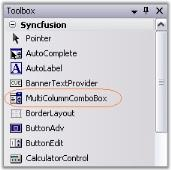

# Getting Started with Windows Forms Multicolumn ComboBox

This section explains how to use the `MultiColumnComboBox` control to create a combo box that displays multiple columns in its drop-down list.

## Assembly deployment

Refer to the [Control Dependencies](https://help.syncfusion.com/windowsforms/control-dependencies#multicolumncombobox) section for the list of required assemblies and NuGet package information needed to use the Multicolumn ComboBox control in your application.

Refer to [NuGet Packages](https://help.syncfusion.com/windowsforms/installation/install-nuget-packages) to learn how to install NuGet packages in a Windows Forms application.

To install the required NuGet package using the NuGet Package Manager Console, run the following command:

```
Install-Package Syncfusion.Tools.Windows
```

## Adding Multicolumn ComboBox via Designer

1. Create a new Windows Forms project in Visual Studio.

2. Drag the [MultiColumnComboBox](https://help.syncfusion.com/cr/windowsforms/Syncfusion.Windows.Forms.Tools.MultiColumnComboBox.html) control from the _Toolbox_ and drop it onto the Windows Form designer. The following dependent assembly is added automatically:
      
	* Syncfusion.Tools.Windows



## Adding Multicolumn ComboBox via Code

To add the `MultiColumnComboBox` control programmatically, follow these steps:

1. Create a C# or VB.NET Windows Forms application in Visual Studio.

2. Add the following assembly reference to the project:

    * Syncfusion.Tools.Windows

3. Include the required namespace.




using System.Windows.Forms;
using Syncfusion.Windows.Forms.Tools;




Imports Syncfusion.Windows.Forms.Tools




4. Create an instance of the `MultiColumnComboBox` control and add it to the form.





namespace WindowsFormsApplication1
{
    public partial class Form1 : Form
    {
        private MultiColumnComboBox multiColumnComboBox1;
        public Form1()
        {
            InitializeComponent();
            multiColumnComboBox1 = new MultiColumnComboBox();
            multiColumnComboBox1.Location = new System.Drawing.Point(20, 20);
            multiColumnComboBox1.Size = new System.Drawing.Size(200, 25);
            this.Controls.Add(multiColumnComboBox1);
        }
    }
}





Public Class Form1
    Inherits Form

    Private multiColumnComboBox1 As MultiColumnComboBox
    Public Sub New()
        InitializeComponent()
        multiColumnComboBox1 = New MultiColumnComboBox()
        multiColumnComboBox1.Location = New System.Drawing.Point(20, 20)
        multiColumnComboBox1.Size = New System.Drawing.Size(200, 25)
        Me.Controls.Add(multiColumnComboBox1)
    End Sub
End Class




{{ codesnippet1 | OrderList_Indent_Level_1 }}

For more data-binding options, refer to [Data binding](https://help.syncfusion.com/windowsforms/multicolumn-combobox/data-binding) page.

## Bind data in a simple form

The simple example below binds a `DataTable` to the `MultiColumnComboBox` through a `DataView`, with `FirstName` column in the combo box's text area and `LastName` as the value.





using System.Data;

private void Form1_Load(object sender, System.EventArgs e)
{
    //Step 1: Create a DataTable and add columns
    DataTable dt = new DataTable("Table1");
    dt.Columns.Add("FirstName");
    dt.Columns.Add("LastName");

    //Step 2: Add rows to the DataTable
    dt.Rows.Add(new object[] { "John", "Tina" });
    dt.Rows.Add(new object[] { "Mary", "Anu" });

    //Step 3: Bind the DataView to MultiColumnComboBox
    this.multiColumnComboBox1.DataSource     = new DataView(dt);
    this.multiColumnComboBox1.DisplayMember = "FirstName";
    this.multiColumnComboBox1.ValueMember   = "LastName";

    //Step 4: Configure the dropdown columns
    this.multiColumnComboBox1.Columns.Add(new Syncfusion.Windows.Forms.Grid.GridColumnDescriptor("FirstName", "FirstName", 120));
    this.multiColumnComboBox1.Columns.Add(new Syncfusion.Windows.Forms.Grid.GridColumnDescriptor("LastName",  "LastName",  120));
}




Imports System.Data

Private Sub Form1_Load(ByVal sender As Object, ByVal e As System.EventArgs) Handles MyBase.Load
    'Step 1: Create a DataTable and add columns
    Dim dt As New DataTable("Table1")
    dt.Columns.Add("FirstName")
    dt.Columns.Add("LastName")

    'Step 2: Add rows to the DataTable
    dt.Rows.Add(New Object() {"John", "Tina"})
    dt.Rows.Add(New Object() {"Mary", "Anu"})

    'Step 3: Bind the DataView to MultiColumnComboBox
    Me.multiColumnComboBox1.DataSource = New DataView(dt)
    Me.multiColumnComboBox1.DisplayMember = "FirstName"
    Me.multiColumnComboBox1.ValueMember = "LastName"

    'Step 4: Configure the dropdown columns
    Me.multiColumnComboBox1.Columns.Add(New Syncfusion.Windows.Forms.Grid.GridColumnDescriptor("FirstName", "FirstName", 120))
    Me.multiColumnComboBox1.Columns.Add(New Syncfusion.Windows.Forms.Grid.GridColumnDescriptor("LastName", "LastName", 120))
End Sub




{{ codesnippet2 | OrderList_Indent_Level_1 }}

## Output

The output for the above code is shown below.


You can also explore our [WinForms MultiColumn ComboBox example](https://github.com/SyncfusionExamples/How-to-display-multiple-members-in-WinForms-MultiColumnComboBox) that shows you how to render and configure the MultiColumn ComboBox.
