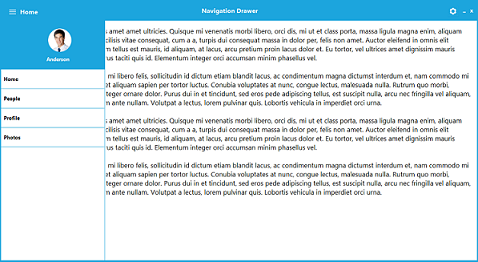

# About Syncfusion® Windows Forms NavigationDrawer Control

[WinForms NavigationDrawer](https://www.syncfusion.com/winforms-ui-controls/navigation-drawer) is a sliding panel menu that comes out from the edge of the window and allows the contents to be placed in a hidden panel. It can be shown by swiping from any of the four screen edges or by demand.

## Key features

* **Position** - Provides an option to set the sliding position of the Drawer panel.

* **Transition** - Provides options to set the transition type of the drawer while opening.

* **Toggle drawer** - Provides an option to toggle between the sliding panel visibility.

* **Animation duration** - Specifies a TimeSpan by which the DrawerContent opens up to the view. Animation duration is applied only when the `ToggleDrawer` function is used.
