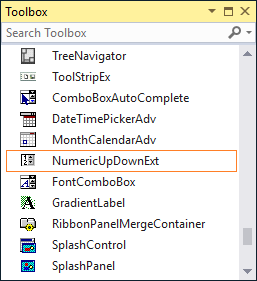
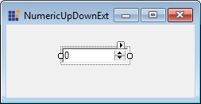
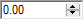

# Getting Started with Windows Forms NumericUpDown

This section explains how to get started with the Windows Forms `NumericUpDown` control and its basic features.

## Assembly Deployment

Refer to the [Control Dependencies](https://help.syncfusion.com/windowsforms/control-dependencies#numericupdownext) section for the list of assemblies and NuGet packages required to use the NumericUpDown control.

Refer to [NuGet Packages](https://help.syncfusion.com/windowsforms/installation/install-nuget-packages) to learn how to install NuGet packages in a Windows Forms application.

To install the required NuGet package using the NuGet Package Manager Console, run the following command:

```powershell
Install-Package Syncfusion.Tools.Windows
```

## Adding NumericUpDown via Designer

1. Create a new Windows Forms application in Visual Studio.

2. Drag the [NumericUpDownExt](https://help.syncfusion.com/cr/windowsforms/Syncfusion.Windows.Forms.Tools.NumericUpDownExt.html) control from the _Toolbox_ and drop it onto the Windows Form designer. The following dependent assemblies are added automatically:

    * Syncfusion.Grid.Base
    * Syncfusion.Grid.Windows
    * Syncfusion.Shared.Base
    * Syncfusion.Shared.Windows
    * Syncfusion.Tools.Base
    * Syncfusion.Tools.Windows



The NumericUpDown control allows users to display and modify numeric values by using the up and down buttons.



## Adding NumericUpDown via Code

The following steps describe how to create a NumericUpDown control programmatically:

1. Create a C# or VB.NET Windows Forms application in Visual Studio.

2. Add the following assembly references to the project:

    * Syncfusion.Grid.Base
    * Syncfusion.Grid.Windows
    * Syncfusion.Shared.Base
    * Syncfusion.Shared.Windows
    * Syncfusion.Tools.Base
    * Syncfusion.Tools.Windows

3. Include the required namespace.

​




using Syncfusion.Windows.Forms.Tools;





Imports Syncfusion.Windows.Forms.Tools





{{ codesnippet1 | OrderList_Indent_Level_1 }}

4. Create an instance of the [NumericUpDownExt](https://help.syncfusion.com/cr/windowsforms/Syncfusion.Windows.Forms.Tools.NumericUpDownExt.html) control and add it to the form.

​



public partial class Form1 : Form
{
    private Syncfusion.Windows.Forms.Tools.NumericUpDownExt numericUpDownExt1;

    public Form1()
    {
        InitializeComponent();

        this.numericUpDownExt1 = new Syncfusion.Windows.Forms.Tools.NumericUpDownExt();
        this.numericUpDownExt1.Location = new System.Drawing.Point(70, 29);
        this.numericUpDownExt1.Name = "numericUpDownExt1";
        this.numericUpDownExt1.Size = new System.Drawing.Size(84, 20);
        this.Controls.Add(this.numericUpDownExt1);
    }
}





Public Partial Class Form1
    Inherits Form

    Private numericUpDownExt1 As Syncfusion.Windows.Forms.Tools.NumericUpDownExt

    Public Sub New()
        InitializeComponent()

        Me.numericUpDownExt1 = New Syncfusion.Windows.Forms.Tools.NumericUpDownExt()
        Me.numericUpDownExt1.Location = New System.Drawing.Point(70, 29)
        Me.numericUpDownExt1.Name = "numericUpDownExt1"
        Me.numericUpDownExt1.Size = New System.Drawing.Size(84, 20)
        Me.Controls.Add(Me.numericUpDownExt1)
    End Sub
End Class




{{ codesnippet2 | OrderList_Indent_Level_1 }}

## Display Settings

The NumericUpDown control provides the [DecimalPlaces](https://help.syncfusion.com/cr/windowsforms/Syncfusion.Windows.Forms.Tools.NumericUpDownExtActionList.html#Syncfusion_Windows_Forms_Tools_NumericUpDownExtActionList_DecimalPlaces) and [ThousandsSeparator](https://help.syncfusion.com/cr/windowsforms/Syncfusion.Windows.Forms.Tools.NumericUpDownExtActionList.html#Syncfusion_Windows_Forms_Tools_NumericUpDownExtActionList_ThousandsSeparator) properties to customize the display format of numeric values.





this.numericUpDownExt1.DecimalPlaces = 2;
this.numericUpDownExt1.ThousandsSeparator = true;





Me.numericUpDownExt1.DecimalPlaces = 2
Me.numericUpDownExt1.ThousandsSeparator = True







## Value Settings

The NumericUpDown control provides the following properties to control numeric values:

* [Value](https://help.syncfusion.com/cr/windowsforms/Syncfusion.Windows.Forms.Tools.NumericUpDownExtActionList.html#Syncfusion_Windows_Forms_Tools_NumericUpDownExtActionList_Value) - Specifies the current value of the control.
* [Hexadecimal](https://help.syncfusion.com/cr/windowsforms/Syncfusion.Windows.Forms.Tools.NumericUpDownExtActionList.html#Syncfusion_Windows_Forms_Tools_NumericUpDownExtActionList_Hexadecimal) - Indicates whether the value is displayed in hexadecimal format.
* [Minimum](https://help.syncfusion.com/cr/windowsforms/Syncfusion.Windows.Forms.Tools.NumericUpDownExtActionList.html#Syncfusion_Windows_Forms_Tools_NumericUpDownExtActionList_Minimum) - Specifies the minimum allowed value.
* [Increment](https://help.syncfusion.com/cr/windowsforms/Syncfusion.Windows.Forms.Tools.NumericUpDownExtActionList.html#Syncfusion_Windows_Forms_Tools_NumericUpDownExtActionList_Increment) - Specifies the amount by which the value is increased or decreased when the up or down button is clicked. The default value is `1`.





this.numericUpDownExt1.Value = new decimal(new int[] {25, 0, 0, 0});
this.numericUpDownExt1.Hexadecimal = true;
this.numericUpDownExt1.Minimum = new decimal(new int[] {50, 0, 0, 0});
this.numericUpDownExt1.Increment = new decimal(new int[] {5, 0, 0, 0});





Me.numericUpDownExt1.Value = New Decimal(New Integer() {25, 0, 0, 0})
Me.numericUpDownExt1.Hexadecimal = True
Me.numericUpDownExt1.Minimum = New Decimal(New Integer() {50, 0, 0, 0})
Me.numericUpDownExt1.Increment = New Decimal(New Integer() {5, 0, 0, 0})




