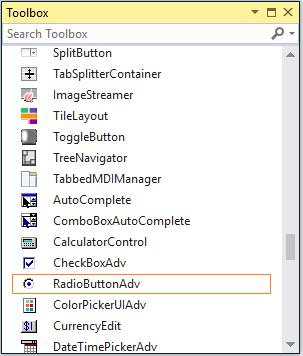

# Getting Started with Windows Forms Radio Button

This section explains how to get started with the Windows Forms `RadioButtonAdv` control and its basic features.

## Assembly Deployment

Refer to the [Control Dependencies](https://help.syncfusion.com/windowsforms/control-dependencies#radiobuttonadv) section for the list of assemblies and NuGet packages required to use the `RadioButtonAdv` control.

Refer to [NuGet Packages](https://help.syncfusion.com/windowsforms/installation/install-nuget-packages) to learn how to install NuGet packages in a Windows Forms application.

To install the required NuGet package using the NuGet Package Manager Console, run the following command:

```powershell
Install-Package Syncfusion.Tools.Windows
```

## Adding Radio Button via Designer

To add the `RadioButtonAdv` control using the designer, follow these steps:

1. Create a new Windows Forms application in Visual Studio.

2. Drag the `RadioButtonAdv` control from the _Toolbox_ and drop it onto the Windows Form designer. The following dependent assemblies are added automatically:

* Syncfusion.Grid.Base
* Syncfusion.Grid.Windows
* Syncfusion.Shared.Base
* Syncfusion.Shared.Windows
* Syncfusion.Tools.Base
* Syncfusion.Tools.Windows



3. Configure the desired properties of the Radio Button control in the _Properties_ window. Commonly used properties include `Text`, `Checked`, `RadioButtonAlignment`, `Style`, `ForeColor`, `BackColor`, and `Font`.

## Adding Radio Button via Code

To create a Radio Button control programmatically, follow these steps:

1. Create a C# or VB.NET Windows Forms application in Visual Studio.

2. Add the following assembly references to the project:

* Syncfusion.Grid.Base
* Syncfusion.Grid.Windows
* Syncfusion.Shared.Base
* Syncfusion.Shared.Windows
* Syncfusion.Tools.Base
* Syncfusion.Tools.Windows

3. Include the required namespace.




using Syncfusion.Windows.Forms.Tools;





Imports Syncfusion.Windows.Forms.Tools




4. Declare and create an instance of the `RadioButtonAdv` control as a form-level field.




private Syncfusion.Windows.Forms.Tools.RadioButtonAdv radioButtonAdv1;
this.radioButtonAdv1 = new Syncfusion.Windows.Forms.Tools.RadioButtonAdv();
this.radioButtonAdv1.Name = "radioButtonAdv1";
this.radioButtonAdv1.Location = new System.Drawing.Point(20, 20);
this.radioButtonAdv1.Size = new System.Drawing.Size(150, 20);





Private radioButtonAdv1 As Syncfusion.Windows.Forms.Tools.RadioButtonAdv
Me.radioButtonAdv1 = New Syncfusion.Windows.Forms.Tools.RadioButtonAdv()
Me.radioButtonAdv1.Name = "radioButtonAdv1"
Me.radioButtonAdv1.Location = New System.Drawing.Point(20, 20)
Me.radioButtonAdv1.Size = New System.Drawing.Size(150, 20)




5. Configure the required properties of the `RadioButtonAdv` control in code.




this.radioButtonAdv1.Text = "radioButtonAdv1";
this.radioButtonAdv1.Checked = true;
this.radioButtonAdv1.ForeColor = System.Drawing.Color.MistyRose;
this.radioButtonAdv1.BackColor = System.Drawing.Color.RosyBrown;
this.radioButtonAdv1.Font = new System.Drawing.Font("Microsoft Sans Serif", 8.25F, System.Drawing.FontStyle.Bold);





Me.radioButtonAdv1.Text = "radioButtonAdv1"
Me.radioButtonAdv1.Checked = True
Me.radioButtonAdv1.ForeColor = System.Drawing.Color.MistyRose
Me.radioButtonAdv1.BackColor = System.Drawing.Color.RosyBrown
Me.radioButtonAdv1.Font = New System.Drawing.Font("Microsoft Sans Serif", 8.25F, System.Drawing.FontStyle.Bold)




6. Add the `RadioButtonAdv` control to the form.




// Add the RadioButtonAdv control to the Form.
this.Controls.Add(this.radioButtonAdv1);





' Add the RadioButtonAdv control to the Form.
Me.Controls.Add(Me.radioButtonAdv1)




The following example demonstrates how to add two Radio Button controls to a form and group them so that selecting one automatically clears the selection of the other.




using System;
using System.Drawing;
using System.Windows.Forms;
using Syncfusion.Windows.Forms.Tools;

namespace RadioButtonAdvGettingStarted
{
    public partial class Form1 : Form
    {
        private Syncfusion.Windows.Forms.Tools.RadioButtonAdv radioButtonAdv1;
        private Syncfusion.Windows.Forms.Tools.RadioButtonAdv radioButtonAdv2;

        public Form1()
        {
            InitializeComponent();
            InitializeRadioButtonAdv();
        }

        private void InitializeRadioButtonAdv()
        {
            // First RadioButtonAdv
            this.radioButtonAdv1 = new Syncfusion.Windows.Forms.Tools.RadioButtonAdv();
            this.radioButtonAdv1.Name = "radioButtonAdv1";
            this.radioButtonAdv1.Text = "Option A";
            this.radioButtonAdv1.Location = new Point(20, 20);
            this.radioButtonAdv1.Size = new Size(150, 20);
            this.radioButtonAdv1.Checked = true;
            this.radioButtonAdv1.ForeColor = Color.MistyRose;
            this.radioButtonAdv1.BackColor = Color.RosyBrown;
            this.radioButtonAdv1.Font = new Font("Microsoft Sans Serif", 8.25F, FontStyle.Bold);

            // Second RadioButtonAdv
            this.radioButtonAdv2 = new Syncfusion.Windows.Forms.Tools.RadioButtonAdv();
            this.radioButtonAdv2.Name = "radioButtonAdv2";
            this.radioButtonAdv2.Text = "Option B";
            this.radioButtonAdv2.Location = new Point(20, 50);
            this.radioButtonAdv2.Size = new Size(150, 20);
            this.radioButtonAdv2.ForeColor = Color.MistyRose;
            this.radioButtonAdv2.BackColor = Color.RosyBrown;
            this.radioButtonAdv2.Font = new Font("Microsoft Sans Serif", 8.25F, FontStyle.Bold);

            // Add the RadioButtonAdv controls to the Form.
            this.Controls.Add(this.radioButtonAdv1);
            this.Controls.Add(this.radioButtonAdv2);
        }
    }
}





Imports System.Drawing
Imports System.Windows.Forms
Imports Syncfusion.Windows.Forms.Tools

Namespace RadioButtonAdvGettingStarted
    Public Partial Class Form1
        Inherits Form

        Private radioButtonAdv1 As Syncfusion.Windows.Forms.Tools.RadioButtonAdv
        Private radioButtonAdv2 As Syncfusion.Windows.Forms.Tools.RadioButtonAdv

        Public Sub New()
            InitializeComponent()
            InitializeRadioButtonAdv()
        End Sub

        Private Sub InitializeRadioButtonAdv()
            ' First RadioButtonAdv
            Me.radioButtonAdv1 = New Syncfusion.Windows.Forms.Tools.RadioButtonAdv()
            Me.radioButtonAdv1.Name = "radioButtonAdv1"
            Me.radioButtonAdv1.Text = "Option A"
            Me.radioButtonAdv1.Location = New Point(20, 20)
            Me.radioButtonAdv1.Size = New Size(150, 20)
            Me.radioButtonAdv1.Checked = True
            Me.radioButtonAdv1.ForeColor = Color.MistyRose
            Me.radioButtonAdv1.BackColor = Color.RosyBrown
            Me.radioButtonAdv1.Font = New Font("Microsoft Sans Serif", 8.25F, FontStyle.Bold)

            ' Second RadioButtonAdv
            Me.radioButtonAdv2 = New Syncfusion.Windows.Forms.Tools.RadioButtonAdv()
            Me.radioButtonAdv2.Name = "radioButtonAdv2"
            Me.radioButtonAdv2.Text = "Option B"
            Me.radioButtonAdv2.Location = New Point(20, 50)
            Me.radioButtonAdv2.Size = New Size(150, 20)
            Me.radioButtonAdv2.ForeColor = Color.MistyRose
            Me.radioButtonAdv2.BackColor = Color.RosyBrown
            Me.radioButtonAdv2.Font = New Font("Microsoft Sans Serif", 8.25F, FontStyle.Bold)

            ' Add the RadioButtonAdv controls to the Form.
            Me.Controls.Add(Me.radioButtonAdv1)
            Me.Controls.Add(Me.radioButtonAdv2)
        End Sub
    End Class
End Namespace



