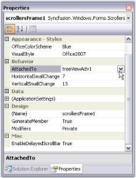
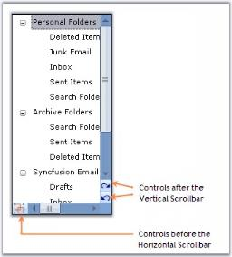
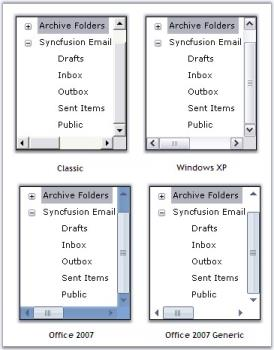
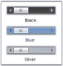
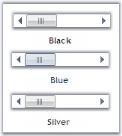
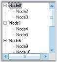

# Getting Started with Windows Forms ScrollersFrame

This section explains how to attach the ScrollersFrame to controls and use its basic functionalities.

## Assembly deployment

The following assembly should be added as reference to use the ScrollersFrame in any application.

<table>
<tr>
<th>
Required assembly  </th><th>
Description  </th></tr>
<tr>
<td>
{{'[Syncfusion.Shared.Base](https://help.syncfusion.com/cr/windowsforms/Syncfusion.Windows.Forms.html)'| markdownify }}  </td><td>
Contains the style-related properties and functionalities for the ScrollersFrame.  </td></tr>
</table>

## Attach ScrollersFrame to control

Add a control to the Windows Forms that should be attached with the Office2007Style scrollbars. Select the control in the [ScrollersFrame.AttachedTo](https://help.syncfusion.com/cr/windowsforms/Syncfusion.Windows.Forms.ScrollersFrame.html#Syncfusion_Windows_Forms_ScrollersFrame_AttachedTo) property.



// Attaching ScrollersFrame to a control using the AttachedTo property
this.scrollersFrame1.AttachedTo = this.treeViewAdv1;


' Attaching ScrollersFrame to a control using the AttachedTo property
Me.scrollersFrame1.AttachedTo = Me.treeViewAdv1



N> The `AttachedTo` property lists all the scrollable controls added to the form. You can select any one of them to attach the ScrollersFrame.

## Adding controls to the scrollbars

The ControlsAfter and ControlsBefore collection properties are available for the ScrollersFrame that lets you add controls before or after the scrollbars.



// Adding controls to the scrollbars through ControlsAfter and ControlsBefore
this.scrollersFrame2.HorizontalScroller.ControlsBefore.Add(buttonAdv3);
this.scrollersFrame2.VerticalScroller.ControlsAfter.Add(buttonAdv1);
this.scrollersFrame2.VerticalScroller.ControlsAfter.Add(buttonAdv2);


' Adding controls to the scrollbars through ControlsAfter and ControlsBefore
Me.scrollersFrame2.HorizontalScroller.ControlsBefore.Add(buttonAdv3)
Me.scrollersFrame2.VerticalScroller.ControlsAfter.Add(buttonAdv1)
Me.scrollersFrame2.VerticalScroller.ControlsAfter.Add(buttonAdv2)



## Programmatic scrolling

The horizontal and vertical scrollers each expose a `Value` property that represents the current position of the scroll box at runtime. This value can be changed using the `HorizontalSmallChange` and `VerticalSmallChange` properties.

<table>
<tr>
<th>
Property</th><th>
Description</th></tr>
<tr>
<td>
HorizontalSmallChange</td><td>
Gets or sets a value to be added to or subtracted from the <code>Value</code> property when the horizontal scroll box is moved a small distance. Default value is 1.</td></tr>
<tr>
<td>
VerticalSmallChange</td><td>
Gets or sets a value to be added to or subtracted from the <code>Value</code> property when the vertical scroll box is moved a small distance. Default value is 1.</td></tr>
</table>



this.scrollersFrame2.VerticalSmallChange = 25;
this.scrollersFrame2.HorizontalSmallChange = 25;


Me.scrollersFrame2.VerticalSmallChange = 25
Me.scrollersFrame2.HorizontalSmallChange = 25



## Visual Styles

Visual styles for the ScrollersFrame control can be edited through the `VisualStyle` property.

<table>
<tr>
<th>
Property</th><th>
Description</th></tr>
<tr>
<td>
VisualStyle</td><td>
Sets the visual style for the scrollbars. Supported values are Classic, WindowsXP, Office2007, Office2007Generic, and Office2016.</td></tr>
<tr>
<td>
OfficeColorScheme</td><td>
Sets the Office color scheme for the scrollbars when VisualStyle is set to Office2007 or Office2007Generic. The available color schemes are, blue, silver, and black and Managed.</td></tr>
<tr>
<td>
Office2016ColorScheme</td><td>
Sets the Office 2016 color scheme for the scrollbars when VisualStyle is set to Office2016. The available color schemes are Black, White, Colorful, and DarkGray.
</table>



this.scrollersFrame1.VisualStyle = Syncfusion.Windows.Forms.ScrollBarCustomDrawStyles.Office2007;


Me.scrollersFrame1.VisualStyle = Syncfusion.Windows.Forms.ScrollBarCustomDrawStyles.Office2007





this.scrollersFrame1.OfficeColorScheme = Syncfusion.Windows.Forms.Office2007ColorScheme.Silver;


Me.scrollersFrame1.OfficeColorScheme = Syncfusion.Windows.Forms.Office2007ColorScheme.Silver



### Custom colors

You can also apply custom colors to the ScrollersFrame by setting the `OfficeColorScheme` to `Managed` and specifying the custom color through the [ApplyManagedColors](https://help.syncfusion.com/cr/windowsforms/Syncfusion.Windows.Forms.Office2007Colors.html#Syncfusion_Windows_Forms_Office2007Colors_ApplyManagedColors_System_Windows_Forms_Form_System_Drawing_Color_) method.


this.scrollersFrame1.OfficeColorScheme = Syncfusion.Windows.Forms.Office2007ColorScheme.Managed;
Office2007Colors.ApplyManagedColors(this, Color.LightSkyBlue);


Me.scrollersFrame1.OfficeColorScheme = Syncfusion.Windows.Forms.Office2007ColorScheme.Managed
Office2007Colors.ApplyManagedColors(Me, Color.LightSkyBlue)



