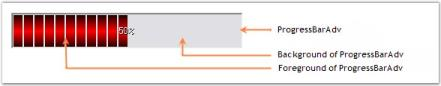
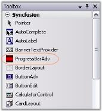
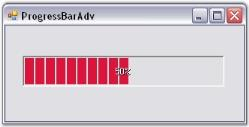

# Getting Started with Windows Forms SplashPanel

This section explains how to get started with the Windows Forms `SplashPanel` control and its basic features.

## Assembly Deployment

Refer to the [Control Dependencies](https://help.syncfusion.com/windowsforms/control-dependencies#splashpanel) section for the list of assemblies and NuGet packages required to use the `SplashPanel` control.

Refer to [NuGet Packages](https://help.syncfusion.com/windowsforms/installation/install-nuget-packages) to learn how to install NuGet packages in a Windows Forms application.

To install the required NuGet package using the NuGet Package Manager Console, run the following command:

```powershell
Install-Package Syncfusion.Tools.Windows
```

## Adding SplashPanel via Designer

The `SplashPanel` control provides full support for the Windows Forms designer. When the control is dragged from the _Toolbox_ onto the form, the following required assembly references are added automatically:

* Syncfusion.Grid.Base.dll
* Syncfusion.Grid.Windows.dll
* Syncfusion.Shared.Base.dll
* Syncfusion.Shared.Windows.dll
* Syncfusion.Tools.Base.dll
* Syncfusion.Tools.Windows.dll

1. Drag the `SplashPanel` control from the **Toolbox** onto the Windows Form designer.

   

2. Configure the required properties of the `SplashPanel` control. Optionally, add child controls to the panel. Set the `TimerInterval` property (in milliseconds) to specify how long the `SplashPanel` remains visible.

3. Specify the startup location of the `SplashPanel` by using the `DesktopAlignment` property.

4. Display the `SplashPanel` by calling the `ShowSplash()` method from an event handler, such as the form's `Load` event or a button's `Click` event.

5. Hide the `SplashPanel` by calling the `HideSplash()` method, for example from a button's `Click` event or the form's `Closing` event.

   

## Adding SplashPanel via Code

To create a `SplashPanel` programmatically and add controls to it, follow these steps:

1. Create a new C# or VB.NET Windows Forms application in Visual Studio.

2. Add the following required assembly references to the project:

    * Syncfusion.Grid.Base.dll
    * Syncfusion.Grid.Windows.dll
    * Syncfusion.Shared.Base.dll
    * Syncfusion.Shared.Windows.dll
    * Syncfusion.Tools.Base.dll
    * Syncfusion.Tools.Windows.dll

3. Include the required namespaces in the form.





using Syncfusion.Windows.Forms.Tools;
using Syncfusion.Drawing;
using System.Reflection;




Imports Syncfusion.Windows.Forms.Tools
Imports Syncfusion.Drawing
Imports System.Reflection




{{ codesnippet1 | OrderList_Indent_Level_1 }}

4. Declare the `SplashPanel` and `Button` controls.





private Syncfusion.Windows.Forms.Tools.SplashPanel splashPanel1;
private System.Windows.Forms.Button button1;




Friend WithEvents splashPanel1 As Syncfusion.Windows.Forms.Tools.SplashPanel
Friend WithEvents button1 As System.Windows.Forms.Button




{{ codesnippet2 | OrderList_Indent_Level_1 }}

5. Initialize the controls.





this.splashPanel1 = new Syncfusion.Windows.Forms.Tools.SplashPanel();
this.button1 = new System.Windows.Forms.Button();
this.splashPanel1.SuspendLayout();
((System.ComponentModel.ISupportInitialize)(this.splashPanel1)).BeginInit();
this.SuspendLayout();




Me.splashPanel1 = New Syncfusion.Windows.Forms.Tools.SplashPanel
Me.button1 = New System.Windows.Forms.Button
Me.splashPanel1.SuspendLayout()
CType(Me.splashPanel1, System.ComponentModel.ISupportInitialize).BeginInit()
Me.SuspendLayout()




{{ codesnippet3 | OrderList_Indent_Level_1 }}

6. Configure the required properties of the `SplashPanel` and `Button` controls.





// Set the properties for SplashPanel.
this.splashPanel1.AnimationSpeed = 10;
this.splashPanel1.BackgroundColor = new Syncfusion.Drawing.BrushInfo(Syncfusion.Drawing.GradientStyle.Vertical, System.Drawing.SystemColors.Highlight, System.Drawing.SystemColors.HighlightText);
this.splashPanel1.Controls.Add(this.button1);
this.splashPanel1.DesktopAlignment = Syncfusion.Windows.Forms.Tools.SplashAlignment.Center;
this.splashPanel1.DiscreetLocation = new System.Drawing.Point(0, 0);
this.splashPanel1.Font = new System.Drawing.Font("Comic Sans MS", 9.75F, System.Drawing.FontStyle.Bold, System.Drawing.GraphicsUnit.Point, ((byte)(0)));
this.splashPanel1.ForeColor = System.Drawing.Color.Pink;
this.splashPanel1.Location = new System.Drawing.Point(16, 16);
this.splashPanel1.Name = "splashPanel1";
this.splashPanel1.ShowAnimation = true;
this.splashPanel1.SuspendAutoCloseWhenMouseOver = false;
this.splashPanel1.TabIndex = 0;
this.splashPanel1.TimerInterval = 5000;

// Set the properties for Button control.
this.button1.BackColor = System.Drawing.Color.DimGray;
this.button1.Location = new System.Drawing.Point(56, 40);
this.button1.Name = "button1";
this.button1.Size = new System.Drawing.Size(96, 23);
this.button1.TabIndex = 0;
this.button1.Text = "SplashPanel";

// Add the SplashPanel to the Form.
this.Controls.Add(this.splashPanel1);





' Set the properties for SplashPanel.
Me.splashPanel1.AnimationSpeed = 10
Me.splashPanel1.BackgroundColor = New Syncfusion.Drawing.BrushInfo(Syncfusion.Drawing.GradientStyle.Vertical, System.Drawing.SystemColors.Highlight, System.Drawing.SystemColors.HighlightText)
Me.splashPanel1.Controls.Add(Me.button1)
Me.splashPanel1.DesktopAlignment = Syncfusion.Windows.Forms.Tools.SplashAlignment.Center
Me.splashPanel1.DiscreetLocation = New System.Drawing.Point(0, 0)
Me.splashPanel1.Font = New System.Drawing.Font("Comic Sans MS", 9.75F, System.Drawing.FontStyle.Bold, System.Drawing.GraphicsUnit.Point, (CByte(0)))
Me.splashPanel1.ForeColor = System.Drawing.Color.Pink
Me.splashPanel1.Location = New System.Drawing.Point(16, 16)
Me.splashPanel1.Name = "splashPanel1"
Me.splashPanel1.ShowAnimation = True
Me.splashPanel1.SuspendAutoCloseWhenMouseOver = False
Me.splashPanel1.TabIndex = 0
Me.splashPanel1.TimerInterval = 5000

' Set the properties for Button control.
Me.button1.BackColor = System.Drawing.Color.DimGray
Me.button1.Location = New System.Drawing.Point(56, 40)
Me.button1.Name = "button1"
Me.button1.Size = New System.Drawing.Size(96, 23)
Me.button1.TabIndex = 0
Me.button1.Text = "SplashPanel"

' Add the SplashPanel to the Form.
Me.Controls.Add(Me.splashPanel1)




{{ codesnippet4 | OrderList_Indent_Level_1 }}

7. Call and implement the `ShowSplash()` method.





this.ShowSplash(false);




Me.ShowSplash(False)




{{ codesnippet5_call | OrderList_Indent_Level_1 }}





private void ShowSplash(bool isModal)
{
    Point pt = Point.Empty;
    SplashPanel currentPanel = this.splashPanel1;
    int interval = 5000;
    currentPanel.TimerInterval = interval;

    if (currentPanel.DesktopAlignment == SplashAlignment.Custom)
    {
        pt = Control.MousePosition;
    }
    currentPanel.ShowSplash(pt, this, isModal);
}




Private Sub ShowSplash(ByVal isModal As Boolean)
    Dim pt As Point = Point.Empty
    Dim currentPanel As SplashPanel = Me.splashPanel1
    Dim interval As Integer = 5000
    currentPanel.TimerInterval = interval

    If currentPanel.DesktopAlignment = SplashAlignment.Custom Then
        pt = Control.MousePosition
    End If
    currentPanel.ShowSplash(pt, Me, isModal)
End Sub




{{ codesnippet5_def | OrderList_Indent_Level_1 }}

8. Resume the layout suspended during initialization.





((System.ComponentModel.ISupportInitialize)(this.splashPanel1)).EndInit();
this.splashPanel1.ResumeLayout(false);
this.ResumeLayout(false);




CType(Me.splashPanel1, System.ComponentModel.ISupportInitialize).EndInit()
Me.splashPanel1.ResumeLayout(False)
Me.ResumeLayout(False)




{{ codesnippet6 | OrderList_Indent_Level_1 }}

9. Run the application.


