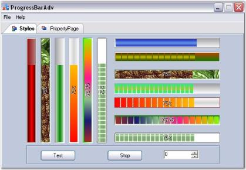
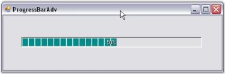

layout: post
title: Getting Started with Windows Forms Splash Screen | Syncfusion®
description: Learn how to get started with the Syncfusion® Windows Forms Splash Screen. Explore setup, features, examples, and customization options.
platform: WindowsForms
control: Splash Screen
documentation: ug
---

# Getting Started with Windows Forms Splash Screen

This section explains how to get started with the Windows Forms Splash Screen control and its basic features.

## Assembly Deployment

Refer to the [Control Dependencies](https://help.syncfusion.com/windowsforms/control-dependencies#splashcontrol) section for the list of assemblies and NuGet packages required to use the `SplashControl`.

Refer to [NuGet Packages](https://help.syncfusion.com/windowsforms/installation/install-nuget-packages) to learn how to install NuGet packages in a Windows Forms application.

To install the required NuGet package using the NuGet Package Manager Console, run the following command:

```powershell
Install-Package Syncfusion.Tools.Windows
```

## Adding Splash Screen via Designer

The `SplashControl` provides full support for the Windows Forms designer. When the control is dragged from the _Toolbox_ onto the form, the following required assembly references are added automatically:

* Syncfusion.Grid.Base.dll
* Syncfusion.Grid.Windows.dll
* Syncfusion.Shared.Base.dll
* Syncfusion.Shared.Windows.dll
* Syncfusion.Tools.Base.dll
* Syncfusion.Tools.Windows.dll

1. Drag the `SplashControl` from the _Toolbox_ onto the form. The `SplashControl` is created in the component tray of the form.

   

2. Set the `SplashImage` and `TimerInterval` properties in the **Properties** window.

3. Set the `AutoMode` property. This property determines how the Splash Screen is displayed.
   - When `AutoMode` is set to `true`, the Splash Screen is displayed automatically during the parent form's `Load` event.
   - When `AutoMode` is set to `false`, the splash screen must be displayed explicitly by calling the `ShowSplash()` method.

4. Preview the splash screen at design time by using the **Preview Splash** option in the Smart Tag.

   

5. Run the application to display the splash screen.

   

6. Handle the `SplashClosed` event to execute code after the splash screen is closed.

7. Hide the splash screen while it is displayed by calling the `HideSplash()` method.

## Adding Splash Screen via Code

To create a `SplashControl` programmatically, follow these steps:

1. Create a new C# or VB.NET Windows Forms application in Visual Studio.

2. Add the following required assembly references to the project:

    * Syncfusion.Grid.Base.dll
    * Syncfusion.Grid.Windows.dll
    * Syncfusion.Shared.Base.dll
    * Syncfusion.Shared.Windows.dll
    * Syncfusion.Tools.Base.dll
    * Syncfusion.Tools.Windows.dll

3. Include the required namespace.





using Syncfusion.Windows.Forms.Tools;




Imports Syncfusion.Windows.Forms.Tools




{{ codesnippet1 | OrderList_Indent_Level_1 }}

4. Declare an instance of the `SplashControl`.

​



private Syncfusion.Windows.Forms.Tools.SplashControl splashControl1;





Friend WithEvents SplashControl1 As Syncfusion.Windows.Forms.Tools.SplashControl




{{ codesnippet2 | OrderList_Indent_Level_1 }}

5. Initialize the control.

​



this.splashControl1 = new Syncfusion.Windows.Forms.Tools.SplashControl();
this.SuspendLayout();





Me.SplashControl1 = New Syncfusion.Windows.Forms.Tools.SplashControl()
Me.SuspendLayout()




{{ codesnippet3 | OrderList_Indent_Level_1 }}

6. Configure the required properties of the `SplashControl`.





this.splashControl1.CustomSplashPanel = null;
this.splashControl1.HostForm = this;
this.splashControl1.HostFormWindowState = System.Windows.Forms.FormWindowState.Normal;
this.splashControl1.TimerInterval = 3000;





Me.SplashControl1.CustomSplashPanel = Nothing
Me.SplashControl1.HostForm = Me
Me.SplashControl1.HostFormWindowState = System.Windows.Forms.FormWindowState.Normal
Me.SplashControl1.TimerInterval = 3000




{{ codesnippet4 | OrderList_Indent_Level_1 }}

7. Run the application to display the splash screen.

     
