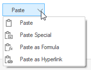

# About Syncfusion® Windows Forms SplitButton Control

The SplitButton control is a combination of a button and a dropdown menu that lets you create a dropdown button-like interface. Using this control, you can perform different operations with dropdown items as a menu hierarchy.

## Features

* **Button Mode** - Provides two types of modes: Normal and Toggle.

* **DropDown Item** - Provides support to add new items to the SplitButton dropdown list.

* **DropDown Position** - Provides support to change the dropdown list position.

* **RightToLeft** - Provides support to align the content of the button from right to left.