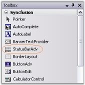
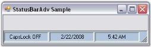
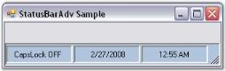

# Getting Started with Windows Forms Status Bar

This section explains how to get started with the Windows Forms Status Bar control using the designer and code.

## Assembly Deployment

Refer to the [Control Dependencies](https://help.syncfusion.com/windowsforms/control-dependencies#statusbar) section for the list of assemblies and NuGet packages required to use the `StatusBarAdv` control.

Refer to [NuGet Packages](https://help.syncfusion.com/windowsforms/installation/install-nuget-packages) to learn how to install NuGet packages in a Windows Forms application.

To install the required NuGet package using the NuGet Package Manager Console, run the following command:

```powershell
Install-Package Syncfusion.Tools.Windows
```

## Adding Status Bar via Designer

The Status Bar control provides full support for the Windows Forms designer. When you drag the control from the _Toolbox_ onto a form, the following required assembly references are added automatically:

* Syncfusion.Grid.Base.dll
* Syncfusion.Grid.Windows.dll
* Syncfusion.Shared.Base.dll
* Syncfusion.Shared.Windows.dll
* Syncfusion.Tools.Base.dll
* Syncfusion.Tools.Windows.dll

To create a `StatusBarAdv` control using the designer:

1. Drag the `StatusBarAdv` control from the _Toolbox_ onto the form.

    

2. Configure the desired background appearance of the `StatusBarAdv` control using the background-related properties in the _Properties_ window.

3. Drag and drop a `StatusBarAdvPanel` onto the `StatusBarAdv` control. Set the `PanelType` property to the required value for each `StatusBarAdvPanel`.

4. Build and run the application.

    

> **Note:** In .NET Core, the Status Bar control's Collection Editor displays the title **"ControlProxy`1 CollectionEditor"** instead of **"StatusBarAdvPanel CollectionEditor"**. This is a known issue and does not affect functionality. For more information, see GitHub issue [#14049](https://github.com/dotnet/winforms/issues/14049).
   
## Adding Status Bar via Code

To create the `StatusBarAdv` control programmatically:

1. Create a new C# or VB.NET Windows Forms application in Visual Studio.

2. Add the following required assembly references to the project:

   * Syncfusion.Grid.Base.dll
   * Syncfusion.Grid.Windows.dll
   * Syncfusion.Shared.Base.dll
   * Syncfusion.Shared.Windows.dll
   * Syncfusion.Tools.Base.dll
   * Syncfusion.Tools.Windows.dll

   Refer to the [Assembly deployment](#assembly-deployment) section for details.
   
3. Add the required namespace to the form.





using Syncfusion.Windows.Forms.Tools;




Imports Syncfusion.Windows.Forms.Tools




{{ codesnippet1 | OrderList_Indent_Level_1 }}

4. Declare instances of the `StatusBarAdv` and `StatusBarAdvPanel` controls.

​



private StatusBarAdv statusBarAdv1;
private StatusBarAdvPanel statusBarAdvPanel1;
private StatusBarAdvPanel statusBarAdvPanel2;
private StatusBarAdvPanel statusBarAdvPanel3;





Private statusBarAdv1 As StatusBarAdv
Private statusBarAdvPanel1 As StatusBarAdvPanel
Private statusBarAdvPanel2 As StatusBarAdvPanel
Private statusBarAdvPanel3 As StatusBarAdvPanel




{{ codesnippet2 | OrderList_Indent_Level_1 }}

5. Initialize the controls.





this.statusBarAdv1 = new StatusBarAdv();
this.statusBarAdvPanel1 = new StatusBarAdvPanel();
this.statusBarAdvPanel2 = new StatusBarAdvPanel();
this.statusBarAdvPanel3 = new StatusBarAdvPanel();





Me.statusBarAdv1 = New StatusBarAdv() 
Me.statusBarAdvPanel1 = New StatusBarAdvPanel() 
Me.statusBarAdvPanel2 = New StatusBarAdvPanel() 
Me.statusBarAdvPanel3 = New StatusBarAdvPanel() 




{{ codesnippet3 | OrderList_Indent_Level_1 }}

6. Configure the required properties and add the `StatusBarAdv` control to the form.





this.statusBarAdv1.BackColor = System.Drawing.Color.LightSteelBlue;
this.statusBarAdv1.BorderColor = System.Drawing.Color.Black;
this.statusBarAdv1.Dock = System.Windows.Forms.DockStyle.Bottom;
this.statusBarAdv1.Name = "statusBarAdv1";

this.statusBarAdv1.Controls.Add(this.statusBarAdvPanel1);
this.statusBarAdv1.Controls.Add(this.statusBarAdvPanel2);
this.statusBarAdv1.Controls.Add(this.statusBarAdvPanel3);

this.statusBarAdvPanel1.PanelType = StatusBarAdvPanelType.CurrentCulture;
this.statusBarAdvPanel2.PanelType = StatusBarAdvPanelType.ShortDate;
this.statusBarAdvPanel3.PanelType = StatusBarAdvPanelType.ShortTime;

this.statusBarAdvPanel1.Size = new System.Drawing.Size(100, 27);
this.statusBarAdvPanel2.Size = new System.Drawing.Size(100, 27);
this.statusBarAdvPanel3.Size = new System.Drawing.Size(100, 27);
this.Controls.Add(this.statusBarAdv1);




   
Me.statusBarAdv1.BackColor = System.Drawing.Color.LightSteelBlue
Me.statusBarAdv1.BorderColor = System.Drawing.Color.Black
Me.statusBarAdv1.Dock = System.Windows.Forms.DockStyle.Bottom
Me.statusBarAdv1.Name = "statusBarAdv1"

Me.statusBarAdv1.Controls.Add(Me.statusBarAdvPanel1)
Me.statusBarAdv1.Controls.Add(Me.statusBarAdvPanel2)
Me.statusBarAdv1.Controls.Add(Me.statusBarAdvPanel3)

Me.statusBarAdvPanel1.PanelType = StatusBarAdvPanelType.CurrentCulture
Me.statusBarAdvPanel2.PanelType = StatusBarAdvPanelType.ShortDate
Me.statusBarAdvPanel3.PanelType = StatusBarAdvPanelType.ShortTime

Me.statusBarAdvPanel1.Size = New System.Drawing.Size(100, 27)
Me.statusBarAdvPanel2.Size = New System.Drawing.Size(100, 27)
Me.statusBarAdvPanel3.Size = New System.Drawing.Size(100, 27)
Me.Controls.Add(Me.statusBarAdv1)




{{ codesnippet4 | OrderList_Indent_Level_1 }}  

7. Run the application. By default, the `StatusBarAdv` control is docked to the bottom of the form.

    
