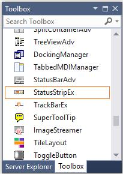
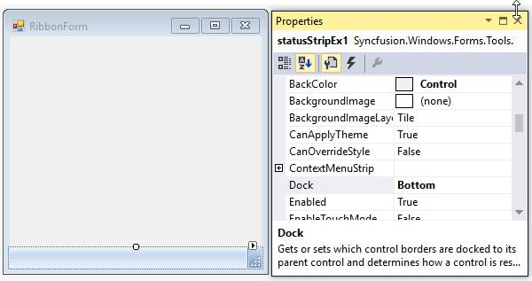
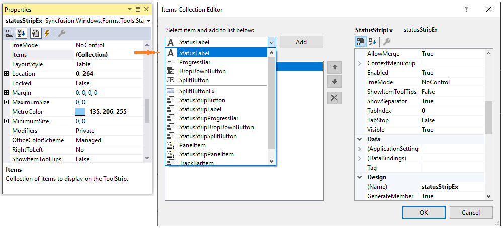
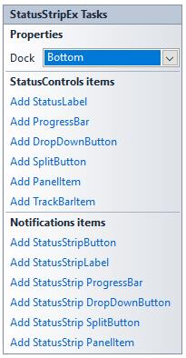

# Getting Started with Windows Forms StatusStrip

The StatusStrip control can be added to the bottom of a Ribbon control and can host controls such as `TrackBarEx`, `ProgressBar`, and `StatusStripButton`.


## Assembly Deployment

Refer to the [Control Dependencies](https://help.syncfusion.com/windowsforms/control-dependencies#statusstripex) section for the list of assemblies and NuGet packages required to use the `StatusStripEx` control.

Refer to [NuGet Packages](https://help.syncfusion.com/windowsforms/installation/install-nuget-packages) to learn how to install NuGet packages in a Windows Forms application.

To install the required NuGet package using the NuGet Package Manager Console, run the following command:

```powershell
Install-Package Syncfusion.Tools.Windows
```

## Adding StatusStrip via Designer

1. Create a new Windows Forms application in Visual Studio.

2. Drag the `StatusStripEx` control from the _Toolbox_ and drop it onto the Windows Form designer. The following dependent assemblies are added automatically:

    * Syncfusion.Grid.Base
    * Syncfusion.Grid.Windows
    * Syncfusion.Shared.Base
    * Syncfusion.Shared.Windows
    * Syncfusion.Tools.Base
    * Syncfusion.Tools.Windows

The StatusStrip control can be docked to the bottom of the `RibbonControlAdv`.



Set the `Dock` property to `Bottom` to dock the control at the bottom.



### Adding Items to StatusStrip

Use the **Items** property to open the **Items Collection Editor**. The editor allows you to add and customize `StatusControl` items and modify their appearance using the available properties.



> **Note:** You can also add `ToolStripStatus` items through the **Tasks** window. For more information, refer to [Smart Tag Options](#smart-tag-options).

## Adding StatusStripEx via Code

The following steps describe how to create a `StatusStripEx` control programmatically:

1. Create a C# or VB.NET Windows Forms application in Visual Studio.

2. Add the following assembly references to the project:

    * Syncfusion.Grid.Base
    * Syncfusion.Grid.Windows
    * Syncfusion.Shared.Base
    * Syncfusion.Shared.Windows
    * Syncfusion.Tools.Base
    * Syncfusion.Tools.Windows

3. Include the required namespace.




using Syncfusion.Windows.Forms.Tools;





Imports Syncfusion.Windows.Forms.Tools




4. Create an instance of the `StatusStripEx` control and add it to the form. The following code example also adds a `ToolStripStatusLabel` to the `StatusStripEx` control.




//Declaring the StatusStripEx and ToolStripStatusLabel
private Syncfusion.Windows.Forms.Tools.StatusStripEx statusStripEx1;
private System.Windows.Forms.ToolStripStatusLabel toolStripStatusLabel1;

//Initializing the StatusStripEx and ToolStripStatusLabel
this.statusStripEx1 = new Syncfusion.Windows.Forms.Tools.StatusStripEx();
this.toolStripStatusLabel1 = new System.Windows.Forms.ToolStripStatusLabel();

//Adding ToolStripStatusLabel to StatusStripEx
this.statusStripEx1.Items.AddRange(new System.Windows.Forms.ToolStripItem[] {
this.toolStripStatusLabel1});
this.Controls.Add(this.statusStripEx1);

//Docking the StatusStripEx to Bottom
this.statusStripEx1.Dock = Syncfusion.Windows.Forms.Tools.DockStyleEx.Bottom;





Imports Syncfusion.Windows.Forms.Tools

'Declaring the StatusStripEx and ToolStripStatusLabel 
Private statusStripEx1 As Syncfusion.Windows.Forms.Tools.StatusStripEx
Private toolStripStatusLabel1 As System.Windows.Forms.ToolStripStatusLabel

'Initializing the StatusStripEx and ToolStripStatusLabel 
Me.statusStripEx1 = New Syncfusion.Windows.Forms.Tools.StatusStripEx() 
Me.toolStripStatusLabel1 = New System.Windows.Forms.ToolStripStatusLabel() 

'Adding ToolStripStatusLabel to StatusStripEx 
Me.statusStripEx1.Items.AddRange(New System.Windows.Forms.ToolStripItem() {Me.toolStripStatusLabel1}) 
Me.Controls.Add(Me.statusStripEx1)

'Docking the StatusStripEx to Bottom
Me.statusStripEx1.Dock = Syncfusion.Windows.Forms.Tools.DockStyleEx.Bottom




## StatusStrip Items

The StatusStrip control supports two categories of items:

* StatusControl items
* Notification items

### StatusControl Items

StatusControl items are displayed on the right side of the StatusStrip control. The following StatusControl items are available:

* StatusLabel
* ProgressBar
* DropDownButton
* SplitButton

### Notification Items

Notification items are displayed on the left side of the StatusStrip control. The following Notification items are available:

* StatusStripLabel
* StatusStripProgressBar
* StatusStripDropDownButton
* StatusStripSplitButton

> **Note:** StatusControl items and Notification items represent the same item types. The only difference is their placement within the `StatusStripEx` control. For example, `StatusStripLabel` is added to the left side of the control, whereas `StatusLabel` is added to the right side.

## Smart Tag Options

Clicking the Smart Tag of the StatusStrip control displays the **Tasks** window. This window provides options for adding `ToolStripStatus` items and configuring the control.



The following option is available:

* **Dock** - Provides docking options for the `StatusStripEx` control.

### StatusControl Items

| Option | Description |
| --- | --- |
| Add StatusLabel | Adds a `StatusLabel` item. |
| Add ProgressBar | Adds a `ProgressBar` item. |
| Add DropDownButton | Adds a `DropDownButton` item. |
| Add SplitButton | Adds a `SplitButton` item. |
| Add PanelItem | Adds a `PanelItem`. |
| Add TrackBarItem | Adds a `TrackBarItem`. |

### Notification Items

| Option | Description |
| --- | --- |
| Add StatusStripButton | Adds a `StatusStripButton` item. |
| Add StatusStripLabel | Adds a `StatusStripLabel` item. |
| Add StatusStripProgressBar | Adds a `StatusStripProgressBar` item. |
| Add StatusStripDropDownButton | Adds a `StatusStripDropDownButton` item. |
| Add StatusStripSplitButton | Adds a `StatusStripSplitButton` item. |
| Add StatusStripPanelItem | Adds a `StatusStripPanelItem`. |

## Sizing Grip Settings

The StatusStrip control displays a sizing grip in its lower-right corner. Use the `SizingGrip` property to show or hide the sizing grip. The following properties can be used to customize its appearance:

| Property | Description |
| --- | --- |
| `GripStyle` | Specifies the style of the sizing grip. |
| `GripMargin` | Specifies the margin around the sizing grip. |




this.statusStripEx1.SizingGrip = true;
this.statusStripEx1.GripStyle = ToolStripGripStyle.Visible;
this.statusStripEx1.GripMargin = new Padding(5);





Me.statusStripEx1.SizingGrip = True
Me.statusStripEx1.GripStyle = ToolStripGripStyle.Visible
Me.statusStripEx1.GripMargin = New Padding(5)




## Color Schemes for StatusStrip

The StatusStrip control supports the following Office 2007 color schemes:

* `Silver`
* `Blue`
* `Black`

Use the `OfficeColorScheme` property to change the color scheme.




this.statusStripEx1.OfficeColorScheme = Syncfusion.Windows.Forms.Tools.ToolStripEx.ColorScheme.Silver;





Me.statusStripEx1.OfficeColorScheme = Syncfusion.Windows.Forms.Tools.ToolStripEx.ColorScheme.Silver





### Visual Styles

The StatusStrip control supports Office 2016 visual styles such as `Office2016Colorful`, `Office2016White`, `Office2016Black`, and `Office2016DarkGray`.

The following code example demonstrates how to apply the `Office2016Colorful` style to the StatusStrip control.




this.statusStripEx1.VisualStyle = Syncfusion.Windows.Forms.Tools.StatusStripExStyle.Office2016Colorful;





Me.statusStripEx1.VisualStyle = Syncfusion.Windows.Forms.Tools.StatusStripExStyle.Office2016Colorful;





### Custom Colors

You can apply custom colors to the StatusStrip control by setting the `OfficeColorScheme` property to `Managed` and specifying the custom colors by using the `ApplyManagedColors` method.




this.statusStripEx1.OfficeColorScheme = Syncfusion.Windows.Forms.Tools.ToolStripEx.ColorScheme.Managed;
Office2007Colors.ApplyManagedColors(this, Color.DarkGreen);





Me.statusStripEx1.OfficeColorScheme = Syncfusion.Windows.Forms.Tools.ToolStripEx.ColorScheme.Managed
Office2007Colors.ApplyManagedColors(Me, Color.DarkGreen)





## Custom Context Menu

You can customize the context menu displayed in the StatusStrip control to resemble the style used in Word 2007. To do this, set the `StatusString` property of notification items such as `StatusStripButton`, `StatusStripLabel`, and related controls.




this.statusStripLabel1.Text = "Pages";
this.statusStripLabel1.StatusString = "1/1";





Me.statusStripLabel1.Text = "Pages"
Me.statusStripLabel1.StatusString = "1/1"



