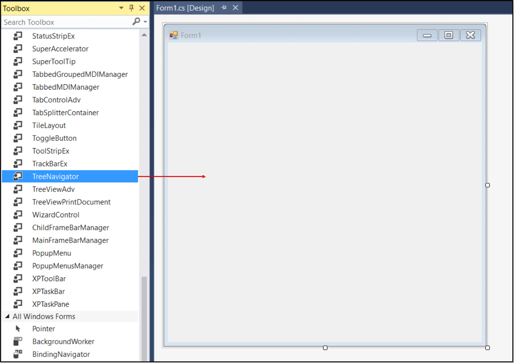
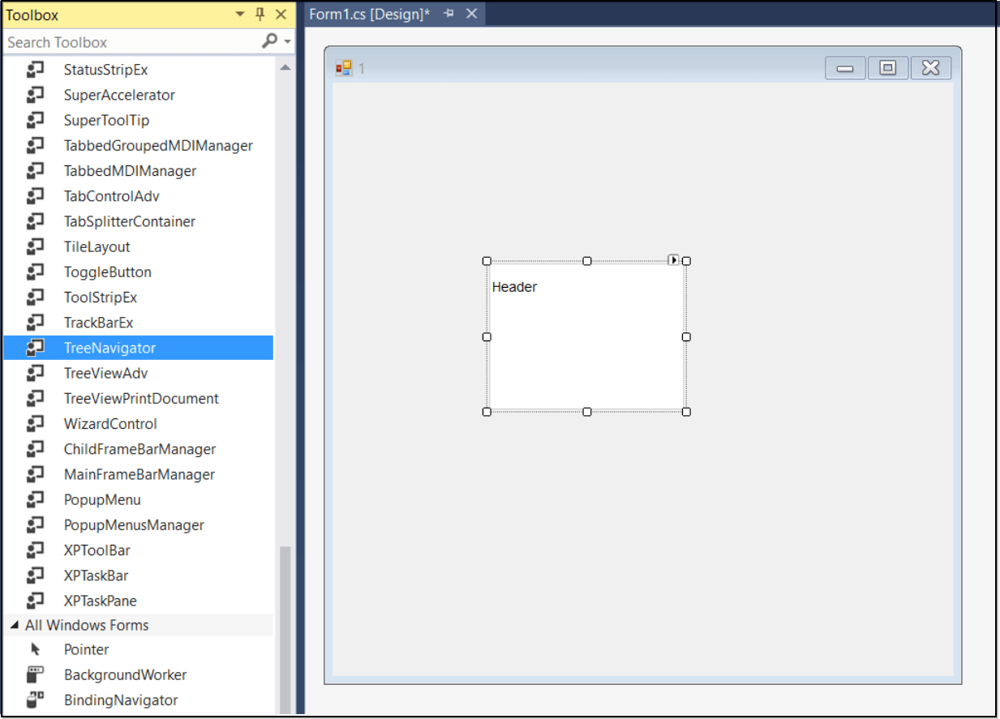
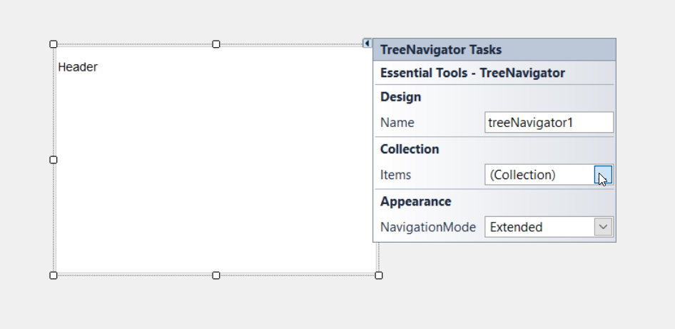
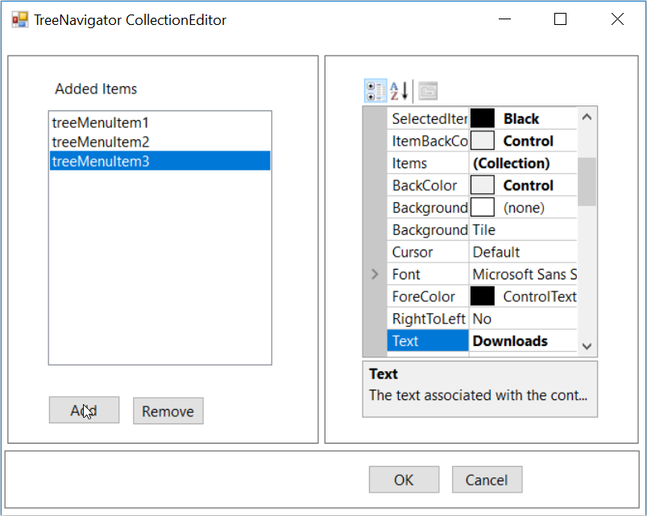

# Getting Started with Windows Forms Tree Navigator

This section explains how to get started with the WinForms Tree Navigator control and create a navigable, expandable tree interface.

## Assembly Deployment

Refer to the [Control Dependencies](https://help.syncfusion.com/windowsforms/control-dependencies#treenavigator) section for the list of assemblies and NuGet packages required to use the `TreeNavigator` control.

Refer to [NuGet Packages](https://help.syncfusion.com/windowsforms/installation/install-nuget-packages) to learn how to install NuGet packages in a Windows Forms application.

To install the required NuGet package using the NuGet Package Manager Console, run the following command:

```powershell
Install-Package Syncfusion.Tools.Windows
```

## Adding Tree Navigator via Designer

1. Open the **Toolbox** in Visual Studio, locate the **Syncfusion** category, and drag the `TreeNavigator` control onto the Windows Form designer.
   
    

2. The following dependent assemblies are added automatically when the control is dragged onto the form:

   * Syncfusion.Tools.Windows
   * Syncfusion.Shared.Base

    

## Adding Tree Navigator via Code

To add the Tree Navigator control programmatically, follow these steps:

1. Add the following required assembly references to the project:

    * Syncfusion.Tools.Windows
    * Syncfusion.Shared.Base

2. Include the required namespace (`Syncfusion.Windows.Forms.Tools`), create an instance of the `TreeNavigator` control, initialize it, and add it to the form.





using System.Drawing;
using System.Windows.Forms;
using Syncfusion.Windows.Forms.Tools;

namespace TreeNavigatorDemo
{
    public partial class Form1 : Form
    {
        private TreeNavigator treeNavigator;

        public Form1()
        {
            InitializeComponent();

            treeNavigator = new TreeNavigator();
            treeNavigator.Location = new Point(20, 20);
            treeNavigator.Size = new Size(200, 300);
            this.Controls.Add(treeNavigator);
        }
    }
}




Imports System.Drawing
Imports System.Windows.Forms
Imports Syncfusion.Windows.Forms.Tools

Public Class Form1
    Inherits Form

    Private treeNavigator As TreeNavigator

    Public Sub New()
        InitializeComponent()

        treeNavigator = New TreeNavigator()
        treeNavigator.Location = New Point(20, 20)
        treeNavigator.Size = New Size(200, 300)
        Me.Controls.Add(treeNavigator)
    End Sub
End Class




{{ codesnippet1 | OrderList_Indent_Level_1 }}

## Adding TreeMenuItem to the Control

The Tree Navigator control is populated with a collection of `TreeMenuItem` objects through the `Items` property. Items can be added in the following ways:

* Adding items through the designer
* Adding items through code

### Adding Items through the Designer

1. After dragging the `TreeNavigator` control onto the form, click the **Smart Tag** button in the upper-right corner of the control.

   

2. Select the **Items** property to open the collection editor, and then add the required items.

   

3. The `TreeMenuItem` objects are added to the `TreeNavigator` control.

   

### Adding Items through Code

The following code example demonstrates how to add `TreeMenuItem` objects to the Tree Navigator control.





// Adds items to the TreeNavigator.
this.treeNavigator.Header.HeaderText = "This PC";

TreeMenuItem treemenuitem1 = new TreeMenuItem();
this.treeNavigator.Items.Add(treemenuitem1);
treemenuitem1.Text = "Desktop";

TreeMenuItem treemenuitem2 = new TreeMenuItem();
this.treeNavigator.Items.Add(treemenuitem2);
treemenuitem2.Text = "Documents";

TreeMenuItem treemenuitem3 = new TreeMenuItem();
this.treeNavigator.Items.Add(treemenuitem3);
treemenuitem3.Text = "Downloads";




' Adds items to the TreeNavigator.
Me.treeNavigator.Header.HeaderText = "This PC"

Dim treemenuitem1 As TreeMenuItem = New TreeMenuItem()
Me.treeNavigator.Items.Add(treemenuitem1)
treemenuitem1.Text = "Desktop"

Dim treemenuitem2 As TreeMenuItem = New TreeMenuItem()
Me.treeNavigator.Items.Add(treemenuitem2)
treemenuitem2.Text = "Documents"

Dim treemenuitem3 As TreeMenuItem = New TreeMenuItem()
Me.treeNavigator.Items.Add(treemenuitem3)
treemenuitem3.Text = "Downloads"




{{ codesnippet2 | OrderList_Indent_Level_1 }}

N> In .NET Core, when adding child items to a TreeMenuItem directly from the Visual Studio Properties window, the default Collection Editor opens instead of the expected editor.
Workaround: Use the main Tree Navigator Collection Editor to add items, then configure the child items as needed. A permanent fix is in progress.
