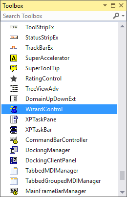
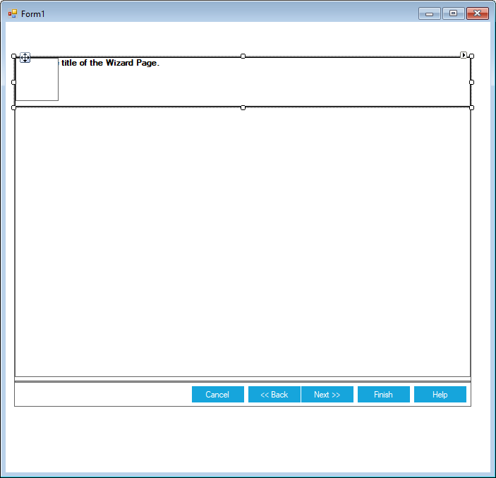
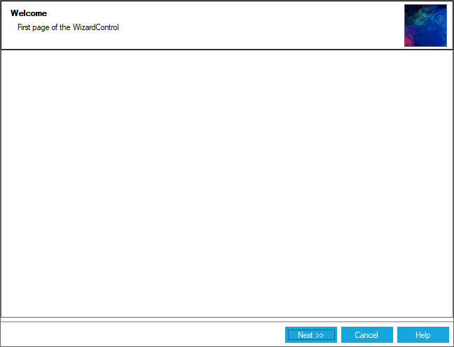
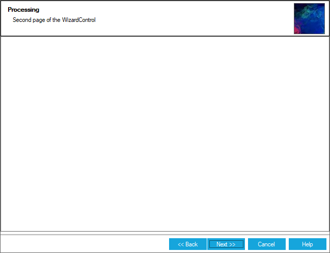
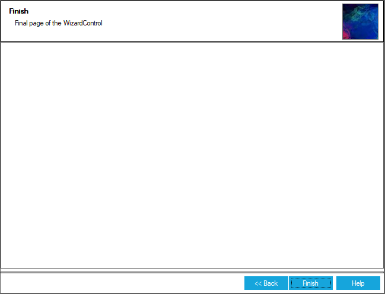
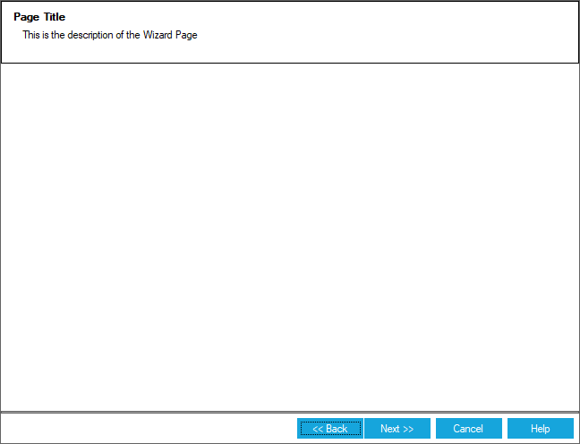
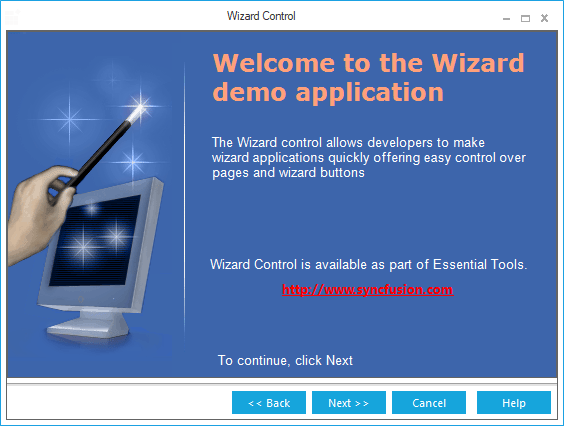

# Getting Started with Windows Forms Wizard Control

This section explains how to get started with the Windows Forms [WizardControl](https://help.syncfusion.com/cr/windowsforms/Syncfusion.Windows.Forms.Tools.WizardControl.html) and its basic features.

## Assembly Deployment

Refer to the [Control Dependencies](https://help.syncfusion.com/windowsforms/control-dependencies#wizardcontrol) section for the list of assemblies and NuGet packages required to use the `WizardControl`.

Refer to [NuGet Packages](https://help.syncfusion.com/windowsforms/installation/install-nuget-packages) to learn how to install NuGet packages in a Windows Forms application.

To install the required NuGet package using the NuGet Package Manager Console, run the following command:

```powershell
Install-Package Syncfusion.Tools.Windows
```

## Adding WizardControl via Designer

The [WizardControl](https://help.syncfusion.com/cr/windowsforms/Syncfusion.Windows.Forms.Tools.WizardControl.html) can be added to a form by dragging it from the _Toolbox_ under the _Syncfusion_ category and dropping it onto the Windows Form designer. The following required assembly references are added automatically:

* Syncfusion.Grid.Base.dll
* Syncfusion.Grid.Windows.dll
* Syncfusion.Shared.Base.dll
* Syncfusion.Shared.Windows.dll
* Syncfusion.Tools.Base.dll
* Syncfusion.Tools.Windows.dll

After adding the control to the form, set the `Dock` property to `Fill` (`DockStyle.Fill`) so that the control occupies the entire form.





> **Note:** In .NET Core and .NET 5+, the **Collection Editor** for the `WizardPages` property may display the title **ControlProxy`1 Collection Editor** instead of **WizardControlPage Collection Editor**. This is a known issue in the .NET Windows Forms Designer and does not affect functionality. For more information, see GitHub issue [dotnet/winforms#14049](https://github.com/dotnet/winforms/issues/14049).

## Adding WizardControl via Code

To add the `WizardControl` programmatically, follow these steps:

1. Add the following required assembly references to the project (this step is required only when adding references manually and is not required when using the `Syncfusion.Tools.Windows` NuGet package):

* Syncfusion.Grid.Base.dll
* Syncfusion.Grid.Windows.dll
* Syncfusion.Shared.Base.dll
* Syncfusion.Shared.Windows.dll
* Syncfusion.Tools.Base.dll
* Syncfusion.Tools.Windows.dll

2. Include the `Syncfusion.Windows.Forms.Tools` namespace. Also include the `Syncfusion.Windows.Forms` namespace, which contains the `Theme` enumeration used to set the control style (for example, `Theme.Metro` and `Theme.Office2016Colorful`).





using Syncfusion.Windows.Forms.Tools;
using Syncfusion.Windows.Forms;




Imports Syncfusion.Windows.Forms.Tools
Imports Syncfusion.Windows.Forms




{{ codesnippet1 | OrderList_Indent_Level_1 }}

3. Create a [WizardControl](https://help.syncfusion.com/cr/windowsforms/Syncfusion.Windows.Forms.Tools.WizardControl.html) instance and add it to the form. Place the following code in the `Form1` constructor or the `Form1_Load` event handler.

Declare the `wizardControl1` field at the class level of `Form1`:


public partial class Form1 : Form
{
    private WizardControl wizardControl1;
    public Form1()
    {
        InitializeComponent();
    }
}



Public Partial Class Form1
    Inherits Form
    Private wizardControl1 As WizardControl
    Public Sub New()
        InitializeComponent()
    End Sub
End Class


Then, create an instance of the control and add it to the form:





this.wizardControl1 = new WizardControl();
this.wizardControl1.Style = Theme.Metro;
this.wizardControl1.Dock = DockStyle.Fill;
this.Controls.Add(this.wizardControl1);




Me.wizardControl1 = New WizardControl()
Me.wizardControl1.Style = Theme.Metro
Me.wizardControl1.Dock = DockStyle.Fill
Me.Controls.Add(Me.wizardControl1)




{{ codesnippet2 | OrderList_Indent_Level_1 }}

### Adding Wizard Pages

[WizardControlPages](https://help.syncfusion.com/cr/windowsforms/Syncfusion.Windows.Forms.Tools.WizardControlPage.html) instances can be added to the [WizardPages](https://help.syncfusion.com/cr/windowsforms/Syncfusion.Windows.Forms.Tools.WizardControl.html#Syncfusion_Windows_Forms_Tools_WizardControl_WizardPages) collection of the `WizardControl`. Although the [WizardPageContainer](https://help.syncfusion.com/cr/windowsforms/Syncfusion.Windows.Forms.Tools.WizardControl.html#Syncfusion_Windows_Forms_Tools_WizardControl_WizardPageContainer) / [WizardContainer](https://help.syncfusion.com/cr/windowsforms/Syncfusion.Windows.Forms.Tools.WizardContainer.html) model is used internally by the control, it is not required for typical usage scenarios.

To avoid a `System.NullReferenceException` during the wizard's reinitialization process, configure the wizard properties and assign the `WizardPages` collection in the `Form1` constructor after the `InitializeComponent()` call.




// Create instance of page elements
WizardControlPage wizardControlPage1 = new WizardControlPage();
WizardControlPage wizardControlPage2 = new WizardControlPage();
WizardControlPage wizardControlPage3 = new WizardControlPage();

// configure pages
this.wizardControlPage1.Title = "Welcome";
this.wizardControlPage1.Description = "First page of the WizardControl";
this.wizardControlPage1.BackVisible = false;

this.wizardControlPage2.Title = "Processing";
this.wizardControlPage2.Description = "Second page of the WizardControl";

this.wizardControlPage3.Title = "Finished";
this.wizardControlPage3.Description = "Final page of the WizardControl";
this.wizardControlPage3.NextVisible = false;
this.wizardControlPage3.CancelVisible = false;
this.wizardControlPage3.FinishVisible = true;

this.pictureBox1.Image = ((System.Drawing.Image)(resources.GetObject("pictureBox1.Image")));
this.wizardControl1.Banner = this.pictureBox1;

// Add pages into the WizardControl
 this.wizardControl1.WizardPages = new Syncfusion.Windows.Forms.Tools.WizardControlPage[] {
        this.wizardControlPage1,
        this.wizardControlPage2,
        this.wizardControlPage3};




' Create instance of page elements

Dim wizardControlPage1 As New WizardControlPage()
Dim wizardControlPage2 As New WizardControlPage()
Dim wizardControlPage3 As New WizardControlPage()

' configure pages
Me.wizardControlPage1.Title = "Welcome"
Me.wizardControlPage1.Description = "First page of the WizardControl"
Me.wizardControlPage1.BackVisible = False

Me.wizardControlPage2.Title = "Processing"
Me.wizardControlPage2.Description = "Second page of the WizardControl"

Me.wizardControlPage3.Title = "Finish"
Me.wizardControlPage3.Description = "Final page of the WizardControl"
Me.wizardControlPage3.NextVisible = False
Me.wizardControlPage3.CancelVisible = False
Me.wizardControlPage3.FinishVisible = True

Me.pictureBox1.Image = (CType(resources.GetObject("pictureBox1.Image"), System.Drawing.Image))
Me.wizardControl1.Banner = Me.pictureBox1

' Add pages into the WizardControl
 Me.wizardControl1.WizardPages = New Syncfusion.Windows.Forms.Tools.WizardControlPage() { Me.wizardControlPage1, Me.wizardControlPage2, Me.wizardControlPage3}










### Configure the BannerPanel

Use the [BannerPanel](https://help.syncfusion.com/cr/windowsforms/Syncfusion.Windows.Forms.Tools.WizardControl.html#Syncfusion_Windows_Forms_Tools_WizardControl_BannerPanel) property to configure the header area of the `WizardControl` by assigning a [GradientPanel](https://help.syncfusion.com/cr/windowsforms/Syncfusion.Windows.Forms.Tools.GradientPanel.html) that contains the required title and description labels.

When a panel is assigned to the `BannerPanel` property, it is automatically re-parented to the `WizardControl`. Therefore, you do not need to add it separately to the `WizardControl.Controls` collection.

The `Title` and `Description` properties accept `Label` references. If the specified labels are not children of the `BannerPanel`, they are automatically re-parented to the assigned panel.




// Create instance of controls to be added

GradientPanel gradientPanel1 = new GradientPanel();
Label label1 = new Label();
Label label2 = new Label();

this.label1.Text = "Page Title";
this.label2.Text = "This is the description of the Wizard Page";

this.gradientPanel1.Controls.Add(this.label1);
this.gradientPanel1.Controls.Add(this.label2);

// Adding it to WizardControl

this.wizardControl1.Controls.Add(this.gradientPanel1);

this.wizardControl1.Title = this.label1;
this.wizardControl1.Description = this.label2;
this.wizardControl1.BannerPanel = this.gradientPanel1;





' Create instance of controls to be added

Dim gradientPanel1 As New GradientPanel()
Dim label1 As New Label()
Dim label2 As New Label()

Me.label1.Text = "Page Title"
Me.label2.Text = "This is the description of the Wizard Page"

Me.gradientPanel1.Controls.Add(Me.label1)
Me.gradientPanel1.Controls.Add(Me.label2)
 
' Adding it to WizardControl

Me.wizardControl1.Controls.Add(Me.gradientPanel1)

Me.wizardControl1.Title = Me.label1
Me.wizardControl1.Description = Me.label2
Me.wizardControl1.BannerPanel = Me.gradientPanel1







For more information about banner customization, see [Banner Settings](Banner-Settings.md). For page-specific title and description settings, see [Wizard Page Settings](Wizard-Page-Settings.md). For modern theming using the `ThemeName` and `ThemeStyle` properties, see [Appearance](Wizard-Control-Appearance.md). For event-related customization, see [Event Handling](Event-Handling.md).

## Change Navigation Button Visibility

You can control the visibility of the Back, Cancel, Next, Help, and Finish navigation buttons for each [WizardControlPage](https://help.syncfusion.com/cr/windowsforms/Syncfusion.Windows.Forms.Tools.WizardControlPage.html) by using the [BackVisible](https://help.syncfusion.com/cr/windowsforms/Syncfusion.Windows.Forms.Tools.WizardControlPage.html#Syncfusion_Windows_Forms_Tools_WizardControlPage_BackVisible), [CancelVisible](https://help.syncfusion.com/cr/windowsforms/Syncfusion.Windows.Forms.Tools.WizardControlPage.html#Syncfusion_Windows_Forms_Tools_WizardControlPage_CancelVisible), [NextVisible](https://help.syncfusion.com/cr/windowsforms/Syncfusion.Windows.Forms.Tools.WizardControlPage.html#Syncfusion_Windows_Forms_Tools_WizardControlPage_NextVisible), [HelpVisible](https://help.syncfusion.com/cr/windowsforms/Syncfusion.Windows.Forms.Tools.WizardControlPage.html#Syncfusion_Windows_Forms_Tools_WizardControlPage_HelpVisible), and [FinishVisible](https://help.syncfusion.com/cr/windowsforms/Syncfusion.Windows.Forms.Tools.WizardControlPage.html#Syncfusion_Windows_Forms_Tools_WizardControlPage_FinishVisible) properties.




this.wizardControlPage1.BackVisible = true;
this.wizardControlPage1.NextVisible = true;
this.wizardControlPage1.CancelVisible = true;
this.wizardControlPage1.HelpVisible = true;
this.wizardControlPage1.FinishVisible = false;




Me.wizardControlPage1.BackVisible = True
Me.wizardControlPage1.NextVisible = True
Me.wizardControlPage1.CancelVisible = True
Me.wizardControlPage1.HelpVisible = True
Me.wizardControlPage1.FinishVisible = False





