# Chart Appearance in Windows Forms Chart

The Windows Forms Chart allows you to customize the colors, images, palettes, borders, margins, titles, watermarks, grids, and skins used to render the chart.

## Background colors

The Windows Forms Chart allows you to customize the background colors of different regions in the chart.

### Outside the chart area

The [BackInterior](https://help.syncfusion.com/cr/windowsforms/Syncfusion.Windows.Forms.Chart.ChartControl.html#Syncfusion_Windows_Forms_Chart_ChartControl_BackInterior) property is used to customize the background of the chart outside the chart area. By default, the background color is `Color.White`.

The following code example customizes the background outside the chart area.




chartControl.BackInterior = new Syncfusion.Drawing.BrushInfo(System.Drawing.Color.LightBlue);




chartControl.BackInterior = New Syncfusion.Drawing.BrushInfo(System.Drawing.Color.LightBlue)




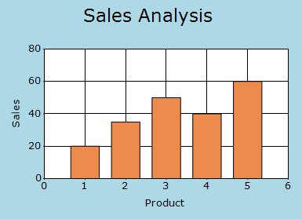

### Inside the plot area

The [BackInterior](https://help.syncfusion.com/cr/windowsforms/Syncfusion.Windows.Forms.Chart.ChartArea.html#Syncfusion_Windows_Forms_Chart_ChartArea_BackInterior) is used to customize the background of the rectangular plot area where the chart points are displayed. By default, the background color is `Color.White`.

The following code example customizes the background of the plot area.




chartControl.ChartArea.BackInterior = new Syncfusion.Drawing.BrushInfo(System.Drawing.Color.Honeydew);




chartControl.ChartArea.BackInterior = New Syncfusion.Drawing.BrushInfo(System.Drawing.Color.Honeydew)




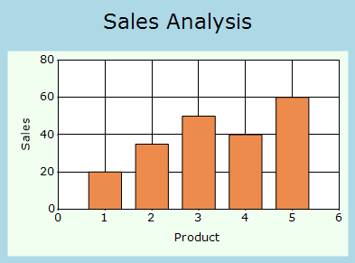

### Inside the chart area

The [ChartInterior](https://help.syncfusion.com/cr/windowsforms/Syncfusion.Windows.Forms.Chart.ChartControl.html#Syncfusion_Windows_Forms_Chart_ChartControl_ChartInterior) property specifies the interior color of the chart area.




chartControl.ChartInterior = new Syncfusion.Drawing.BrushInfo( Syncfusion.Drawing.GradientStyle.Horizontal, System.Drawing.Color.Khaki, System.Drawing.Color.LightYellow);




chartControl.ChartInterior = New Syncfusion.Drawing.BrushInfo(Syncfusion.Drawing.GradientStyle.Horizontal, System.Drawing.Color.Khaki, System.Drawing.Color.LightYellow)




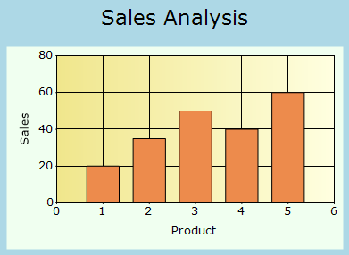

## Background image

The chart supports background images for the chart control and chart area.

### Chart background image

The [BackgroundImage](https://help.syncfusion.com/cr/windowsforms/Syncfusion.Windows.Forms.Chart.ChartControl.html#Syncfusion_Windows_Forms_Chart_ChartControl_BackgroundImage) property displays an image in the background of the chart control. The [BackgroundImageLayout](https://learn.microsoft.com/en-us/dotnet/api/system.windows.forms.control.backgroundimagelayout?view=windowsdesktop-10.0#system-windows-forms-control-backgroundimagelayout) property specifies how the image is arranged. The supported values are [None](https://learn.microsoft.com/en-us/dotnet/api/system.windows.forms.imagelayout?view=windowsdesktop-10.0#system-windows-forms-imagelayout-none), [Tile](https://learn.microsoft.com/en-us/dotnet/api/system.windows.forms.imagelayout?view=windowsdesktop-10.0#system-windows-forms-imagelayout-tile), [Center](https://learn.microsoft.com/en-us/dotnet/api/system.windows.forms.imagelayout?view=windowsdesktop-10.0#system-windows-forms-imagelayout-center), [Stretch](https://learn.microsoft.com/en-us/dotnet/api/system.windows.forms.imagelayout?view=windowsdesktop-10.0#system-windows-forms-imagelayout-stretch), and [Zoom](https://learn.microsoft.com/en-us/dotnet/api/system.windows.forms.imagelayout?view=windowsdesktop-10.0#system-windows-forms-imagelayout-zoom).




// Example for image location Image.FromFile(@"Location/image");
chartControl.BackgroundImage = System.Drawing.Image.FromFile("image.jpg");
chartControl.BackgroundImageLayout = System.Windows.Forms.ImageLayout.Stretch;




' Example for image location Image.FromFile("Location/image")
chartcontrol.BackgroundImage = System.Drawing.Image.FromFile("image.jpg")
chartcontrol.BackgroundImageLayout = System.Windows.Forms.ImageLayout.Stretch




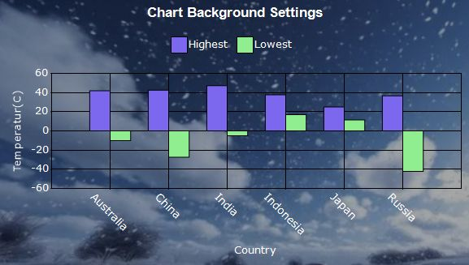

### Chart area background image

The [ChartAreaBackImage](https://help.syncfusion.com/cr/windowsforms/Syncfusion.Windows.Forms.Chart.ChartControl.html#Syncfusion_Windows_Forms_Chart_ChartControl_ChartAreaBackImage) property displays an image in the chart area. By default, the value is `null`.




// Example for image location Image.FromFile(@"Location/image");
chartControl.ChartAreaBackImage = System.Drawing.Image.FromFile("image.jpg");




' Example for image location Image.FromFile("Location/image")
chartcontrol.ChartAreaBackImage = System.Drawing.Image.FromFile("image.jpg")




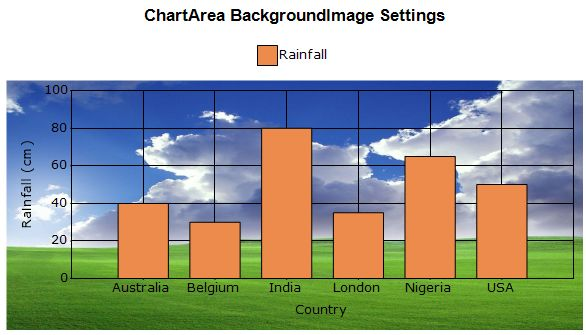

### Chart interior background image

Use [ChartInteriorBackImage](https://help.syncfusion.com/cr/windowsforms/Syncfusion.Windows.Forms.Chart.ChartControl.html#Syncfusion_Windows_Forms_Chart_ChartControl_ChartInteriorBackImage) property displays a custom background image for the chart interior. By default, this property is set to `null`.




// Example for image location Image.FromFile(@"Location/image");
chartControl.ChartInteriorBackImage = System.Drawing.Image.FromFile("image.jpg");




' Example for image location Image.FromFile("Location/image")
chartcontrol.ChartInteriorBackImage = System.Drawing.Image.FromFile("image.jpg")




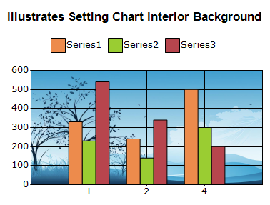

## Palettes

The [Palette](https://help.syncfusion.com/cr/windowsforms/Syncfusion.Windows.Forms.Chart.ChartControl.html#Syncfusion_Windows_Forms_Chart_ChartControl_Palette) property provides options to apply different color palettes to the chart. You can apply a palette to the entire chart or customize it for individual series.

The Windows Forms Chart provides the following predefined palettes:

- Almond
- Default
- DefaultAlpha
- DefaultOld
- DefaultOldAlpha
- EarthTone
- Analog
- Colorful
- Nature
- Pastel
- Triad
- WarmCold
- GrayScale
- SkyBlueStyle
- RedYellowStyle
- GreenYellowStyle
- PinkVioletStyle
- Metro
- Office2016
- Custom

### Applying palette to series

Each palette applies a predefined set of colors to the chart series in a predefined order.

The following code example applies the [Metro](https://help.syncfusion.com/cr/windowsforms/Syncfusion.Windows.Forms.Chart.ChartColorPalette.html#Syncfusion_Windows_Forms_Chart_ChartColorPalette_Metro) palette to the chart.




chartControl.Palette = ChartColorPalette.Metro;




chartControl.Palette = ChartColorPalette.Metro




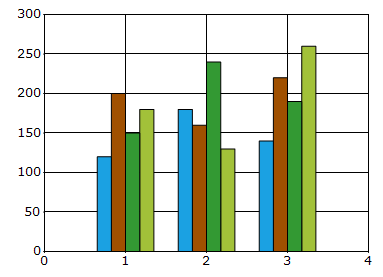

### Applying custom color to segment

You can set the individual color for each segment of the series by using the [Interior](https://help.syncfusion.com/cr/windowsforms/Syncfusion.Windows.Forms.Chart.ChartStyleInfo.html#Syncfusion_Windows_Forms_Chart_ChartStyleInfo_Interior) property of series styles collection.

The following code example shows you how to set the custom color for the chart series.





public class SalesData
{
    private string year;
    private double sales;
    private Color segmentColor;

    public string Year
    {
        get { return year; }
        set { year = value; }
    }

    public double Sales
    {
        get { return sales; }
        set { sales = value; }
    }

    public Color SegmentColor
    {
        get { return segmentColor; }
        set { segmentColor = value; }
    }

    public SalesData(string year, double sales, Color color)
    {
        this.year = year;
        this.sales = sales;
        this.segmentColor = color;
    }
}
	



Public Class SalesData

    Private m_year As String
    Private m_sales As Double
    Private m_segmentColor As Color

    Public Property Year() As String
        Get
            Return m_year
        End Get
        Set(ByVal value As String)
            m_year = value
        End Set
    End Property

    Public Property Sales() As Double
        Get
            Return m_sales
        End Get
        Set(ByVal value As Double)
            m_sales = value
        End Set
    End Property

    Public Property SegmentColor() As Color
        Get
            Return m_segmentColor
        End Get
        Set(ByVal value As Color)
            m_segmentColor = value
        End Set
    End Property

    Public Sub New(ByVal year As String, ByVal sales As Double, ByVal color As Color)
        Me.m_year = year
        Me.m_sales = sales
        Me.m_segmentColor = color
    End Sub

End Class



	
BindingList<SalesData> dataSource = new BindingList<SalesData>();
dataSource.Add(new SalesData("1999", 23, Color.Navy));
dataSource.Add(new SalesData("2000", 17, Color.Yellow));
dataSource.Add(new SalesData("2001", 22, Color.Cyan));
dataSource.Add(new SalesData("2002", 18, Color.Brown));
dataSource.Add(new SalesData("2003", 22, Color.LimeGreen));
dataSource.Add(new SalesData("2004", 30, Color.Orange));

CategoryAxisDataBindModel dataSeriesModel = new CategoryAxisDataBindModel(dataSource);
dataSeriesModel.CategoryName = "Year";
dataSeriesModel.YNames = new string[] { "Sales" };
chartControl.PrimaryXAxis.ValueType = ChartValueType.Category;

ChartSeries chartSeries = new ChartSeries("Sales");
chartSeries.CategoryModel = dataSeriesModel;

for (int i = 0; i < dataSource.Count; i++)
{
    chartSeries.Styles[i].Interior = new BrushInfo((dataSource[i] as SalesData).SegmentColor);
}

chartControl.Series.Add(chartSeries);




Dim dataSource As New BindingList(Of SalesData)()
dataSource.Add(New SalesData("1999", 23, Color.Navy))
dataSource.Add(New SalesData("2000", 17, Color.Yellow))
dataSource.Add(New SalesData("2001", 22, Color.Cyan))
dataSource.Add(New SalesData("2002", 18, Color.Brown))
dataSource.Add(SalesData("2003", 22, Color.LimeGreen))
dataSource.Add(New SalesData("2004", 30, Color.Orange))

Dim dataSeriesModel As New CategoryAxisDataBindModel(dataSource)
dataSeriesModel.CategoryName = "Year"
dataSeriesModel.YNames = New String() {"Sales"}
chartControl.PrimaryXAxis.ValueType = ChartValueType.Category

Dim chartSeries As New ChartSeries("Sales")
chartSeries.CategoryModel = dataSeriesModel

For i As Integer = 0 To dataSource.Count - 1
    chartSeries.Styles(i).Interior = New BrushInfo(dataSource(i).SegmentColor)
Next
chartControl.Series.Add(chartSeries)




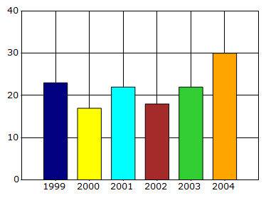

### Getting chart palette colors

Use the [GetColor](https://help.syncfusion.com/cr/windowsforms/Syncfusion.Windows.Forms.Chart.ChartColorModel.html#Syncfusion_Windows_Forms_Chart_ChartColorModel_GetColor_System_Int32_) method of [ChartColorModel](https://help.syncfusion.com/cr/windowsforms/Syncfusion.Windows.Forms.Chart.ChartColorModel.html) can be used to acquire a list of colors for the palette in the chart control.

The following code example demonstrates how to obtain the chart palette color list.



chartControl = new ChartControl();

...

int numberOfPaletteColors = chartControl.Palette == ChartColorPalette.Metro ? ChartColorModel.NumColorsInMetroPalette : ChartColorModel.NumColorsInPalette;

List<Color> paletteColors = new List<Color>();
for (int i = 0; i < numberOfPaletteColors; i++)
{
    paletteColors.Add(chartControl.Model.ColorModel.GetColor(i));
}




## Custom Palette

The [CustomPalette](https://help.syncfusion.com/cr/windowsforms/Syncfusion.Windows.Forms.Chart.ChartControl.html#Syncfusion_Windows_Forms_Chart_ChartControl_CustomPalette) property is used to define a custom color palette for the chart. You can specify your own colors and their display order instead of using a predefined palette.

The following code example applies a custom palette to the chart.




chartControl.Palette = ChartColorPalette.Custom;
chartControl.CustomPalette = new Color[] { Color.LightGreen, Color.LightBlue, Color.Aqua, Color.YellowGreen };




chartControl.Palette = ChartColorPalette.Custom
chartControl.CustomPalette = New Color() {Color.LightGreen, Color.LightBlue, Color.Aqua, Color.YellowGreen}




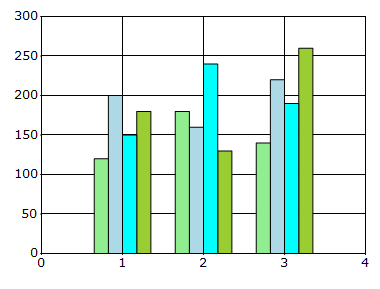

## Border and margins

The chart provides properties for customizing the chart-area border, shadow, chart-area margins, plot-area margins, and spacing between elements. 

### Chart area border

The following properties customize the chart-area border:
- [BorderColor](https://help.syncfusion.com/cr/windowsforms/Syncfusion.Windows.Forms.Chart.ChartArea.html#Syncfusion_Windows_Forms_Chart_ChartArea_BorderColor): Specifies the color of the chart area border. The default value is `SystemColors.ControlText`.
- [BorderStyle](https://help.syncfusion.com/cr/windowsforms/Syncfusion.Windows.Forms.Chart.ChartArea.html#Syncfusion_Windows_Forms_Chart_ChartArea_BorderStyle): Specifies the style of the chart area border. The default value is `BorderStyle.None`. The supported values are:
    - `None`: Does not display a border.
    - `FixedSingle`: Displays a single-line border.
    - `Fixed3D`: Displays a three-dimensional border.
- [BorderWidth](https://help.syncfusion.com/cr/windowsforms/Syncfusion.Windows.Forms.Chart.ChartArea.html#Syncfusion_Windows_Forms_Chart_ChartArea_BorderWidth): Specifies the width of the chart area border. The default value is `1`.

**BorderAppearance**

The chart control border can be customized using the following properties:

- [BaseColor](https://help.syncfusion.com/cr/windowsforms/Syncfusion.Windows.Forms.Chart.ChartBorderInfo.html#Syncfusion_Windows_Forms_Chart_ChartBorderInfo_BaseColor): Specifies the base color of the chart border. By default, it uses the border's default rendering color.
- [SkinStyle](https://help.syncfusion.com/cr/windowsforms/Syncfusion.Windows.Forms.Chart.ChartBorderInfo.html#Syncfusion_Windows_Forms_Chart_ChartBorderInfo_SkinStyle): Specifies the border skin style. The default value is [None](https://help.syncfusion.com/cr/windowsforms/Syncfusion.Windows.Forms.Chart.ChartBorderSkinStyle.html#Syncfusion_Windows_Forms_Chart_ChartBorderSkinStyle_None).
The supported values are:
    - Bevel
    - Embed
    - Emboss
    - Etched
    - Frame
    - Gel
    - None
    - Open
    - Pinned
    - Projector
    - Raised
    - RoundedDiagonal
    - Slice
    - Sunken
- [FrameThickness](https://help.syncfusion.com/cr/windowsforms/Syncfusion.Windows.Forms.Chart.ChartBorderInfo.html#Syncfusion_Windows_Forms_Chart_ChartBorderInfo_FrameThickness): Specifies the thickness of the chart border frame. This property is applicable only when [SkinStyle](https://help.syncfusion.com/cr/windowsforms/Syncfusion.Windows.Forms.Chart.ChartBorderInfo.html#Syncfusion_Windows_Forms_Chart_ChartBorderInfo_SkinStyle) is set to [Frame](https://help.syncfusion.com/cr/windowsforms/Syncfusion.Windows.Forms.Chart.ChartBorderSkinStyle.html#Syncfusion_Windows_Forms_Chart_ChartBorderSkinStyle_Frame). By default, the framework defined thickness is used.
- [Interior](https://help.syncfusion.com/cr/windowsforms/Syncfusion.Windows.Forms.Chart.ChartBorderInfo.html#Syncfusion_Windows_Forms_Chart_ChartBorderInfo_Interior): Specifies the interior color of the chart border. This property is applicable only when [SkinStyle](https://help.syncfusion.com/cr/windowsforms/Syncfusion.Windows.Forms.Chart.ChartBorderInfo.html#Syncfusion_Windows_Forms_Chart_ChartBorderInfo_SkinStyle) is set to [Sunken](https://help.syncfusion.com/cr/windowsforms/Syncfusion.Windows.Forms.Chart.ChartBorderSkinStyle.html#Syncfusion_Windows_Forms_Chart_ChartBorderSkinStyle_Sunken), [Etched](https://help.syncfusion.com/cr/windowsforms/Syncfusion.Windows.Forms.Chart.ChartBorderSkinStyle.html#Syncfusion_Windows_Forms_Chart_ChartBorderSkinStyle_Etched), or [Raised](https://help.syncfusion.com/cr/windowsforms/Syncfusion.Windows.Forms.Chart.ChartBorderSkinStyle.html#Syncfusion_Windows_Forms_Chart_ChartBorderSkinStyle_Raised). By default, no custom interior brush is applied.

The following code example customizes the chart-area border and the overall chart border appearance.




chartControl.ChartArea.BorderColor = System.Drawing.Color.Goldenrod;
chartControl.ChartArea.BorderStyle = System.Windows.Forms.BorderStyle.FixedSingle;
chartControl.ChartArea.BorderWidth = 2;
chartControl.BorderAppearance.BaseColor = System.Drawing.Color.DarkGray;
//This property setting will be effective, when SkinStyle is 'Frame'.
chartControl.BorderAppearance.FrameThickness = new Syncfusion.Windows.Forms.Chart.ChartThickness(15F, 30F, 15F, 18F);
//This interior property settings will be effective when SkinStyle is Sunken, Etched and Raised.
chartControl.BorderAppearance.Interior.ForeColor = System.Drawing.Color.Maroon;
chartControl.BorderAppearance.SkinStyle = Syncfusion.Windows.Forms.Chart.ChartBorderSkinStyle.Raised;




chartControl.ChartArea.BorderColor = System.Drawing.Color.Goldenrod
chartControl.ChartArea.BorderStyle = System.Windows.Forms.BorderStyle.FixedSingle
chartControl.ChartArea.BorderWidth = 2
chartControl.BorderAppearance.BaseColor = System.Drawing.Color.DarkGray
'This property setting will be effective, when SkinStyle Is 'Frame'.
chartControl.BorderAppearance.FrameThickness = New Syncfusion.Windows.Forms.Chart.ChartThickness(15.0F, 30.0F, 15.0F, 18.0F)
'This interior property settings will be effective when SkinStyle Is Sunken, Etched And Raised
chartControl.BorderAppearance.Interior.ForeColor = System.Drawing.Color.Maroon
chartControl.BorderAppearance.SkinStyle = Syncfusion.Windows.Forms.Chart.ChartBorderSkinStyle.Raised




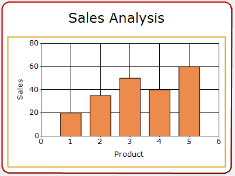

### Chart area shadow

The following properties customize the shadow displayed around the chart area:

- [ChartAreaShadow](https://help.syncfusion.com/cr/windowsforms/Syncfusion.Windows.Forms.Chart.ChartControl.html#Syncfusion_Windows_Forms_Chart_ChartControl_ChartAreaShadow): Controls whether a shadow is displayed around the chart area. The default value is `false`.
- [ShadowColor](https://help.syncfusion.com/cr/windowsforms/Syncfusion.Windows.Forms.Chart.ChartControl.html#Syncfusion_Windows_Forms_Chart_ChartControl_ShadowColor): Specifies the color or gradient used for the chart-area shadow. By default, it is set to a solid brush with the color `Color.FromArgb(155, 169, 169, 169)`.
- [ShadowWidth](https://help.syncfusion.com/cr/windowsforms/Syncfusion.Windows.Forms.Chart.ChartControl.html#Syncfusion_Windows_Forms_Chart_ChartControl_ShadowWidth): Specifies the width of the chart area shadow. The default value is `5`.

The following code example displays a shadow around the chart area and customizes its appearance.




chartControl.ChartAreaShadow = true;
chartControl.ShadowColor = new Syncfusion.Drawing.BrushInfo(Syncfusion.Drawing.GradientStyle.ForwardDiagonal, System.Drawing.Color.AntiqueWhite, System.Drawing.Color.Goldenrod);
chartControl.ShadowWidth = 7;




chartControl.ChartAreaShadow = True
chartControl.ShadowColor = New Syncfusion.Drawing.BrushInfo(Syncfusion.Drawing.GradientStyle.ForwardDiagonal, System.Drawing.Color.AntiqueWhite, System.Drawing.Color.Goldenrod)
chartControl.ShadowWidth = 7



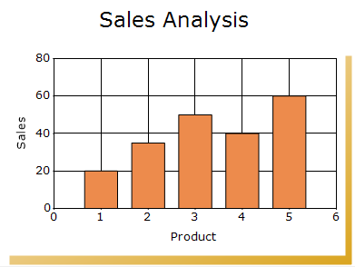

### Chart area margins

The [ChartAreaMargins](https://help.syncfusion.com/cr/windowsforms/Syncfusion.Windows.Forms.Chart.ChartControl.html#Syncfusion_Windows_Forms_Chart_ChartControl_ChartAreaMargins) property specifies the space between the chart area border and the chart plot area. By default, the margin is set to 10 pixels on all four sides.

The following code example applies a margin of `20` pixels to all sides of the chart area.




chartControl.ChartAreaMargins = new Syncfusion.Windows.Forms.Chart.ChartMargins(20, 20, 20, 20);




chartControl.ChartAreaMargins = New Syncfusion.Windows.Forms.Chart.ChartMargins(20, 20, 20, 20)




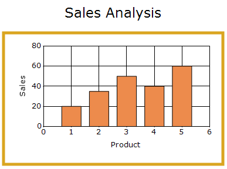

### Spacing between elements

The [ElementsSpacing](https://help.syncfusion.com/cr/windowsforms/Syncfusion.Windows.Forms.Chart.ChartControl.html#Syncfusion_Windows_Forms_Chart_ChartControl_ElementsSpacing) property specifies the spacing between chart elements. The default value is `20f`.

The following image shows the spacing between the chart border and the legend when the legend is positioned on the right side of the chart.




chartControl.ElementsSpacing = 30;




chartControl.ElementsSpacing = 30




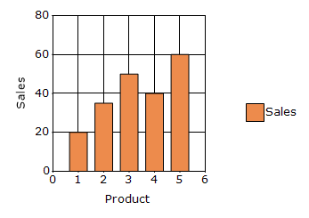

## Foreground settings

Foreground settings customize text and other foreground elements displayed by the chart.

### Chart title

The [ChartControl](https://help.syncfusion.com/cr/windowsforms/Syncfusion.Windows.Forms.Chart.ChartControl.html) provides properties for displaying and customizing the chart title.

The following properties are used to configure the title text, position, alignment, and appearance: 
- [Text](https://help.syncfusion.com/cr/windowsforms/Syncfusion.Windows.Forms.Chart.ChartControl.html#Syncfusion_Windows_Forms_Chart_ChartControl_Text): Specifies the chart title. By default, no title text is displayed.
- [TextPosition](https://help.syncfusion.com/cr/windowsforms/Syncfusion.Windows.Forms.Chart.ChartControl.html#Syncfusion_Windows_Forms_Chart_ChartControl_TextPosition): Specifies the position of the chart title. The supported values are:
    - [Top](https://help.syncfusion.com/cr/windowsforms/Syncfusion.Windows.Forms.Chart.ChartTextPosition.html#Syncfusion_Windows_Forms_Chart_ChartTextPosition_Top)
    - [Bottom](https://help.syncfusion.com/cr/windowsforms/Syncfusion.Windows.Forms.Chart.ChartTextPosition.html#Syncfusion_Windows_Forms_Chart_ChartTextPosition_Bottom)
    - [Left](https://help.syncfusion.com/cr/windowsforms/Syncfusion.Windows.Forms.Chart.ChartTextPosition.html#Syncfusion_Windows_Forms_Chart_ChartTextPosition_Left)
    - [Right](https://help.syncfusion.com/cr/windowsforms/Syncfusion.Windows.Forms.Chart.ChartTextPosition.html#Syncfusion_Windows_Forms_Chart_ChartTextPosition_Right)
- [TextAlignment](https://help.syncfusion.com/cr/windowsforms/Syncfusion.Windows.Forms.Chart.ChartControl.html#Syncfusion_Windows_Forms_Chart_ChartControl_TextAlignment): Specifies the alignment of the chart title relative to the chart borders. The supported values are:
    - `Near`
    - `Center`
    - `Far`
- [ForeColor](https://help.syncfusion.com/cr/windowsforms/Syncfusion.Windows.Forms.Chart.ChartControl.html#Syncfusion_Windows_Forms_Chart_ChartControl_ForeColor): Specifies the foreground color of the chart title.

The following code example customizes the chart title text, position, alignment, font, and foreground color.



chartControl.Text = "Illustrates Foreground Settings";
chartControl.ForeColor = System.Drawing.Color.DarkBlue;
chartControl.TextPosition = ChartTextPosition.Top;


chartControl.Text = "Illustrates Foreground Settings"
chartControl.ForeColor = System.Drawing.Color.DarkBlue
chartControl.TextPosition = ChartTextPosition.Top



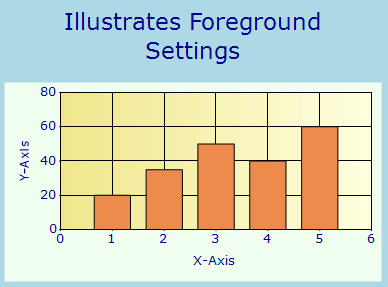

## Custom drawing

Custom drawing allows you to render custom graphics in the chart area when the built-in appearance features are not sufficient. Handle the [ChartAreaPaint](https://help.syncfusion.com/cr/windowsforms/Syncfusion.Windows.Forms.Chart.ChartControl.html#Syncfusion_Windows_Forms_Chart_ChartControl_ChartAreaPaint) event to perform custom drawing. This event is raised both during chart rendering and when the chart is exported to image formats, SVG, and other outputs. 

Use this event instead of the standard `Paint` event to ensure custom graphics are included in exported charts.

The following code demonstrates custom drawing in the chart using the ChartAreaPaint event.




chartControl.ChartAreaPaint += ChartControl_ChartAreaPaint;
private void ChartControl_ChartAreaPaint(object sender, PaintEventArgs e)
{
    // Get the right end of the X-axis.
    Point ptX = this.chartControl.ChartArea.GetPointByValue(new ChartPoint( chartControl.PrimaryXAxis.Range.Max, chartControl.PrimaryYAxis.Range.Min));

    // Draw arrow at the end of X-axis.
    PointF ptX1 = new PointF(ptX.X - 7, ptX.Y - 4);
    PointF ptX2 = new PointF(ptX.X, ptX.Y);
    PointF ptX3 = new PointF(ptX.X - 7, ptX.Y + 4);

    e.Graphics.FillPolygon(Brushes.Black, new PointF[] { ptX1, ptX2, ptX3 });

    // Get the top end of the Y-axis.
    Point ptY = chartControl.ChartArea.GetPointByValue(new ChartPoint(chartControl.PrimaryXAxis.Range.Min, chartControl.PrimaryYAxis.Range.Max));

    // Draw arrow at the top of Y-axis.
    PointF ptY1 = new PointF(ptY.X - 4, ptY.Y + 7);
    PointF ptY2 = new PointF(ptY.X, ptY.Y);
    PointF ptY3 = new PointF(ptY.X + 4, ptY.Y + 7);

    e.Graphics.FillPolygon(Brushes.Black, new PointF[] { ptY1, ptY2, ptY3 });

    // Draw diagonal line.
    e.Graphics.DrawLine(Pens.Gray, ptY.X, ptX.Y, ptX.X, ptY.Y);

    // Draw custom points.
    DrawPoint(e.Graphics, 500, 500, "Point1");
    DrawPoint(e.Graphics, 1000, 400, "Point2");
    DrawPoint(e.Graphics, 1800, 430, "Point3");
    DrawPoint(e.Graphics, 2500, 450, "Point4");
    DrawPoint(e.Graphics, 2200, 350, "Point5");
}

private void DrawPoint(Graphics graphics, double x, double y, string text)
{
    Point pt = chartControl.ChartArea.GetPointByValue(new ChartPoint(x, y));

    // Draw marker.
    Rectangle markerBounds = new Rectangle(pt.X - 4, pt.Y - 4, 8, 8);

    graphics.FillEllipse(Brushes.Peru, markerBounds);
    graphics.DrawEllipse(Pens.SaddleBrown, markerBounds);

    // Draw text below the marker.
    SizeF textSize = graphics.MeasureString(text, this.Font);

    graphics.DrawString(text, this.Font, Brushes.Black,  pt.X - (textSize.Width / 2), pt.Y + 8);
}





AddHandler chartControl.ChartAreaPaint, AddressOf ChartControl_ChartAreaPaint

Private Sub ChartControl_ChartAreaPaint(ByVal sender As Object, ByVal e As PaintEventArgs)

    ' Get the right end of the X-axis.
    Dim ptX As Point = chartControl.ChartArea.GetPointByValue(
        New ChartPoint( chartControl.PrimaryXAxis.Range.Max, chartControl.PrimaryYAxis.Range.Min))

    ' Draw arrow at the end of X-axis.
    Dim ptX1 As New PointF(ptX.X - 7, ptX.Y - 4)
    Dim ptX2 As New PointF(ptX.X, ptX.Y)
    Dim ptX3 As New PointF(ptX.X - 7, ptX.Y + 4)

    e.Graphics.FillPolygon(Brushes.Black, New PointF() {ptX1, ptX2, ptX3})

    ' Get the top end of the Y-axis.
    Dim ptY As Point = chartControl.ChartArea.GetPointByValue(
        New ChartPoint(chartControl.PrimaryXAxis.Range.Min, chartControl.PrimaryYAxis.Range.Max))

    ' Draw arrow at the top of Y-axis.
    Dim ptY1 As New PointF(ptY.X - 4, ptY.Y + 7)
    Dim ptY2 As New PointF(ptY.X, ptY.Y)
    Dim ptY3 As New PointF(ptY.X + 4, ptY.Y + 7)

    e.Graphics.FillPolygon(Brushes.Black, New PointF() {ptY1, ptY2, ptY3})

    ' Draw diagonal line.
    e.Graphics.DrawLine(Pens.Gray, ptY.X, ptX.Y, ptX.X, ptY.Y)

    ' Draw custom points.
    DrawPoint(e.Graphics, 500, 500, "Point1")
    DrawPoint(e.Graphics, 1000, 400, "Point2")
    DrawPoint(e.Graphics, 1800, 430, "Point3")
    DrawPoint(e.Graphics, 2500, 450, "Point4")
    DrawPoint(e.Graphics, 2200, 350, "Point5")

End Sub

Private Sub DrawPoint(ByVal graphics As Graphics, ByVal x As Double, ByVal y As Double, ByVal text As String)

    Dim pt As Point = chartControl.ChartArea.GetPointByValue(New ChartPoint(x, y))

    ' Draw marker.
    Dim markerBounds As New Rectangle(pt.X - 4, pt.Y - 4, 8, 8)

    graphics.FillEllipse(Brushes.Peru, markerBounds)
    graphics.DrawEllipse(Pens.SaddleBrown, markerBounds)

    ' Draw text below the marker.
    Dim textSize As SizeF = graphics.MeasureString(text, Me.Font)

    graphics.DrawString(text, Me.Font, Brushes.Black, pt.X - (textSize.Width / 2.0F), pt.Y + 8)

End Sub




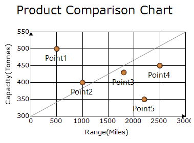

## Interlaced grid background

The [InterlacedGrid](https://help.syncfusion.com/cr/windowsforms/Syncfusion.Windows.Forms.Chart.ChartAxis.html#Syncfusion_Windows_Forms_Chart_ChartAxis_InterlacedGrid) property enables alternating background bands between grid lines. By default, this property is set to `false`.

The [InterlacedGridInterior](https://help.syncfusion.com/cr/windowsforms/Syncfusion.Windows.Forms.Chart.ChartAxis.html#Syncfusion_Windows_Forms_Chart_ChartAxis_InterlacedGridInterior) property customizes the appearance of these interlaced bands by setting their background fill. The default value is `Color.LightGray`.




chartControl.PrimaryXAxis.InterlacedGrid = true;
chartControl.PrimaryXAxis.InterlacedGridInterior = new Syncfusion.Drawing.BrushInfo( Color.FromArgb(166, 184, 200));

// Enable interlaced grid for Y-axis.
chartControl.PrimaryYAxis.InterlacedGrid = true;
chartControl.PrimaryYAxis.InterlacedGridInterior = new Syncfusion.Drawing.BrushInfo(Color.FromArgb(124, 144, 179));




chartControl.PrimaryXAxis.InterlacedGrid = True
chartControl.PrimaryXAxis.InterlacedGridInterior = New Syncfusion.Drawing.BrushInfo(Color.FromArgb(166, 184, 200))

chartControl.PrimaryYAxis.InterlacedGrid = True
chartControl.PrimaryYAxis.InterlacedGridInterior = New Syncfusion.Drawing.BrushInfo(Color.FromArgb(124, 144, 179))




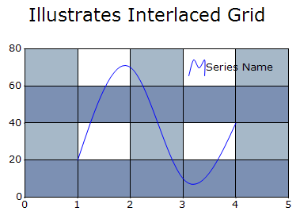

## Chart skins

[ChartControl](https://help.syncfusion.com/cr/windowsforms/Syncfusion.Windows.Forms.Chart.ChartControl.html) allows users to customize its appearance by applying pre defined visual styles. The [Skins](https://help.syncfusion.com/cr/windowsforms/Syncfusion.Windows.Forms.Chart.ChartControl.html#Syncfusion_Windows_Forms_Chart_ChartControl_Skins) property applies a built in visual style to the chart.

The Skins property supports the following values:

- Almond
- Blend
- Blueberry
- Marble
- Metro
- Midnight
- Monochrome
- None
- Office2007Black
- Office2007Blue
- Office2007Silver
- Office2016Black
- Office2016Colorful
- Office2016DarkGray
- Office2016White
- Olive
- Sandune
- Turquoise
- Vista
- VS2010

The following code explain how to set Skins in ChartControl.




chartControl.Skins = Skins.Almond;




chartControl.Skins = Skins.Almond




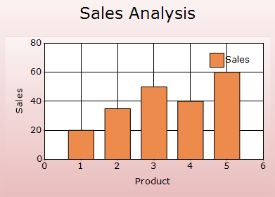

## Text rendering quality

The [TextRenderingHint](https://help.syncfusion.com/cr/windowsforms/Syncfusion.Windows.Forms.Chart.ChartControl.html#Syncfusion_Windows_Forms_Chart_ChartControl_TextRenderingHint) property controls the quality used to render text in the chart. Higher-quality settings produce smoother text, while lower-quality settings can improve rendering performance.

n> The Chart Area of [TextRenderingHint](https://help.syncfusion.com/cr/windowsforms/Syncfusion.Windows.Forms.Chart.ChartArea.html#Syncfusion_Windows_Forms_Chart_ChartArea_TextRenderingHint) property is obsolete. Use the [TextRenderingHint](https://help.syncfusion.com/cr/windowsforms/Syncfusion.Windows.Forms.Chart.ChartControl.html#Syncfusion_Windows_Forms_Chart_ChartControl_TextRenderingHint) property to configure the text-rendering quality of the chart.

The following code sets the text-rendering quality to `SingleBitPerPixelGridFit`.



this.chartControl.TextRenderingHint = TextRenderingHint.SingleBitPerPixelGridFit;


Me.chartControl.TextRenderingHint = TextRenderingHint.SingleBitPerPixelGridFit



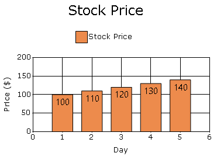

## See also

- [How to customize the appearance of chart axes in WinForms Chart](https://support.syncfusion.com/kb/article/1066/how-to-customize-the-appearance-of-chart-axes-in-winforms-chart)
- [How to display an image as the background of the chart area in WinForms Chart](https://support.syncfusion.com/kb/article/1075/how-to-display-an-image-as-the-background-of-the-chartarea-in-winforms-chart)
- [How to customize background and foreground settings in WinForms Chart](https://support.syncfusion.com/kb/article/1198/how-to-customize-background-and-foreground-settings-in-winforms-chart)
- [How to add an image to Windows Forms Chart Area](https://help.syncfusion.com/windowsforms/chart/faq/how-to-add-an-image-on-chart-area)
- [How to restore gradient in Windows Forms Chart](https://help.syncfusion.com/windowsforms/chart/faq/how-to-get-back-to-the-gradient-appearance-of-the-)
- [How to set a color palette in Windows Forms Chart](https://help.syncfusion.com/windowsforms/chart/faq/how-to-set-the-color-palette-for-a-chart)
- [How to customize series borders in WinForms Chart](https://support.syncfusion.com/kb/article/8952/how-to-customize-series-borders-in-winforms-chart)
- [How to display an image as the background of the chart area in WinForms Chart?](https://support.syncfusion.com/kb/article/1075/how-to-display-an-image-as-the-background-of-the-chartarea-in-winforms-chart)
- [How to set a custom border for chart series elements in WinForms Chart](https://support.syncfusion.com/kb/article/1078/how-to-set-a-custom-border-for-chart-series-elements-in-winforms-chart)
- [How to set the Interior color for the Chart and the Chart series](https://support.syncfusion.com/kb/article/1080/how-to-set-the-interior-color-for-the-chart-and-the-chart-series)
- [How to display images for data points in a WinForms Chart](https://support.syncfusion.com/kb/article/1085/how-to-display-images-for-data-points-in-a-winforms-chart)
- [How to set a border for the chart area in WinForms Chart](https://support.syncfusion.com/kb/article/1188/how-to-set-a-border-for-the-chart-area-in-winforms-chart)