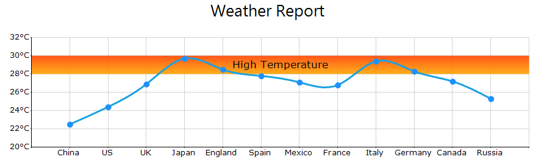
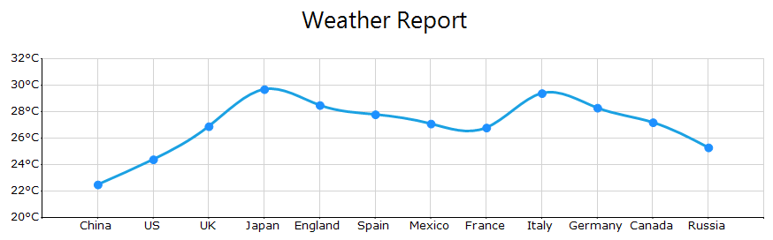
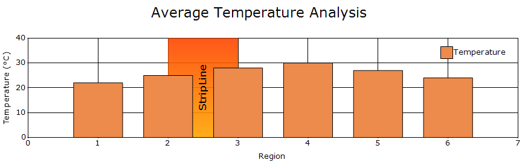
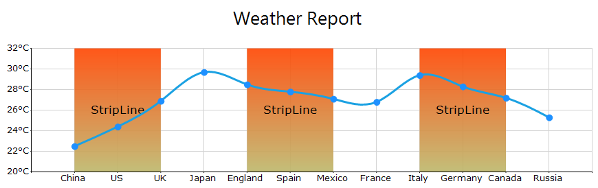
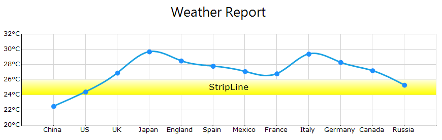
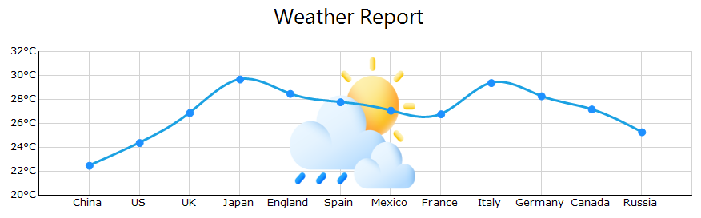
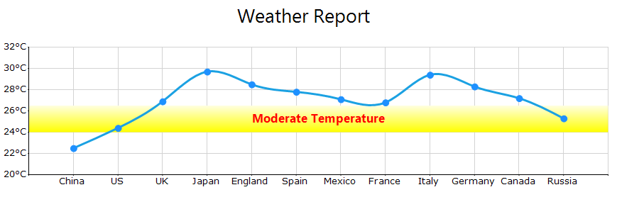
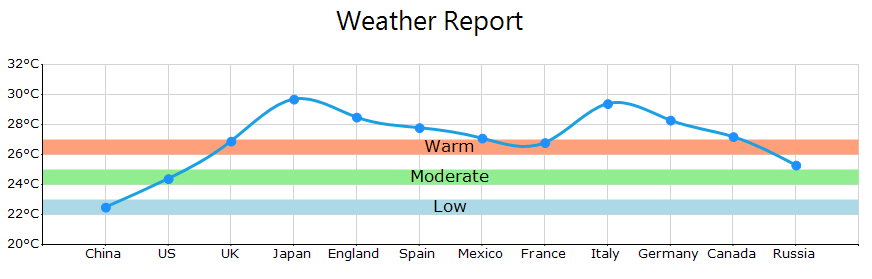

# Strip Lines in Windows Forms Chart

Windows Forms Chart allows you to add strip lines that shade specific regions or ranges in the plot area background at regular or custom intervals.

## Adding strip lines to an axis

Create a [ChartStripLine](https://help.syncfusion.com/cr/windowsforms/Syncfusion.Windows.Forms.Chart.ChartStripLine.html), configure its range and appearance, and add it to the required axis.

The following code example adds a horizontal strip line to the primary Y-axis and highlights the high temperature range.




ChartStripLine stripLine = new ChartStripLine();

stripLine.Enabled = true;
stripLine.Vertical = false;

stripLine.Start = 28;
stripLine.End = 30;
stripLine.Width = 2;

stripLine.Text = "High Temperature";
stripLine.TextAlignment = ContentAlignment.MiddleCenter;

stripLine.Interior = new BrushInfo(230, new BrushInfo(GradientStyle.Vertical, Color.OrangeRed, Color.Orange));

chartControl.PrimaryYAxis.StripLines.Add(stripLine);




Dim stripLine As New ChartStripLine()

stripLine.Enabled = True
stripLine.Vertical = False

stripLine.Start = 28
stripLine.End = 30
stripLine.Width = 2

stripLine.Text = "High Temperature"
stripLine.TextAlignment = ContentAlignment.MiddleCenter

stripLine.Interior = New BrushInfo(230, New BrushInfo( GradientStyle.Vertical, Color.OrangeRed, Color.Orange))

chartControl.PrimaryYAxis.StripLines.Add(stripLine)




## Visibility

The [Enabled](https://help.syncfusion.com/cr/windowsforms/Syncfusion.Windows.Forms.Chart.ChartStripLine.html#Syncfusion_Windows_Forms_Chart_ChartStripLine_Enabled) property controls whether the strip line is displayed or not. The default value is `false`.

The following code example hides the strip line.




stripLine.Enabled = false;




stripLine.Enabled = False




## Strip line orientation

The [Vertical](https://help.syncfusion.com/cr/windowsforms/Syncfusion.Windows.Forms.Chart.ChartStripLine.html#Syncfusion_Windows_Forms_Chart_ChartStripLine_Vertical) property specifies the orientation of the strip line. By default, strip lines are rendered horizontally.

The following code example displays a vertical strip line.




stripLine.Vertical = true;




stripLine.Vertical = True




## Numeric strip lines

The following properties are used to define the strip-line range on a numeric axis:
- [Start](https://help.syncfusion.com/cr/windowsforms/Syncfusion.Windows.Forms.Chart.ChartStripLine.html#Syncfusion_Windows_Forms_Chart_ChartStripLine_Start): Specifies the value at which the strip line begins.
- [End](https://help.syncfusion.com/cr/windowsforms/Syncfusion.Windows.Forms.Chart.ChartStripLine.html#Syncfusion_Windows_Forms_Chart_ChartStripLine_End): Specifies the value at which the strip line ends.
- [Width](https://help.syncfusion.com/cr/windowsforms/Syncfusion.Windows.Forms.Chart.ChartStripLine.html#Syncfusion_Windows_Forms_Chart_ChartStripLine_Width): Specifies the width of the strip line. A width of `1f` is used unless a different value is specified.

The following code example highlights the range between `28` and `30`.




stripLine.Start = 28;
stripLine.End = 30;
stripLine.Width = 2;




stripLine.Start = 28
stripLine.End = 30
stripLine.Width = 2




## Period

The [Period](https://help.syncfusion.com/cr/windowsforms/Syncfusion.Windows.Forms.Chart.ChartStripLine.html#Syncfusion_Windows_Forms_Chart_ChartStripLine_Period) property specifies the interval at which a strip line is repeated on a numeric axis. The default value is 2.

The following code example demonstrates how to repeat a strip line at an interval of four units.




stripLine.Start = 1;
stripLine.End = 10;
stripLine.Width = 2;
stripLine.Period = 4;




stripLine.Start = 1
stripLine.End = 10
stripLine.Width = 2
stripLine.Period = 4




## Customizing appearance

The appearance of a strip line can be customized using fill, text, and background image settings.

### Interior

The [Interior](https://help.syncfusion.com/cr/windowsforms/Syncfusion.Windows.Forms.Chart.ChartStripLine.html#Syncfusion_Windows_Forms_Chart_ChartStripLine_Interior) property specifies the fill of a strip line. By default stripline shows in white color.

The following code example demonstrates how to apply a color to the strip line.




stripLine.Interior = new BrushInfo(GradientStyle.Vertical, Color.LightYellow, Color.Yellow);




stripLine.Interior = New BrushInfo(GradientStyle.Vertical, Color.LightYellow, Color.Yellow)




### Background image

The [BackImage](https://help.syncfusion.com/cr/windowsforms/Syncfusion.Windows.Forms.Chart.ChartStripLine.html#Syncfusion_Windows_Forms_Chart_ChartStripLine_BackImage) property specifies the image displayed in the strip line background. By default, no image is associated with the strip line.




stripLine.BackImage = Image.FromFile("background.png");




stripLine.BackImage = Image.FromFile("background.png")




### Text

The following properties customize the text displayed in a strip line:

- [Text](https://help.syncfusion.com/cr/windowsforms/Syncfusion.Windows.Forms.Chart.ChartStripLine.html#Syncfusion_Windows_Forms_Chart_ChartStripLine_Text) - Specifies the text displayed in the strip line. The default strip line text is `"StripLine"`.
- [TextColor](https://help.syncfusion.com/cr/windowsforms/Syncfusion.Windows.Forms.Chart.ChartStripLine.html#Syncfusion_Windows_Forms_Chart_ChartStripLine_TextColor) - Specifies the color used to render the strip line text.  By default, the text uses `SystemColors.ControlText`.
- [TextAlignment](https://help.syncfusion.com/cr/windowsforms/Syncfusion.Windows.Forms.Chart.ChartStripLine.html#Syncfusion_Windows_Forms_Chart_ChartStripLine_TextAlignment) - Specifies the alignment of the text within the strip line. The default value is `MiddleCenter`. This property supports the following values:
    - TopLeft
    - TopCenter
    - TopRight
    - MiddleLeft
    - MiddleCenter
    - MiddleRight
    - BottomLeft
    - BottomCenter
    - BottomRight
- [Font](https://help.syncfusion.com/cr/windowsforms/Syncfusion.Windows.Forms.Chart.ChartStripLine.html#Syncfusion_Windows_Forms_Chart_ChartStripLine_BackImage) - Specifies the font used to render the strip line text. The strip line text is rendered using a `Verdana` font with a size of `10` by default.

The following code example demonstrates how to customize the strip line text appearance.




stripLine.Text = "Target Zone";
stripLine.TextColor = Color.Red;
stripLine.TextAlignment = ContentAlignment.MiddleCenter;
stripLine.Font = new Font("Segoe UI", 10, FontStyle.Bold);




stripLine.Text = "Target Zone"
stripLine.TextColor = Color.Red
stripLine.TextAlignment = ContentAlignment.MiddleCenter
stripLine.Font = New Font("Segoe UI", 10, FontStyle.Bold)




## Multiple strip lines

Multiple strip lines can be added to the same axis to highlight different ranges.

The following code explain how to add the multiple striplines.




ChartStripLine stripLine1 = new ChartStripLine();
stripLine1.Enabled = true;
stripLine1.Start = 22;
stripLine1.End = 24;
stripLine1.Text = "Low";
stripLine1.Interior = new BrushInfo(Color.LightBlue);

ChartStripLine stripLine2 = new ChartStripLine();
stripLine2.Enabled = true;
stripLine2.Start = 24;
stripLine2.End = 26;
stripLine2.Text = "Moderate";
stripLine2.Interior = new BrushInfo(Color.LightGreen);

ChartStripLine stripLine3 = new ChartStripLine();
stripLine3.Enabled = true;
stripLine3.Start = 26;
stripLine3.End = 28;
stripLine3.Text = "Warm";
stripLine3.Interior = new BrushInfo(Color.LightSalmon);

chartControl.PrimaryYAxis.StripLines.Add(stripLine1);
chartControl.PrimaryYAxis.StripLines.Add(stripLine2);
chartControl.PrimaryYAxis.StripLines.Add(stripLine3);




Dim stripLine1 As New ChartStripLine()

stripLine1.Enabled = True
stripLine1.Start = 22
stripLine1.End = 24
stripLine1.Text = "Low"
stripLine1.Interior = New BrushInfo(Color.LightBlue)

Dim stripLine2 As New ChartStripLine()

stripLine2.Enabled = True
stripLine2.Start = 24
stripLine2.End = 26
stripLine2.Text = "Moderate"
stripLine2.Interior = New BrushInfo(Color.LightGreen)

Dim stripLine3 As New ChartStripLine()

stripLine3.Enabled = True
stripLine3.Start = 26
stripLine3.End = 28
stripLine3.Text = "Warm"
stripLine3.Interior = New BrushInfo(Color.LightSalmon)

chartControl.PrimaryYAxis.StripLines.Add(stripLine1)
chartControl.PrimaryYAxis.StripLines.Add(stripLine2)
chartControl.PrimaryYAxis.StripLines.Add(stripLine3)




## See also

- [How to add striplines to an axis in a WinForms Chart](https://support.syncfusion.com/kb/article/1232/how-to-add-striplines-to-an-axis-in-a-winforms-chart)