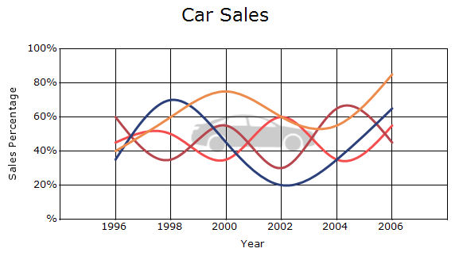

# Watermark in Windows Forms Chart

[ChartControl](https://help.syncfusion.com/cr/windowsforms/Syncfusion.Windows.Forms.Chart.ChartControl.html) provides watermark support through the [Watermark](https://help.syncfusion.com/cr/windowsforms/Syncfusion.Windows.Forms.Chart.ChartArea.html#Syncfusion_Windows_Forms_Chart_ChartArea_Watermark) property, which allows you to display text, an image, or both within the chart area.

The following properties customize the watermark:

- [Text](https://help.syncfusion.com/cr/windowsforms/Syncfusion.Windows.Forms.Chart.ChartWatermark.html#Syncfusion_Windows_Forms_Chart_ChartWatermark_Text): Specifies the watermark text. The default value is an empty string.
- [Image](https://help.syncfusion.com/cr/windowsforms/Syncfusion.Windows.Forms.Chart.ChartWatermark.html#Syncfusion_Windows_Forms_Chart_ChartWatermark_Image): Specifies the watermark image. The default value is `null`.
- [ImageSize](https://help.syncfusion.com/cr/windowsforms/Syncfusion.Windows.Forms.Chart.ChartWatermark.html#Syncfusion_Windows_Forms_Chart_ChartWatermark_ImageSize): Specifies the watermark image size. The default value is `null`.
- [Font](https://help.syncfusion.com/cr/windowsforms/Syncfusion.Windows.Forms.Chart.ChartWatermark.html#Syncfusion_Windows_Forms_Chart_ChartWatermark_Font): Specifies the watermark font. 
- [TextColor](https://help.syncfusion.com/cr/windowsforms/Syncfusion.Windows.Forms.Chart.ChartWatermark.html#Syncfusion_Windows_Forms_Chart_ChartWatermark_TextColor): Specifies the watermark text color. By default, the watermark uses the charts [ForeColor](https://help.syncfusion.com/cr/windowsforms/Syncfusion.Windows.Forms.Chart.ChartControl.html#Syncfusion_Windows_Forms_Chart_ChartControl_ForeColor) value.
- [Opacity](https://help.syncfusion.com/cr/windowsforms/Syncfusion.Windows.Forms.Chart.ChartWatermark.html#Syncfusion_Windows_Forms_Chart_ChartWatermark_Opacity): Specifies the watermark opacity. The default value is `60`.
- [Margin](https://help.syncfusion.com/cr/windowsforms/Syncfusion.Windows.Forms.Chart.ChartWatermark.html#Syncfusion_Windows_Forms_Chart_ChartWatermark_Margin): Specifies the space around the watermark. The default value is `10, 10, 10, 10`.
- [HorizontalAlignment](https://help.syncfusion.com/cr/windowsforms/Syncfusion.Windows.Forms.Chart.ChartWatermark.html#Syncfusion_Windows_Forms_Chart_ChartWatermark_HorizontalAlignment): Specifies the horizontal alignment. The default value is [ChartAlignment.Near](https://help.syncfusion.com/cr/windowsforms/Syncfusion.Windows.Forms.Chart.ChartAlignment.html#Syncfusion_Windows_Forms_Chart_ChartAlignment_Near).
- [VerticalAlignment](https://help.syncfusion.com/cr/windowsforms/Syncfusion.Windows.Forms.Chart.ChartWatermark.html#Syncfusion_Windows_Forms_Chart_ChartWatermark_VerticalAlignment): Specifies the vertical alignment. The default value is [ChartAlignment.Near](https://help.syncfusion.com/cr/windowsforms/Syncfusion.Windows.Forms.Chart.ChartAlignment.html#Syncfusion_Windows_Forms_Chart_ChartAlignment_Near).
- [ZOrder](https://help.syncfusion.com/cr/windowsforms/Syncfusion.Windows.Forms.Chart.ChartWatermark.html#Syncfusion_Windows_Forms_Chart_ChartWatermark_ZOrder): Specifies whether the watermark is displayed above or below chart content. The default value is [Over](https://help.syncfusion.com/cr/windowsforms/Syncfusion.Windows.Forms.Chart.ChartWaterMarkOrder.html#Syncfusion_Windows_Forms_Chart_ChartWaterMarkOrder_Over).The available values are:
    - `Behind`: Displays the watermark behind the chart content.
    - `Over`: Displays the watermark over the chart content.

The following code example demonstrates how to add and customize an image watermark in the chart area.




chartControl.ChartArea.Watermark.Image = System.Drawing.Image.FromFile(@"Resources\carsales.png");
chartControl.ChartArea.Watermark.Opacity = 60;
chartControl.ChartArea.Watermark.HorizontalAlignment = ChartAlignment.Center;
chartControl.ChartArea.Watermark.VerticalAlignment = ChartAlignment.Center;
chartControl.ChartArea.Watermark.ZOrder = ChartWaterMarkOrder.Behind;




chartControl.ChartArea.Watermark.Image = System.Drawing.Image.FromFile("Resources\carsales.png")
chartControl.ChartArea.Watermark.Opacity = 60
chartControl.ChartArea.Watermark.HorizontalAlignment = ChartAlignment.Center
chartControl.ChartArea.Watermark.VerticalAlignment = ChartAlignment.Center
chartControl.ChartArea.Watermark.ZOrder = ChartWaterMarkOrder.Behind



