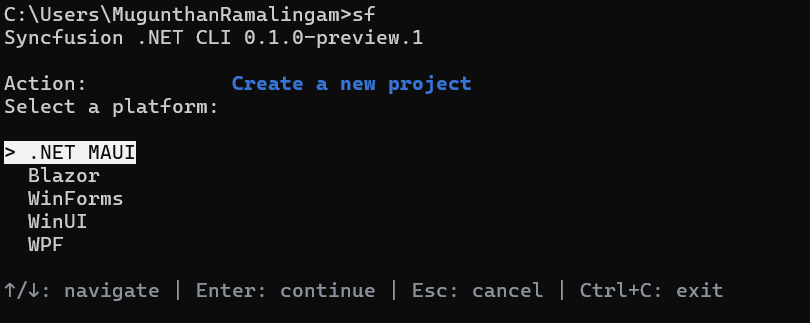
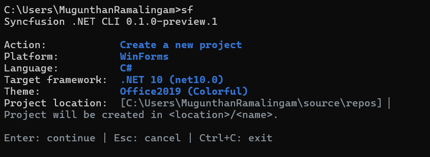
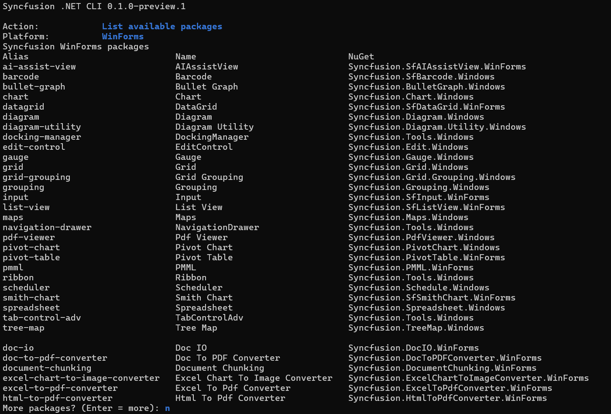
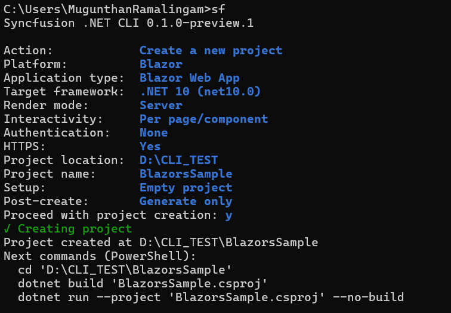

# Overview of the Syncfusion<sup>®</sup> .NET CLI

The Syncfusion<sup>®</sup> .NET CLI (`sf`) is a command line tool that creates Windows Forms projects and manages Syncfusion<sup>®</sup> Windows Forms NuGet packages from a terminal. After you install the CLI, you can run `sf` with no arguments to open an interactive menu, or run a direct command such as `sf new winforms` for scripted, prompt-free creation.

N> The Syncfusion<sup>®</sup> .NET CLI is currently in preview and is installed with the `--prerelease` flag.

N> Package removal (`sf remove`) is temporarily disabled across all platforms while improvements are in progress.

You can use the CLI to perform the following actions:

* Create a blank Windows Forms app, or an app containing generated Syncfusion<sup>®</sup> control samples, in C# or VB.
* Add or update Syncfusion<sup>®</sup> Windows Forms NuGet package references in an existing project.
* List available and installed packages, and search the package catalog.
* Generate projects for .NET MAUI, Blazor, WPF, Windows Forms, and WinUI 3.

This documentation covers the Windows Forms platform.

## Prerequisites

The following software is required before you install and use the CLI:

* [.NET SDK](https://dotnet.microsoft.com/download). The SDK selected through `PATH` takes precedence, with the running .NET installation as a fallback.
* For modern .NET projects (`.NET 8` and later), the Windows Forms project templates installed with the .NET SDK. The CLI creates modern Windows Forms projects through the installed `winforms` template, and generated projects use Windows TFMs with `EnableWindowsTargeting`.
* For .NET Framework projects (`.NET Framework 4.6.2` and later), Visual Studio MSBuild with the .NET desktop workload. .NET Framework projects use classic MSBuild XML and explicit source/reference items, not modern SDK templates. Microsoft's `Microsoft.NETFramework.ReferenceAssemblies` 1.0.3 supplies the exact reference assemblies, including frameworks absent from the local developer packs.
* An internet connection so package operations can reach [nuget.org](https://www.nuget.org).

N> Building and running Windows Forms applications requires Windows. On macOS or Linux, use `sf new winforms --post-action generate` to generate the project source without restoring or building.

N> Syncfusion<sup>®</sup> packages resolve from the official nuget.org feed, `https://api.nuget.org/v3/index.json`. The CLI accepts only this source through `--source`.

## Installation

The CLI is published as a .NET global tool with the package ID `Syncfusion.DotNet.CLI`.

1. Open a terminal and run the following command. Add `--prerelease` while only preview versions are available.

    ```bash
    dotnet tool install -g Syncfusion.DotNet.CLI --prerelease
    ```

2. Verify the installation and print the CLI version.

    ```bash
    sf --version
    ```

To update the tool to the latest release, run:

```bash
dotnet tool update -g Syncfusion.DotNet.CLI --prerelease
```

To remove the tool, run:

```bash
dotnet tool uninstall -g Syncfusion.DotNet.CLI
```

## Initialize the CLI

Run `sf` in an interactive terminal to open the main menu. The menu shows the current CLI version and groups the available operations.


| Group | Operation | Command reference |
| --- | --- | --- |
| Project creation | Create a new project | `sf new` |
| Package management | Add a package to an existing project | `sf add` |
| Package management | Update a package in an existing project | `sf update` |
| Discovery | List available packages | `sf list <platform> packages` |
| Discovery | List installed packages in an existing project | `sf list <platform> installed` |
| Discovery | Search for packages | `sf search` |
| Help and information | View CLI information | `sf info` |
| Help and information | Show help | `sf help` |
| Exit | Exit | `Ctrl+C` |

N> The `<platform>` text is a usage placeholder. Use `winforms` for Windows Forms.

Use the following keys to navigate the interactive screens:

| Key | Action |
| --- | --- |
| Up / Down | Move through the options |
| Enter | Choose the focused option, or continue |
| Space | Toggle a checkbox in a multi-selection list |
| Escape | Cancel the current question and return to the menu |
| `Ctrl+C` | Exit the interactive session |

Complete direct commands remain usable without opening the menu. `--no-interactive` disables prompts in any command.

## Available commands

| Command | Purpose |
| --- | --- |
| `sf new winforms` | Create a new Windows Forms project |
| `sf add winforms <package>` | Add a Syncfusion<sup>®</sup> package to an existing project |
| `sf update winforms <package>` | Update a package in an existing project |
| `sf list winforms packages` | List available packages |
| `sf list winforms installed` | List installed packages in an existing project |
| `sf search winforms <text>` | Search packages |
| `sf info` | Show CLI information |
| `sf help winforms` | Show the Windows Forms command map |
| `sf --version` | Show the CLI version |

## Create a Windows Forms project

You can create a Windows Forms project through the interactive wizard or a direct command.

### Create a project using the interactive wizard

Run `sf new`, or select **Create a new project** from the main menu. The Windows Forms creation flow is:

1. **Platform:** Select **Windows Forms**.

    

2. **Language:** Select **C#** or **Visual Basic**. C# is the first option.

3. **Framework:** Select the target framework.

    * .NET 10 (`net10.0`), the default
    * .NET 9 (`net9.0`)
    * .NET 8 (`net8.0`)
    * .NET Framework 4.8 (`net48`)
    * .NET Framework 4.7 (`net47`)
    * .NET Framework 4.6.2 (`net462`)

4. **Theme:** Select the project theme. The supported Windows Forms theme is **Office2019 Colorful**.

5. **Location and name:** Enter the parent directory and the project name. The default locations are `%USERPROFILE%\source\repos` on Windows and `~/Projects` on Linux and macOS. The suggested name is `SyncfusionWinFormsApp`, and the first available numeric suffix is used when the destination name collides.

6. **Setup:** Select **Blank app** or **Include Syncfusion controls**. Blank app is the first option.

7. **Controls:** When you include controls, choose one or more controls from the list. Controls start unchecked, and at least one selection is required.

    

8. **Post-create:** Select **Generate only** or **Build project**.

9. **Confirmation:** Review the selected values and confirm to create the project.

N> A complete direct command does not open the wizard. When a name is missing in an interactive terminal, the wizard supplies a default and collects the remaining unspecified inputs. Missing required values in scripts produce an error.

### Available controls

The following controls are available in a new Windows Forms project:

| Control | Control ID |
| --- | --- |
| Chart | `chart` |
| DataGrid | `datagrid` |
| Diagram | `diagram` |
| DockingManager | `docking-manager` |
| NavigationDrawer | `navigation-drawer` |

### Create a project using direct commands

To create a blank project without the wizard:

```bash
sf new winforms -n MyApp
```

To create a C# project containing Syncfusion<sup>®</sup> control samples:

```bash
sf new winforms -n MyApp --control datagrid
sf new winforms -n MyApp --control chart --control datagrid
```

To create a VB project that targets .NET Framework 4.8 with the Office2019 Colorful theme and a DataGrid sample:

```bash
sf new winforms --name MyAppVB --language VB --target-framework net48 --theme Office2019Colorful --control datagrid --post-action build
```

## Manage packages in an existing project

Package operations change NuGet references only. They do not generate control files. In a CLI-generated project, control aliases such as `chart` and `datagrid` also integrate their sample files, assets, and welcome navigation through `sf add`.

`<package>` accepts a canonical package alias, a canonical package ID, or an exact unambiguous package display name:

```bash
sf add winforms datagrid -p ./MyApp
sf add winforms Syncfusion.SfDataGrid.WinForms -p ./MyApp
```

To update a package in an existing project:

```bash
sf update winforms datagrid --path /full/path/MyApp.csproj --version 35.1.40 --build
```

To list the available and installed packages:

```bash
sf list winforms packages
sf list winforms installed --path /full/path/MyApp.vbproj
```



To search the package catalog:

```bash
sf search chart --framework winforms
```

Existing-project commands accept `-p/--path` with a project file (`.csproj` or `.vbproj`), a project directory, or a supported subdirectory. Discovery stops at the nearest project or repository boundary. `--json` emits one JSON document for script use.

N> Update preserves sample source and aligns managed Syncfusion<sup>®</sup> release versions to avoid dependency downgrades. Shared dependencies remain installed for other controls. Edited or unowned sample source blocks destructive changes, and failed operations roll back files, metadata, project references, and central versions.

## Options reference

### Creation options

| Option | Description |
| --- | --- |
| `-n`, `--name` | Project name. Required when prompting is unavailable |
| `-p`, `--path` | Parent directory. Defaults to the current directory |
| `--language` | Project language: `C#` or `VB` |
| `-t`, `--target-framework` | Target framework: `net462`, `net47`, `net48`, `net8.0`, `net9.0`, or `net10.0` |
| `--theme` | Project theme, such as `Office2019Colorful` |
| `--control` | One or more control IDs, or `empty`. Omit to create an empty project |
| `--post-action` | Post-create action: `generate` or `build`. Defaults to `build` for direct commands |
| `--version` | The Syncfusion<sup>®</sup> NuGet package version |
| `--source` | Package source; Syncfusion<sup>®</sup> packages require `https://api.nuget.org/v3/index.json` |
| `--configfile` | The NuGet configuration file to use |
| `--dry-run` | Preview the action without making changes |
| `--force` | Allow supported overwrites. Edited control samples and existing project destinations remain protected |
| `--no-restore` | Skip `dotnet restore` after the action |
| `--no-build` | Skip `dotnet build` after the action |
| `--no-interactive` | Disable interactive prompts |
| `--json` | Emit a JSON document instead of table output |

N> `--post-action build` conflicts with `--no-build`. Neither `--force` nor confirmation authorizes overwriting an existing project destination.

### Package operation options

| Option | Description |
| --- | --- |
| `-p`, `--path` | The project directory, `.csproj` file, `.vbproj` file, or a supported subdirectory |
| `-v`, `--version` | The Syncfusion<sup>®</sup> NuGet package version |
| `--source` | Package source; Syncfusion<sup>®</sup> packages require `https://api.nuget.org/v3/index.json` |
| `--configfile` | The NuGet configuration file to use |
| `--dry-run` | Preview the action without making changes |
| `--force` | Allow supported overwrites |
| `--no-restore` | Skip `dotnet restore` after the action |
| `--build` | Build the project after the action |
| `--json` | Emit one JSON document |

### Exit codes

| Exit code | Meaning |
| --- | --- |
| `0` | Success |
| `1` | Command or validation failure |
| `70` | Internal CLI error |
| `130` | `Ctrl+C` interruption |

## Help

Run `sf help` for a short command map, or `sf help winforms` for the Windows Forms command examples.


## Examples

Create a C# project with Chart and DataGrid samples and build after creation:

```bash
sf new winforms --name MyApp --target-framework net10.0 --control chart --control datagrid --post-action build
```

Create a blank project without restore, build, or prompts:

```bash
sf new winforms --name MyApp --path ./apps --post-action generate --no-restore --no-interactive
```

Add a package to an existing project:

```bash
sf add winforms datagrid -p ./MyApp
```

Search the package catalog:

```bash
sf search winforms grid
```

## Troubleshooting

### `sf` command is not found

Confirm that the tool is installed and the .NET global tools directory is on your `PATH`. The .NET SDK prints the tool location at the end of a successful installation.

```bash
dotnet tool list -g
```

### Build failure after creation

The default post-create build includes restore. Missing Windows desktop tools or .NET Framework MSBuild appear as build errors after the project files are generated. The generated project is retained, and the CLI prints the quoted build command so you can retry it from any directory:

```bash
dotnet build "<generated-project.csproj>"
```

To skip the build and generate the files only, use `--post-action generate` or `--no-build`.



### Existing project is not found

Run the command from the project directory, or pass the project file or directory explicitly with `-p/--path`. Discovery stops at the nearest project or repository boundary. Scripts require a specific `.csproj` or `.vbproj` file.

### Package source errors

Confirm that the network can reach nuget.org. The CLI resolves Syncfusion<sup>®</sup> packages only from the official nuget.org feed.

## FAQs

**Does the CLI generate a license key?** No. Syncfusion<sup>®</sup> licensing requirements continue to apply. Set `SYNCFUSION_LICENSE_KEY` in the application environment to register an existing license; no license values are written into generated sources. Refer to the [licensing overview](https://help.syncfusion.com/common/essential-studio/licensing/overview) to generate and register a license key in your project.

**Which languages are supported?** C# and VB.

**Which target frameworks are supported?** .NET Framework 4.6.2 (`net462`), 4.7 (`net47`), 4.8 (`net48`), and .NET 8 (`net8.0`), .NET 9 (`net9.0`), .NET 10 (`net10.0`). Unsupported selections fail validation rather than changing the request.

**Which theme is supported?** Office2019 Colorful.

**Which platforms does the CLI support?** .NET MAUI, Blazor, WPF, Windows Forms, and WinUI 3. This documentation covers Windows Forms.

## See also

* [Syncfusion Windows Forms controls](https://www.syncfusion.com/winforms-controls)
* [Syncfusion Windows Forms help documentation](https://help.syncfusion.com/windowsforms/overview)
* [Installing Syncfusion Windows Forms NuGet packages](https://help.syncfusion.com/windowsforms/installation/install-nuget-packages)
* [System requirements for Windows Forms](https://help.syncfusion.com/windowsforms/system-requirements)