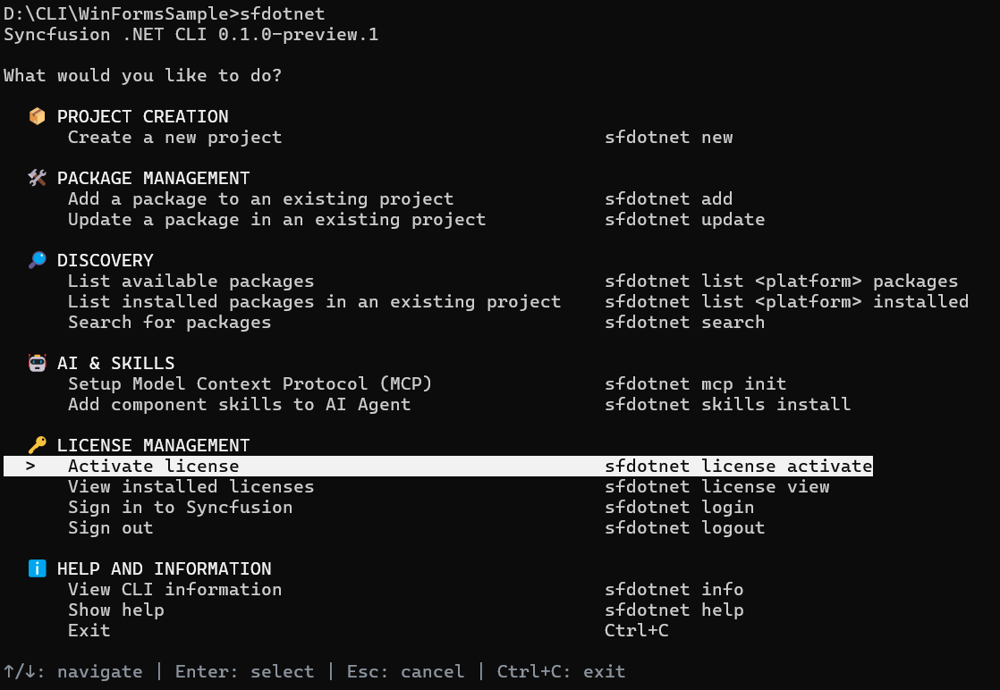
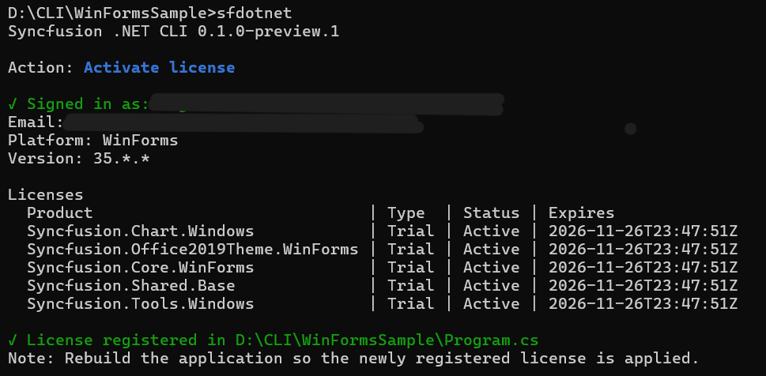
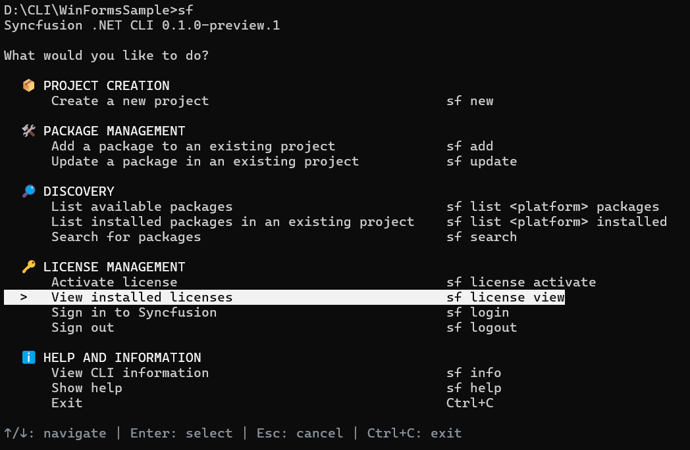
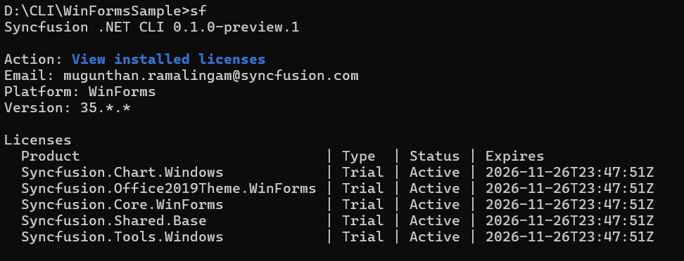

# Activate Syncfusion® licenses

The CLI detects the Syncfusion® controls used in a project, downloads the matching license keys from your Syncfusion® account, and registers the keys in the project's startup code. For example, when a sample is created with the Chart control, the CLI registers the license for `Syncfusion.SfChart.WinForms` in `Program.cs` so the build runs without a license warning.

N> Open the Command Prompt or Terminal in the target sample's project directory before running the license activation command. The license operation is project-specific, and the command path must point to the intended sample.

## Activate a license through the interactive menu

1. Open the Command Prompt or Terminal in the target sample's project directory.

    
    
    cd C:\Projects\MyApp
    
    

2. Run `sf` to open the main menu.

    
    
    sf
    
    

3. Under **License management**, select **Activate license**. The CLI focuses the **Activate License** entry and shows the navigation hint at the bottom of the screen.

    

4. If you are not signed in, the CLI opens your default browser to the Syncfusion® sign-in page. Complete sign in with your Syncfusion® account.

    

5. After sign in, the CLI checks your entitlements, downloads the matching keys for the Syncfusion® controls in the sample, and registers the keys in `Program.cs` (or `Application.xaml.vb` for VB projects).

    

6. Rebuild the application so the newly registered license is applied. The CLI prints the following reminder at the end of the activation output.

    > Note: Rebuild the application so the newly registered license is applied.

## Activate a license using a direct command

Run the activation command from the sample's project directory:



sf license activate



Pass `--path` to point the CLI at a specific project directory, `.csproj`, or `.vbproj` file:



sf license activate --path ./MyApp
sf license activate --path ./MyApp/MyApp.csproj



Use `--yes` to accept the trial EULA prompt without asking:



sf license activate --yes



Use `--file` to activate from an existing key file. With no value, the CLI reads `./syncfusion-license.txt` from the project directory. With an absolute path, the CLI uses the specified file instead:



sf license activate --file
sf license activate --file C:\Keys\syncfusion-license.txt



N> When a license key is supplied through `--file`, the CLI skips sign in and download and registers the keys already in the file. The file path must be absolute.

## View installed licenses

To see the licenses cached for the current project, run:



sf license view



The command reads the cached metadata, lists each product, the license type, the status, and the expiry date, and warns when a Syncfusion® package in the project is not covered.

The cached output reports the registered email, platform, major version, and one row per product.

## Sign in and sign out

License activation requires an authenticated Syncfusion® session. During activation, if you are not signed in, the CLI opens your default browser to the Syncfusion® sign-in page, where you complete sign in with your Syncfusion® account. You can also manage the sign-in session directly.

### Sign-in requirements

* A Syncfusion® account with an active license or trial entitlement for the packages in the project.
* A browser available on the machine, because sign in is completed in the browser.
* An internet connection, because entitlements and license keys are downloaded from your Syncfusion® account.

### Sign in ahead of activation

To sign in without running activation, run:



sf login



The CLI opens the browser sign-in page. After you complete sign in, the session is cached locally, and the next `sf license activate` skips the browser step.

### Sign out

To clear the local sign-in session, run:



sf logout



After sign out, the cached session is removed. The next activation prompts for sign in again.

N> The sign-in session is used for license operations. `sf logout` clears the session only; it does not remove the license keys already registered in the project's startup code.

## License options

| Option | Description |
| --- | --- |
| `-p`, `--path` | The project directory or `.csproj`/`.vbproj` to scan for Syncfusion® packages. Defaults to the current directory |
| `-y`, `--yes` | Accept the trial EULA prompt automatically during activation |
| `--file` | Activate from an existing key file. With no value, the CLI reads `./syncfusion-license.txt` from the project directory. With an absolute path, the CLI uses the specified file |
| `--json` | Emit one JSON document instead of table output |

## FAQs

**Does the CLI register a license?**

Yes. `sf license activate` scans the project for Syncfusion® `PackageReference` entries, downloads the matching license keys from your Syncfusion® account, and inserts `SyncfusionLicenseProvider.RegisterLicense(...)` into `Program.cs` for C# projects or `Application.xaml.vb` for VB projects. The CLI signs you in through the browser the first time, or you can sign in ahead with `sf login`. For background information on Syncfusion® licensing, refer to the [licensing overview](https://help.syncfusion.com/common/essential-studio/licensing/overview).

**Where does the CLI register the license for Windows Forms?** In `Program.cs` for C# projects and in `Application.xaml.vb` for VB projects. For .NET MAUI, Blazor, WPF, and WinUI, the CLI targets `MauiProgram.cs`, `Program.cs`, `App.xaml.cs`, and `App.xaml.cs` respectively.

**Can I use my own key file?**

Yes. Run `sf license activate --file C:\Keys\syncfusion-license.txt` with an absolute path. The CLI reads the keys from the file and registers them in the project's startup code without contacting the license service.

## See also

* [Create a Windows Forms project](/windowsforms/dotnet-cli/create-project)
* [Manage packages in an existing project](/windowsforms/dotnet-cli/manage-packages)
* [Syncfusion® licensing overview](https://help.syncfusion.com/common/essential-studio/licensing/overview)