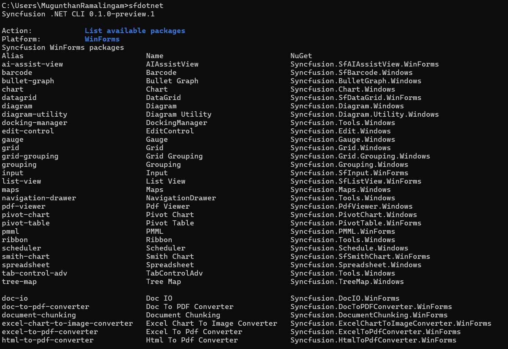

# Manage packages in an existing project

Package operations change NuGet references only. They do not generate control files. In a CLI-generated project, control aliases such as `chart` and `datagrid` also integrate their sample files, assets, and welcome navigation through `sfdotnet add`.

`<package>` accepts a canonical package alias, a canonical package ID, or an exact unambiguous package display name.

## Install a package by package alias

To install a package using its canonical package alias:



sfdotnet add winforms datagrid -p ./MyApp



## Install a package by package identifier

To install a package using its exact canonical package ID:



sfdotnet add winforms Syncfusion.SfDataGrid.WinForms -p ./MyApp



## Update packages

To update a package in an existing project to a specific version:



sfdotnet update winforms datagrid --path /full/path/MyApp.csproj --version 35.1.40 --build



## List available packages

To list all packages available for Windows Forms:



sfdotnet list winforms packages



Add `--details` to show package descriptions, setup support, and verification evidence.

## List installed packages

To list the Syncfusion® packages already installed in an existing project:



sfdotnet list winforms installed --path /full/path/MyApp.vbproj



## Search packages

To search the package catalog:



sfdotnet search winforms grid



Existing-project commands accept `-p/--path` with a project file (`.csproj` or `.vbproj`), a project directory, or a supported subdirectory. Discovery stops at the nearest project or repository boundary. `--json` emits one JSON document for script use.

N> Update preserves sample source and aligns managed Syncfusion® release versions to avoid dependency downgrades. Shared dependencies remain installed for other controls. Edited or unowned sample source blocks destructive changes, and failed operations roll back files, metadata, project references, and central versions.

## Package operation options

| Option | Description |
| --- | --- |
| `-p`, `--path` | The project directory, `.csproj` file, `.vbproj` file, or a supported subdirectory |
| `-v`, `--version` | The Syncfusion® NuGet package version |
| `-f`, `--framework` | Alternative to the positional platform argument |
| `--template` / `--control` | One or more template or control IDs (add command) |
| `--source` | Package source; Syncfusion® packages require `https://api.nuget.org/v3/index.json` |
| `--configfile` | The NuGet configuration file to use |
| `--dry-run` | Preview the action without making changes |
| `--force` | Allow supported overwrites |
| `--no-restore` | Skip `dotnet restore` after the action |
| `--build` | Build the project after the action |
| `--no-build` | Skip `dotnet build` after the action |
| `--no-interactive` | Disable interactive prompts |
| `--json` | Emit one JSON document |
| `--verbose` | Print detailed diagnostic output |

## See also

* [Create a Windows Forms project](/windowsforms/dotnet-cli/create-project)
* [License activation](/windowsforms/dotnet-cli/licensing)
* [Installing Syncfusion Windows Forms NuGet packages](https://help.syncfusion.com/windowsforms/installation/install-nuget-packages)