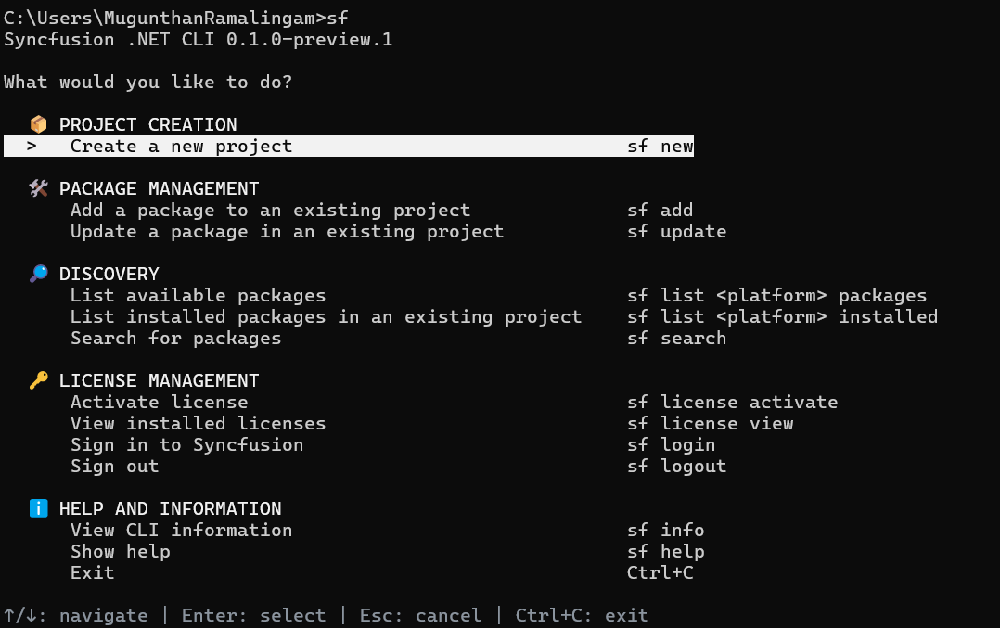

# Overview of the Syncfusion<sup>®</sup> .NET CLI

The Syncfusion<sup>®</sup> .NET CLI (`sf`) is a command line tool that creates Windows Forms projects, manages Syncfusion<sup>®</sup> Windows Forms NuGet packages, and registers licenses from a terminal. After you install the CLI, you can run `sf` with no arguments to open an interactive menu, or run a direct command such as `sf new winforms` for scripted, prompt-free creation.

N> The Syncfusion<sup>®</sup> .NET CLI is currently in preview and is installed with the `--prerelease` flag.

You can use the CLI to perform the following actions:

* Create a blank Windows Forms app, or an app containing generated Syncfusion<sup>®</sup> control samples, in C# or VB. For details, refer to [Create a Windows Forms project](/windowsforms/dotnet-cli/create-project).
* Add or update Syncfusion<sup>®</sup> Windows Forms NuGet package references in an existing project. For details, refer to [Manage packages](/windowsforms/dotnet-cli/manage-packages).
* Activate Syncfusion<sup>®</sup> licenses for the controls used in a sample, and view installed licenses. For details, refer to [License activation](/windowsforms/dotnet-cli/licensing).
* Configure an official Syncfusion<sup>®</sup> Model Context Protocol (MCP) server for AI coding clients. For details, refer to [MCP configuration](/windowsforms/dotnet-cli/configure-mcp).
* Install official Syncfusion<sup>®</sup> component skills for AI agents. For details, refer to [AI skills installation](/windowsforms/dotnet-cli/install-skills).

This documentation covers the Windows Forms platform.

## Prerequisites

The following software is required before you install and use the CLI:

* [.NET SDK](https://dotnet.microsoft.com/download). The SDK selected through `PATH` takes precedence, with the running .NET installation as a fallback. The Windows Forms project templates are installed with the .NET SDK for modern .NET projects. For .NET Framework projects (`.NET Framework 4.6.2` and later), Visual Studio MSBuild with the .NET desktop workload is required.
* An internet connection so package operations can reach [nuget.org](https://www.nuget.org).
* A Syncfusion<sup>®</sup> account to activate licenses. Sign in is performed through the browser during license activation.

N> Building and running Windows Forms applications requires Windows. On macOS or Linux, use `sf new winforms --post-action generate` to generate the project source without restoring or building.

N> Syncfusion<sup>®</sup> packages resolve from the official nuget.org feed, `https://api.nuget.org/v3/index.json`. The CLI accepts only this source through `--source`.

## Installation

The CLI is published as a .NET global tool with the package ID `Syncfusion.DotNet.Cli`.

1. Open a terminal and run the following command. Add `--prerelease` while only preview versions are available.

    
    
    dotnet tool install -g Syncfusion.DotNet.Cli --prerelease
    
    

2. Verify the installation and print the CLI version.

    
    
    sf --version
    
    

3. Add the .NET global tools directory to the `PATH` environment variable so the `sf` command is available in any terminal. The default tools directory is:

    ```
    %USERPROFILE%\.dotnet\tools
    ```

4. To update the tool to the latest release, run:

    
    
    dotnet tool update -g Syncfusion.DotNet.Cli --prerelease
    
    

To remove the tool, run:



dotnet tool uninstall -g Syncfusion.DotNet.Cli



## Initialize the CLI

Run `sf` in an interactive terminal to open the main menu. The menu shows the current CLI version and groups the available operations.



Use the following CLI key actions to navigate the interactive screens:

| Key action | Action |
| --- | --- |
| Up / Down | Move through the options |
| Enter | Choose the focused option, or continue |
| Space | Toggle a checkbox in a multi-selection list |
| Escape | Cancel the current question and return to the menu |
| `Ctrl+C` | Exit the interactive session |

Complete direct commands remain usable without opening the menu. `--no-interactive` disables prompts in any command.

## Available commands

N> The `<platform>` text is a usage placeholder. Use `winforms` for Windows Forms.

| Command | Purpose | For details, refer to |
| --- | --- | --- |
| `sf new winforms` | Create a new Windows Forms project | [Create a Windows Forms project](/windowsforms/dotnet-cli/create-project) |
| `sf add winforms <package>` | Add a Syncfusion<sup>®</sup> package to an existing project | [Manage packages](/windowsforms/dotnet-cli/manage-packages) |
| `sf update winforms <package>` | Update a package in an existing project | [Manage packages](/windowsforms/dotnet-cli/manage-packages) |
| `sf list winforms packages` | List available packages | [Manage packages](/windowsforms/dotnet-cli/manage-packages) |
| `sf list winforms installed` | List installed packages in an existing project | [Manage packages](/windowsforms/dotnet-cli/manage-packages) |
| `sf search winforms <text>` | Search packages | [Manage packages](/windowsforms/dotnet-cli/manage-packages) |
| `sf mcp init winforms` | Configure a project-local Syncfusion<sup>®</sup> MCP client | [MCP configuration](/windowsforms/dotnet-cli/configure-mcp) |
| `sf skills install winforms` | Install Syncfusion<sup>®</sup> component skills for AI agents | [AI skills installation](/windowsforms/dotnet-cli/install-skills) |
| `sf login` | Sign in to Syncfusion through the browser | [License activation](/windowsforms/dotnet-cli/licensing) |
| `sf logout` | Sign out and clear the local session | [License activation](/windowsforms/dotnet-cli/licensing) |
| `sf license activate` | Download the license for the project's packages and register it in the project's startup code | [License activation](/windowsforms/dotnet-cli/licensing) |
| `sf license view` | Show the licenses cached for the project (no network call) | [License activation](/windowsforms/dotnet-cli/licensing) |
| `sf info` | Show CLI information | |
| `sf help winforms` | Show the Windows Forms command map | |
| `sf --version` | Show the CLI version | |

## See also

* [Syncfusion Windows Forms controls](https://www.syncfusion.com/winforms-controls)
* [Syncfusion Windows Forms help documentation](https://help.syncfusion.com/windowsforms/overview)
* [System requirements for Windows Forms](https://help.syncfusion.com/windowsforms/system-requirements)
* [Installing Syncfusion Windows Forms NuGet packages](https://help.syncfusion.com/windowsforms/installation/install-nuget-packages)
* [Syncfusion<sup>®</sup> licensing overview](https://help.syncfusion.com/common/essential-studio/licensing/overview)