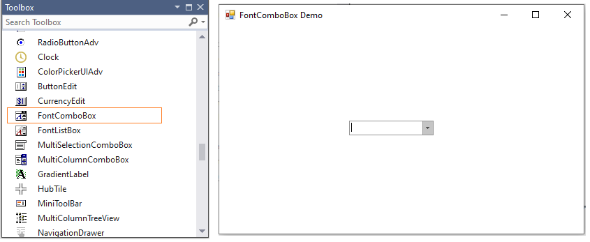
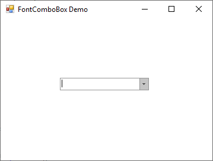
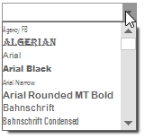

# Getting Started with Windows Forms FontComboBox

This section explains how to get started with the Windows Forms [FontComboBox](https://help.syncfusion.com/cr/windowsforms/Syncfusion.Windows.Forms.Tools.FontComboBox.html) control and its basic features.

## Assembly Deployment

Refer to the [Control dependencies](https://help.syncfusion.com/windowsforms/control-dependencies#fontcombobox) section for the list of assemblies and NuGet packages required to use the `FontComboBox` control.

Refer to [NuGet Packages](https://help.syncfusion.com/windowsforms/installation/install-nuget-packages) to learn how to install NuGet packages in a Windows Forms application.

To install the required NuGet package using the NuGet Package Manager Console, run the following command:

```powershell
Install-Package Syncfusion.Tools.Windows
```

## Adding FontComboBox via Designer

1. Create a new Windows Forms project in Visual Studio.

2. Drag the [FontComboBox](https://help.syncfusion.com/cr/windowsforms/Syncfusion.Windows.Forms.Tools.FontComboBox.html) control from the _Toolbox_ and drop it onto the Windows Form designer. The following dependent assemblies are added automatically:

    * Syncfusion.Tools.Windows
    * Syncfusion.Shared.Base
    * Syncfusion.Tools.Base
    * Syncfusion.Grid.Base
    * Syncfusion.Shared.Windows
    * Syncfusion.Grid.Windows
    * Syncfusion.SpellChecker.Base



## Adding FontComboBox via Code

To add the FontComboBox control programmatically, follow these steps. Place the code in the form constructor or the form's `Load` event handler.

1. Add the following assembly references to the project:

    * Syncfusion.Tools.Windows
    * Syncfusion.Shared.Base
    * Syncfusion.Tools.Base
    * Syncfusion.Grid.Base
    * Syncfusion.Shared.Windows
    * Syncfusion.Grid.Windows
    * Syncfusion.SpellChecker.Base

2. Include the `Syncfusion.Windows.Forms.Tools` namespace.

3. Create an instance of the `FontComboBox` control and add it to the form.





using System.Drawing;
using System.Windows.Forms;
using Syncfusion.Windows.Forms.Tools;

public partial class Form1 : Form
{
    private FontComboBox fontComboBox;

    public Form1()
    {
        InitializeComponent();

        fontComboBox = new FontComboBox();
        fontComboBox.Size = new Size(150, 40);
        fontComboBox.Location = new Point(100, 100);
        this.Controls.Add(fontComboBox);
    }
}




Imports System.Drawing
Imports System.Windows.Forms
Imports Syncfusion.Windows.Forms.Tools

Public Partial Class Form1
    Inherits Form

    Private fontComboBox As FontComboBox

    Public Sub New()
        InitializeComponent()

        fontComboBox = New FontComboBox()
        fontComboBox.Size = New Size(150, 40)
        fontComboBox.Location = New Point(100, 100)
        Me.Controls.Add(fontComboBox)
    End Sub
End Class




{{ codesnippet1 | OrderList_Indent_Level_1 }} 



## AutoComplete

The font items displayed in the FontComboBox control can be filtered as you type by using the [UseAutoComplete](https://help.syncfusion.com/cr/windowsforms/Syncfusion.Windows.Forms.Tools.FontComboBox.html#Syncfusion_Windows_Forms_Tools_FontComboBox_UseAutoComplete) property. The default value is `false`. Set it to `true` to enable automatic completion based on the installed system fonts.




fontComboBox.UseAutoComplete = true;




fontComboBox.UseAutoComplete = True






## Selection

You can select a font programmatically by using the [SelectedItem](https://learn.microsoft.com/en-us/dotnet/api/system.windows.forms.combobox.selecteditem) or [SelectedIndex](https://learn.microsoft.com/en-us/dotnet/api/system.windows.forms.combobox.selectedindex) property of the FontComboBox control. Use the `SelectedItem` property to select a font by name and the `SelectedIndex` property to select a font by its position in the list.




//Select the item using SelectedItem property.
fontComboBox.SelectedItem = "Arial";
//Select the index using SelectedIndex property.
fontComboBox.SelectedIndex = 1;




'Select the item using SelectedItem property.
fontComboBox.SelectedItem = "Arial"
'Select the index using SelectedIndex property.
fontComboBox.SelectedIndex = 1





N> [View sample in GitHub](https://github.com/SyncfusionExamples/GettingStarted-WF-FontComboBox)

## RTL Support

By default, the FontComboBox control displays its content from left to right. Use the [RightToLeft](https://learn.microsoft.com/en-us/dotnet/api/system.windows.forms.control.righttoleft) property to display the control content in right-to-left languages. Valid values are `No`, `Yes`, and `Inherit`.




fontComboBox.RightToLeft = RightToLeft.Yes;




fontComboBox.RightToLeft = RightToLeft.Yes





