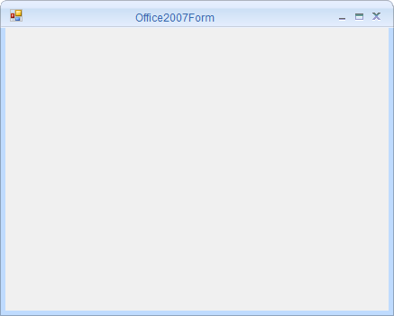

# About Syncfusion® Windows Forms Office2007 Form Control

The `Office2007Form` is an advanced standard `Form` that offers a Microsoft Office 2007-like UI and appearance. It allows the end-user to create a Microsoft Office 2007-like, appealing user interface in their application. It also supports various built-in color schemes and customization options that help control the form's behavior and appearance.

## Key features

* **Caption Alignment** – Supports configuring the caption text alignment.
* **Color schemes** – Supports Office color schemes like Blue, Black, Silver, and Managed.
* **Customization** – Supports customizing the appearance of the caption bar.
* **Right-to-left** – Supports right-to-left layout for the form and its child controls.

## Choose between different form controls

You can refer to the different form controls [here](https://help.syncfusion.com/windowsforms/sfform/overview#choose-between-different-form-controls).