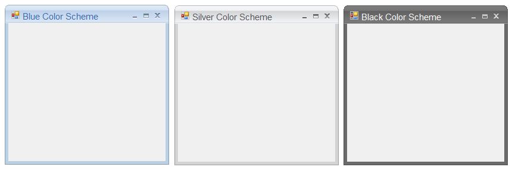
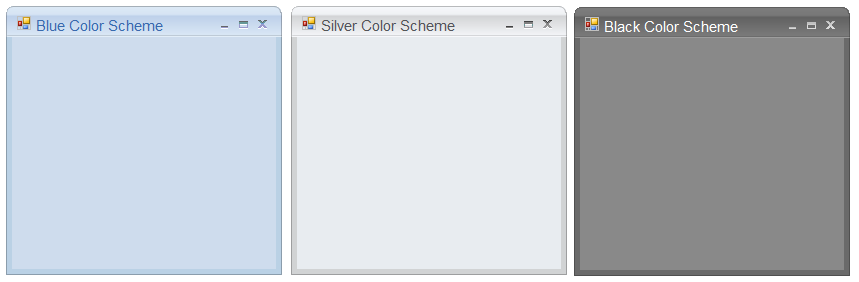

# Configure Color Schemes in Windows Forms Office2010Form

The `Office2010Form` supports the following Office color schemes, which can be set through the [ColorScheme](https://help.syncfusion.com/cr/windowsforms/Syncfusion.Windows.Forms.Office2010Form.html#Syncfusion_Windows_Forms_Office2010Form_ColorScheme) property.

* Blue
* Silver
* Black
* Managed





// Set the Blue color scheme.
this.ColorScheme = Office2010Theme.Blue;





' Set the Blue color scheme.
Me.ColorScheme = Office2010Theme.Blue





  

To apply the Managed color scheme `ApplyManagedColors` function from Office2010Colors is used as in the below code snippet





using Syncfusion.Windows.Forms;

// Set the Managed color scheme and apply a custom accent color.
this.ColorScheme = Office2010Theme.Managed;
Office2010Colors.ApplyManagedColors(this, Color.DarkMagenta);





Imports Syncfusion.Windows.Forms

' Set the Managed color scheme and apply a custom accent color.
Me.ColorScheme = Office2010Theme.Managed
Office2010Colors.ApplyManagedColors(Me, Color.DarkMagenta)





  

## Background color for the Office2010Form

The background of the Office2010Form (client area) can be set to match the active color scheme. Set the [UseOffice2010SchemeBackColor](https://help.syncfusion.com/cr/windowsforms/Syncfusion.Windows.Forms.Office2010Form.html#Syncfusion_Windows_Forms_Office2010Form_UseOffice2010SchemeBackColor) property to `true` to make this effective. The `ColorScheme` property must be set before this property takes effect.





// Apply the active color scheme to the form's background.
this.UseOffice2010SchemeBackColor = true;





' Apply the active color scheme to the form's background.
Me.UseOffice2010SchemeBackColor = True





  
  
## Applying color schemes

Office2010Form now have the option to apply the Aero theme on forms, which provides a glassy effect. This can be done through the [ApplyAeroTheme](https://help.syncfusion.com/cr/windowsforms/Syncfusion.Windows.Forms.Office2010Form.html#Syncfusion_Windows_Forms_Office2010Form_ApplyAeroTheme) property.

Aero theme support is available for Office2010Form when used on Windows Vista machines. Previously, ColorSchemes could not be applied to the Office2010Form when the Aero theme was enabled. Now, ColorSchemes can be applied by disabling the Aero theme on Office2010Form.





// Disable the Aero Theme on the Office2010Form (default).
this.ApplyAeroTheme = false;





' Disable the Aero Theme on the Office2010Form (default).
Me.ApplyAeroTheme = false



