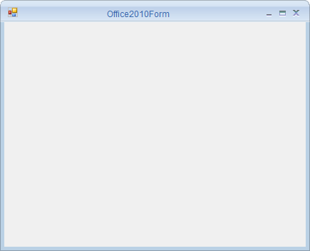

# About Syncfusion® Windows Forms Office2010 Form Control

The `Office2010Form` is an advanced standard Form that offers a Microsoft Office 2010-like UI and appearance. It allows developers to create a Microsoft Office 2010-inspired user interface in their applications. It also supports various built-in color schemes and customization options that help users control the form's behavior and appearance.

## Key features

* **Caption alignment** - Specifies the alignment of the caption text.
* **Color schemes** - Supports built-in Office color schemes such as Blue, Black, Silver, and Managed.
* **Caption bar customization** - Customizes the appearance of the caption bar.
* **Right-to-left** - Aligns the control elements in a right-to-left layout.

