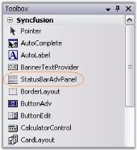
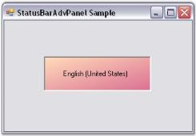
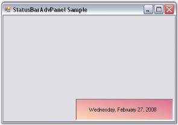

# Getting Started with Windows Forms StatusBarAdvPanel

This section explains how to get started with the Windows Forms `StatusBarAdvPanel` control using the designer and code.

## Assembly Deployment

Refer to the [Control Dependencies](https://help.syncfusion.com/windowsforms/control-dependencies#statusbar) section for the list of assemblies and NuGet packages required to use the `StatusBarAdvPanel` control.

Refer to [NuGet Packages](https://help.syncfusion.com/windowsforms/installation/install-nuget-packages) to learn how to install NuGet packages in a Windows Forms application.

To install the required NuGet package using the NuGet Package Manager Console, run the following command:

```powershell
Install-Package Syncfusion.Tools.Windows
```

## Adding StatusBarAdvPanel via Designer

The `StatusBarAdvPanel` control provides support for the Windows Forms designer. When the control is added through the designer, the following required assembly references are added automatically:

* Syncfusion.Grid.Base.dll
* Syncfusion.Grid.Windows.dll
* Syncfusion.Shared.Base.dll
* Syncfusion.Shared.Windows.dll
* Syncfusion.Tools.Base.dll
* Syncfusion.Tools.Windows.dll

To create a `StatusBarAdvPanel` using the designer:

1. Drag and drop a `StatusBarAdvPanel` control onto the form.

   

2. Configure the desired background using the `BackgroundColor` property in the **Properties** window.

3. Set the `PanelType` property to the required value.

4. Customize the border appearance by setting the `BorderColor` property.

5. Build and run the application.

   
  
## Adding StatusBarAdvPanel via Code

To create a `StatusBarAdvPanel` control programmatically:

1. Create a new C# or VB.NET Windows Forms application in Visual Studio.

2. Add the following required assembly references to the project:

   * Syncfusion.Grid.Base.dll
   * Syncfusion.Grid.Windows.dll
   * Syncfusion.Shared.Base.dll
   * Syncfusion.Shared.Windows.dll
   * Syncfusion.Tools.Base.dll
   * Syncfusion.Tools.Windows.dll

   Refer to the [Assembly deployment](#assembly-deployment) section for more information.
   
3. Include the required namespace in the form.





using Syncfusion.Windows.Forms.Tools;





Imports Syncfusion.Windows.Forms.Tools




{{ codesnippet1 | OrderList_Indent_Level_1 }}

4. Declare an instance of the `StatusBarAdvPanel` control.





private Syncfusion.Windows.Forms.Tools.StatusBarAdvPanel statusBarAdvPanel1;





Private statusBarAdvPanel1 As Syncfusion.Windows.Forms.Tools.StatusBarAdvPanel




{{ codesnippet2 | OrderList_Indent_Level_1 }}

5. Initialize the control and add it to the form.





this.statusBarAdvPanel1 = new Syncfusion.Windows.Forms.Tools.StatusBarAdvPanel();
this.statusBarAdvPanel1.Location = new System.Drawing.Point(48, 128);
this.Controls.Add(this.statusBarAdvPanel1);





Me.statusBarAdvPanel1 = New Syncfusion.Windows.Forms.Tools.StatusBarAdvPanel()
Me.statusBarAdvPanel1.Location = New System.Drawing.Point(48, 128)
Me.Controls.Add(Me.statusBarAdvPanel1)




{{ codesnippet3 | OrderList_Indent_Level_1 }}

6. Configure the required properties of the control.





this.statusBarAdvPanel1.BackgroundColor = new Syncfusion.Drawing.BrushInfo(Syncfusion.Drawing.GradientStyle.BackwardDiagonal, System.Drawing.Color.PaleVioletRed, System.Drawing.Color.PeachPuff);
this.statusBarAdvPanel1.BorderColor = System.Drawing.Color.Black;
this.statusBarAdvPanel1.HAlign = Syncfusion.Windows.Forms.Tools.HorzFlowAlign.Left;
this.statusBarAdvPanel1.Location = new System.Drawing.Point(160, 184);
this.statusBarAdvPanel1.PanelType = Syncfusion.Windows.Forms.Tools.StatusBarAdvPanelType.LongDate;
this.statusBarAdvPanel1.Size = new System.Drawing.Size(216, 48);




Me.statusBarAdvPanel1.BackgroundColor = New Syncfusion.Drawing.BrushInfo(Syncfusion.Drawing.GradientStyle.BackwardDiagonal, System.Drawing.Color.PaleVioletRed, System.Drawing.Color.PeachPuff)
Me.statusBarAdvPanel1.BorderColor = System.Drawing.Color.Black
Me.statusBarAdvPanel1.HAlign = Syncfusion.Windows.Forms.Tools.HorzFlowAlign.Left
Me.statusBarAdvPanel1.Location = New System.Drawing.Point(160, 184)
Me.statusBarAdvPanel1.PanelType = Syncfusion.Windows.Forms.Tools.StatusBarAdvPanelType.LongDate
Me.statusBarAdvPanel1.Size = New System.Drawing.Size(216, 48)




{{ codesnippet4 | OrderList_Indent_Level_1 }}

7. Run the application. The `StatusBarAdvPanel` displays the specified date text.

   
